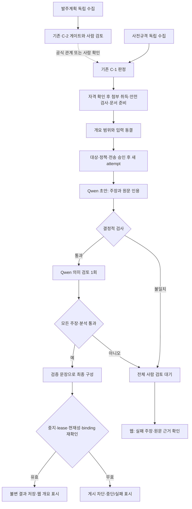

# 사전규격 수집·개요 검토 안정화 설계

작성일: 2026-09-10 · 상태: 구현·격리 검증 반영, 실사용 초안4건 모두 사람 검토 필요([Plan](Plan.md)) · 계약: [Spec](Spec.md)

## 현재 흐름과 변경 경계

발주계획과 사전규격은 독립 수집한다. 공식 식별자 또는 사람의 관계 확인으로 연결하며, 선택한 발주계획이 있어야만 사전규격을 가져오는 구조로 바꾸지 않는다. 발주계획 C-2와 사전규격 C-1의 정책·품질 승인 조건도 유지한다.

사전규격의 `우선 검토`는 자동 문서 준비를 여는 조건이다. SW 여부·추적 발주계획 연결·등급에 따른 첨부 자격은 기존 규칙을 사용한다. 문서 준비 완료와 개요 범위 확정은 v4 개요 실행 승인을 대신하지 않는다. 새 개요를 만들려면 해당 target을 명시적으로 enqueue해야 한다.

2026-09-11 MVP는 rhwp의 PDF·페이지 텍스트를 core로 수용하고 digest 절 후보를 보조로 분리한다. core 검증 후 후보를 만들며 outline·부분 반환을 v2 sidecar에 정확히 보존한다. 후보를 사용할 수 없으면 경고, 부분 목록이면 수동 쪽 선택으로 연결한다. 실패한 core를 건져 쓰거나 필수 무결성을 완화하지 않는다. 공백 쪽은 본문과 함께 원문 그대로 유지하되 근거가 될 수 없다.

자동 선택 장이 `제안개요` 작성 양식이거나 같은 줄에 여러 장 경계가 있으면 기존 모호성
경고로 담당자 확인에 넘긴다. 기존 ready target은 읽기 전용 재평가 경고만 추가하고
변경하지 않는다. 제안 작성 지침의 짧은 입력이 용량 예산에 든다는 이유로 검토 준비나
내용 검증 성공으로 세지 않는다. 범용 목차 해석이나 임의의 짧은 범위 재선택은 없다.

합성 analysis-worker는 이미 존재하는 작업을 C-2 → 심층 검토 → 회사 핏 → 개요 순으로 처리한다. `--once`는 최대 한 업무를 처리하며 이 업무 안에서 모델을 여러 번 부를 수 있다. 수집 예약 scheduler와 C-1 worker는 별개다. 이 작업은 개요 slot의 복구·배정·중지를 바꾼다.



## 모듈별 책임

아래 경로는 저장소 루트 기준이다. 신규 파일명은 구현 시 이 책임 경계 안에서 정한다.

| 경로 | 변경 책임 |
|---|---|
| `skills/bidops-collect/scripts/collect_notices.py` | 회차 획득, 배타적 raw/결과 쓰기, explicit raw 입력 |
| `skills/bidops-collect/scripts/collect_order_plans.py` | 배타적 생성의 비교 기준; 공통 helper 추출 시 회귀 대상 |
| `web/backend/app/lifecycle/services/pipeline.py` | 새 경로 이름만 생성, 폴더 선생성·raw symlink 제거, 원본과 출력 인자 분리 |
| `web/backend/app/screening/runtime.py` | collect 호출에서 출력 폴더를 선점하지 않도록 변경; 예약 실행 호출부와 함께 확인 |
| `web/backend/app/deep_review/schemas/prespec_overview_claims.py`·`schemas/page_overview.py` | 초안·검증·v4 결과·v2 조회의 엄격한 계약과 과거 parser |
| `web/backend/app/deep_review/services/prespec_overview_claim_validation.py`·`prespec_overview_claim_policy.py` | 원문 locator·typed quantity 검증, 주장 전체성, 최종 구성과 검증 hash; 기존 `page_overview_validation.py`는 v3 이력 계약으로 보존 |
| `web/backend/app/deep_review/policies/` | 두 stage를 가진 새 정책·prompt·출력 schema·호출 예산 |
| `web/backend/app/deep_review/services/prespec_v4_runner.py` | 다단계 실행, call 기록, 종료 분류, 게시 검사, lease 정리와 배정 |
| `web/backend/app/deep_review/services/prespec_overview_runner.py` | 기존 권고형 개요의 identity 복구, v4 예약 문서 제외 유지 |
| `web/backend/app/deep_review/services/prespec_v4_ops.py`·`cli/prespec_v4.py` | activation 버전, gate 잠금, enqueue·중지·새 attempt, 안전한 취소 집계 |
| `web/backend/app/core/model_client.py` | 단일 목적별 transport, stage별 출력 계약, 작은 identity backoff helper와 확인된 모델 context 전달 |
| `web/backend/app/deep_review/models.py`·`alembic/versions/`·`scripts/runtime-privileges.sql` | 상태·참조·불변 제약, 새 call/검증 기록, 최소 권한 |
| `web/backend/app/deep_review/services/page_overview.py`·`routers/deep_reviews.py` | v2 현재성·이력·실패 진단, 고정 PDF 조회 |
| `web/backend/app/deep_review/document_mcp/native.py`·`native_artifacts.py` | native core와 보조 digest 처리 분리, outline·전체/반환 후보 수 v2 계약, 기존 v1 읽기 |
| `web/backend/app/deep_review/services/prespec_v4_range.py` | 후보 유무와 무관한 직접 쪽 선택, 최신 안전 target의 append-only 확정과 기존 notice 잠금 |
| `web/backend/app/deep_review/services/company_fit.py` | 새 결과의 버전·검증 상태를 읽고 실패/중지/과거 대체 차단 |
| `web/frontend/src/lib/api.ts`·`lib/types.ts`·`components/pre-specs/PageOverviewSection.tsx`·`pages/PreSpecDetailPage.tsx` | 새 API와 결과 타입, 실패 근거 표시, 과거 결과 구분 |

모델 identity 재확인은 두 개요 runner가 공유하는 작은 helper로 분리한다. 새로운 범용 scheduler나 job framework는 만들지 않는다. 전역 업무 우선순위와 공통 client 보안 게이트를 각 runner에 복제하지 않는다.

## 전체 워크플로우 의사코드

```text
review_collection_window(window, execution_approval):
    plans_run = collect_order_plans(new_unique_path(), order_plan_date_window(window))
    prespec_run = collect_notices(new_unique_path(), notice_date_window(window), skip_bids=true)
    ingest_preserving_all_records_and_existing_reviews(plans_run, prespec_run)
    link_by_official_ids_or_human_confirmed_relationships()

    if approved_C2_execution_is_allowed():
        enqueue_existing_order_plan_screening(plans_run)
    else:
        record_C2_blockers()  # 실패를 우회해 실행 완료로 표시하지 않음

    if approved_C1_execution_is_allowed():
        run_existing_C1_with_policy_selected_population(prespec_run)
    process_eligible_attachments_and_priority_document_preparation()

    for notice in explicitly_selected_overview_samples(execution_approval):
        target = prepare_frozen_pdf_and_overview_range(notice)
        if target.needs_human_review:
            show_range_confirmation_required(target)
            continue
        enqueue_new_attempt(target, approved_activation, new_policy_binding)

    # 별도 analysis-worker가 큐를 처리; 아래 개요 slot 참조
    web_reads_current_state_and_history_from_API()
```

## 수집 의사코드

```text
collect_notices(output, source_raw=None):
    validate_allowed_paths_without_following_symlinks(output, source_raw)
    claim_directory_exclusively(output)  # 기존 경로면 이 지점에서 종료
    try:
        if source_raw:
            raw_pages = read_verify_and_copy_raw_exclusively(source_raw, output / "raw")
        else:
            client = create_G2B_client_after_loading_authorized_key()
            raw_pages = fetch_pages_and_write_each_exclusively(client, output / "raw")
        result = normalize_using_existing_rules(raw_pages)
        validate_completeness_or_preserve_partial_warning(result)
        write_serialized_json_exclusively(output / "collected-notices.json", result)
    except CollectionFailure:
        retain_existing_raw_and_report_safe_failure()
        raise  # 재실행은 새 경로; 원본 삭제·덮어쓰기 없음
```

## 개요 slot과 주장 검증 의사코드

```text
overview_slot_tick(now):
    expire_attempts_independently_of_activation(now)
    # DB/현재성 확인 실패는 여기서 차단; "작업 없음"으로 취급하지 않음
    candidate = next_authorized_v4_candidate_for_current_activation()
    if candidate and identity_can_be_checked_or_is_ready(now):
        binding = resolve_or_recheck_identity_without_document_payload(now)
        if binding:
            attempt = claim_under_gate(candidate, binding, lease_seconds=1200)
            if attempt:
                return execute_overview(attempt)
    excluded = all_document_versions_reserved_by_v4_targets_or_attempts()
    return legacy_runner.run_once(excluded_document_version_ids=excluded)

execute_overview(attempt):
    frozen = load_and_verify_pinned_input(attempt)
    try:
        check_draft_request_capacity_without_truncation(frozen, confirmed_context, output_reserve)
        draft = dispatch_with_gate_and_call_ledger("draft", frozen)
        if draft.has_only_technical_format_error:
            draft = dispatch_with_gate_and_call_ledger("draft_format_retry", frozen, safe_error_codes)
        parse_strict_draft_or_fail(draft)

        checks = verify_every_claim_and_source_locator(draft, frozen)
        if checks.have_failure:
            return close_human_review_under_gate(attempt, draft, checks)

        check_actual_semantic_request_capacity(frozen, draft, checks, confirmed_context, output_reserve)
        semantic = dispatch_with_gate_and_call_ledger("semantic_review", frozen, draft, checks)
        validate_exact_claim_analysis_and_unknown_id_coverage_or_fail(semantic)
        checks = combine_without_overriding_deterministic_failures(checks, semantic)
        if checks.have_contradiction_or_uncertainty:
            return close_human_review_under_gate(attempt, draft, checks)

        result = compose_from_exact_verified_texts(draft, checks, frozen.limitations)
        verify_final_claim_coverage_and_hashes(result, checks)
        with transaction_and_gate_lock():
            assert_same_activation_running_lease_current_input_and_binding(attempt)
            insert_verification_and_result_and_close_attempt_and_job_atomically()
    except CancelledOrStale:
        preserve_call_events_without_publishing_or_mutating_terminal_attempt()
    except TechnicalFailure as failure:
        close_if_still_owned_running(attempt, safe_code(failure))
```

`dispatch_with_gate_and_call_ledger`는 호출 전 승인을 짧은 트랜잭션으로 확인하고, HTTP 후 원응답을 암호화 보존한 뒤 현재성을 다시 검사한다. 취소된 응답도 call 이력은 남기지만 검증·최종 결과를 생성하지 않는다. `close_human_review_under_gate`도 동일 게시 조건을 재확인하므로 중지와 경쟁해서 취소 상태를 덮을 수 없다.

## 중지와 모델 복구

```text
deactivate_v4(actor, reason):
    with transaction_and_gate_lock():
        append_OFF_event(actor, safe_reason_code(reason))
        cancel_all_queued_and_running_v4_attempts_and_linked_jobs()
        return cancellation_counts

resolve_identity(now):
    if configuration_is_invalid_or_binding_has_changed:
        return BLOCKED  # 새 승인 binding 없이 자동 갱신하지 않음
    if cached_success_is_valid:
        return cached_success
    if now < next_identity_check_at:
        return WAITING
    try:
        identity = client.verify_identity()  # 문서 payload 없음
        return cache_matching_approved_binding(identity)
    except TransientIdentityFailure:
        close_owned_client_and_set_next_check_with_capped_backoff(now)
        return WAITING
```

이미 전송한 요청은 서버 취소 기능이 없어도 논리적으로 중지할 수 있다. 이를 위해 종료한 attempt를 나중에 수정하는 대신 별도 append-only call 이력에 지연 응답을 기록한다. 승인 세대가 바뀌면 예전 결과는 계속 차단한다.

## 웹에서의 확인 흐름

담당자는 사전규격 상세의 개요 영역에서 현재 실행 상태를 먼저 본다. 전체 통과하면 개요 문장과 PDF 근거 링크를 읽는다. 검증이 실패하면 최종 요약 대신 “근거 확인 필요”와 실패 주장·사유·검증된 원문 인용을 본다. 근거 링크는 해당 attempt가 고정한 PDF를 연다.

모델 미실행/실패여도 최신 준비 target의 안전한 PDF를 별도 링크로 열 수 있다. 자동 ready도 선택 범위·후보 경고를 보여 주고, pending에서는 후보 선택과 직접 시작/끝 쪽 입력을 전환한다. 부분 후보는 참고 표로만 보여 주며 쪽 입력을 사용한다. 기존 자동 ready의 잘못된 범위는 별도 pending 행을 끼워 넣지 않고 기존 확인 API로 새 human_confirmed target을 추가한다. 대기/실행 중이면 확정을 막고 새 범위 뒤 옛 target enqueue도 막는다. 문서/원본/PDF의 현재 안전성은 확인 API에서 다시 검사한다.

입력 범위의 사람 확인 대기와 주장 검증의 사람 확인 대기는 서로 다른 이유로 표시한다. 과거 완료는 이력에서 열 수 있고 이전 검증 기준·모델·미측정 표식을 유지한다. 최신 취소·실패·stale 상태에서 과거 요약을 현재 결과처럼 보이지 않게 한다.
새 범위 확인 뒤 이전 target의 완료 개요는 current에서 제외(`stale/target_superseded`)하고
이력에 보존한다. 회사 핏은 이 공유 projection을 읽으므로 별도 현재성 규칙을 만들지 않는다.

입력 용량 초과는 기존 failed 상태에 `input_capacity_exceeded`를 붙여 “입력 용량 초과로 미실행”과 후속 조치를 표시한다. 내용의 참·거짓을 판단한 상태가 아니다. 의미 단계가 미실행이어도 앞선 초안 호출이 있을 수 있으므로 모델 호출이 전혀 없었다고 단정하지 않는다. 길이를 줄이는 자동 절단·요약·분할은 하지 않는다.

새 사람 승인·추적·최종 입찰 결정 UI는 추가하지 않는다. 원문 확인 뒤 재실행은 현재 CLI의 명시적 새 attempt 경로를 확장해 처리하고, 기존 terminal attempt와 검증 이력은 보존한다.
