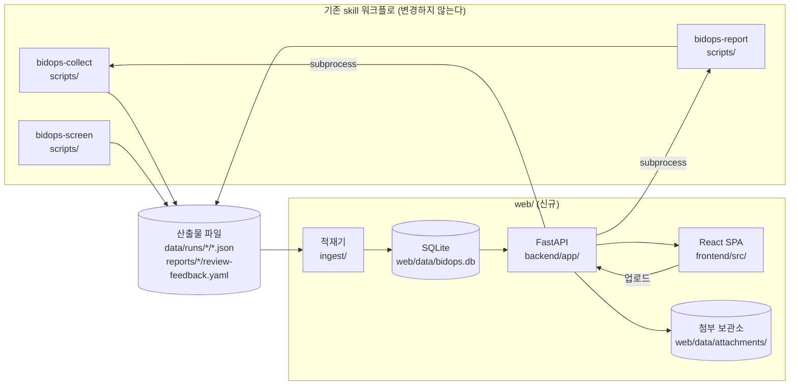
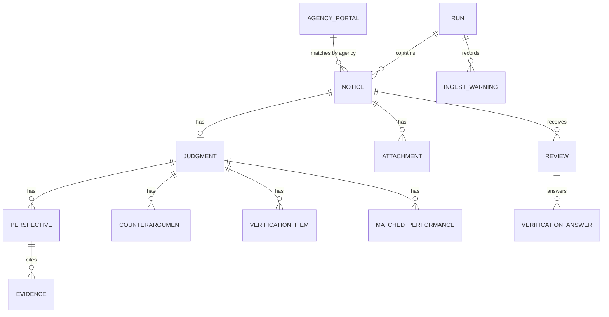

# BidOps Admin 시스템 구조

> `docs/PRD.md`가 정의한 요구사항을 구현하기 위한 기술 구조. 결정의 근거는 `docs/ADR.md`에 기록한다.

---

## 1. 전체 구성



핵심 원칙은 **기존 skill 스크립트를 수정하지 않는다**는 것이다. 웹 계층은 산출물 파일을 읽어 적재하고, 파이프라인 실행이 필요할 때는 같은 스크립트를 서브프로세스로 호출한다. 이렇게 하면 1국면의 검증 자산이 그대로 유지되며, 판정 품질에 대한 기준선이 흔들리지 않는다.

---

## 2. 기술 스택

| 계층 | 선택 | 비고 |
|---|---|---|
| 백엔드 언어 | Python 3.12 | 기존 스크립트와 동일한 런타임 |
| 웹 프레임워크 | FastAPI + Uvicorn | 타입 기반 스키마 검증이 산출물 계약 검증과 잘 맞는다 |
| ORM | SQLAlchemy 2.x (Declarative) | |
| 검증 | Pydantic v2 | 요청·응답 모델과 산출물 계약 검증에 함께 사용한다 |
| 데이터베이스 | SQLite (WAL) | 단일 담당자 사용을 전제한다 |
| 백엔드 테스트 | pytest + httpx | |
| 프론트 빌드 | Vite 6 | |
| 프론트 언어 | React 19 + TypeScript 5 | |
| 스타일 | Tailwind CSS v4 (`@theme`) | `design.md`의 팔레트를 토큰으로 이식한다 |
| 서버 상태 | TanStack Query v5 | 회차 전환 시 캐시 무효화를 일괄 처리한다 |
| 라우팅 | React Router v7 | |
| 프론트 테스트 | Vitest + Testing Library | |

기존 `skills/*/scripts/`는 표준 라이브러리만 사용한다. 이 방침을 깨지 않기 위해 웹 계층의 의존성은 `web/backend/` 아래에 격리하고, 별도 가상환경(`web/backend/.venv`)에서 실행한다.

---

## 3. 디렉토리 구조

```
bidops-agent/
├── skills/                     기존 skill (수정하지 않는다)
├── data/runs/<run_id>/         기존 산출물
├── reports/<run_id>/           기존 보고서
├── docs/
│   ├── PRD.md ARCHITECTURE.md ADR.md PLAN.md
│   └── web/design/*.dc.html    레이아웃 아트보드
└── web/
    ├── backend/
    │   ├── app/
    │   │   ├── main.py             앱 조립, CORS, 정적 서빙
    │   │   ├── config.py           경로·설정 (BIDOPS_ROOT 등)
    │   │   ├── db.py               엔진, 세션, 초기화
    │   │   ├── models.py           SQLAlchemy 모델
    │   │   ├── schemas.py          Pydantic 응답 모델
    │   │   ├── ingest/
    │   │   │   ├── contracts.py    산출물 스키마 검증 (v1/v2)
    │   │   │   ├── loader.py       run 디렉토리 → DB
    │   │   │   └── feedback.py     review-feedback.yaml 적재
    │   │   ├── services/
    │   │   │   ├── metrics.py      검증 통과 기준 5항목 계산
    │   │   │   ├── pipeline.py     skill 스크립트 서브프로세스 실행
    │   │   │   └── attachments.py  파일 저장·기관 포털 매칭
    │   │   └── routers/
    │   │       ├── runs.py notices.py reviews.py
    │   │       ├── attachments.py portals.py
    │   │       └── metrics.py profile.py
    │   ├── tests/
    │   ├── pyproject.toml
    │   └── requirements.txt
    ├── frontend/
    │   ├── src/
    │   │   ├── main.tsx App.tsx routes.tsx
    │   │   ├── styles/theme.css      Tailwind v4 @theme 토큰
    │   │   ├── lib/api.ts types.ts format.ts
    │   │   ├── components/
    │   │   │   ├── shell/Sidebar.tsx TopBar.tsx RunSelector.tsx
    │   │   │   ├── common/Badge.tsx Panel.tsx DataTable.tsx Facts.tsx
    │   │   │   └── notice/JudgmentPanels.tsx AttachmentPanel.tsx ReviewBar.tsx
    │   │   └── pages/
    │   │       ├── DashboardPage.tsx QueuePage.tsx NoticeDetailPage.tsx
    │   │       ├── AttachmentsPage.tsx RunsPage.tsx
    │   │       └── ProfilePage.tsx MetricsPage.tsx
    │   ├── index.html vite.config.ts tsconfig.json package.json
    │   └── tests/
    └── data/
        ├── bidops.db
        └── attachments/<notice_id>/<file>
```

`web/data/`는 `.gitignore`에 추가한다. 데이터베이스는 산출물 파일에서 언제든 재생성할 수 있고, 첨부 원문은 저장소에 두지 않는다는 기존 방침을 따른다.

---

## 4. 데이터 모델



### 4.1 주요 테이블

| 테이블 | 핵심 컬럼 | 설명 |
|---|---|---|
| `run` | `id`, `window_from`, `window_to`, `timezone`, `generated_at`, `screening_basis`, `status`, `superseded_by`, `counts_json` | 실행 회차. 디렉토리명(`20260817-20260823`)이 자연키가 되며, 재분류 실행은 새 행을 만들고 이전 행을 `superseded`로 표시한다 |
| `notice` | `id`, `run_id`, `notice_key`, `bid_no`, `bid_ord`, `source_type`, `title`, `agency`, `published_at`, `deadline_at`, `budget`, `estimated_price`, `method`, `url`, `sample_role`, `sample_stratum`, `collection_bucket`, `procurement_class_json`, `region_limit_json`, `lifecycle_json`, `qualification_flags_json`, `focus_matches_json`, `performance_matches_json`, `performance_top_score`, `candidate_sources_json`, `unknown_fields_json`, `raw_source` | 정규화 공고. `notice_key`는 `bid:R26BK01689645:000` 형식의 계약 식별자이며 회차 간 동일 공고 추적의 기준이다 |
| `judgment` | `id`, `notice_pk`, `schema_version`, `grade`, `readiness`, `primary_focus`, `exclusion_category`, `summary`, `next_action` | 에이전트 판정. `schema_version`으로 v1·v2를 구분한다 |
| `perspective` | `id`, `judgment_id`, `position`, `name`, `assessment`, `reason` | 관점별 판단. v1 데이터는 1행, v2는 5행이 된다 |
| `evidence` | `id`, `perspective_id`, `source`, `status`, `fact` | 근거. `status`는 `confirmed`·`inferred`·`unknown` |
| `counterargument` | `id`, `judgment_id`, `position`, `text` | 반론 |
| `verification_item` | `id`, `judgment_id`, `item`, `why`, `blocking`, `status` | 확인 항목 |
| `matched_performance` | `id`, `judgment_id`, `name`, `match_reason`, `mismatch_or_limit`, `source`, `status` | 연결 수행실적 |
| `attachment` | `id`, `notice_pk`, `name`, `url`, `origin`, `file_ext`, `size_bytes`, `stored_path`, `extract_status`, `created_at` | 첨부. `origin`은 `g2b` 또는 `manual` |
| `agency_portal` | `id`, `agency_pattern`, `system_name`, `search_url_template`, `enabled`, `note` | 발주기관 자체 조달시스템. MVP 3개 기관을 초기 데이터로 넣는다 |
| `review` | `id`, `notice_pk`, `run_id`, `disposition`, `system_judgment_review`, `corrected_grade`, `corrected_readiness`, `weakest_perspective`, `reason`, `reviewer`, `created_at`, `updated_at` | 담당자 리뷰. 회차별로 보관하여 판정 변화와 대조한다 |
| `verification_answer` | `id`, `review_id`, `item`, `answer` | 확인 항목 답변 |
| `ingest_warning` | `id`, `run_id`, `level`, `code`, `message`, `context_json` | 적재 경고. 스키마 불일치와 필드 누락을 기록한다 |

### 4.2 인덱스

- `notice(run_id, collection_bucket, sample_role)` — 목록 필터의 기본 경로
- `notice(notice_key)` — 회차 간 동일 공고 조회
- `notice(deadline_at)` — 마감 임박 정렬
- `judgment(notice_pk)` 유니크
- `review(notice_pk, run_id)` 유니크

---

## 5. 적재 규칙

적재기는 `data/runs/<run_id>/` 아래 파일을 다음 순서로 읽는다.

| 순서 | 파일 | 필수 | 실패 시 동작 |
|---|---|---|---|
| 1 | `validation-set.json` | 필수 | 회차 적재를 중단한다 |
| 2 | `screening-results.json` | 선택 | 판정 없이 공고만 적재하고 경고를 남긴다 |
| 3 | `collected-notices.json` | 선택 | 존재하면 후보 풀 통계를 보완한다. `.gitignore` 대상이므로 없을 수 있다 |
| 4 | `reports/<run_id>/review-feedback.yaml` | 선택 | 값이 채워진 항목만 초기 리뷰로 적재한다 |

**계약 위반의 처리 방침**은 다음과 같다. 워크플로 계약은 "누락된 필드를 기본값으로 채우는 동작은 어느 단계에도 없다"고 규정한다. 적재기도 이 방침을 따르되, 이미 생성된 산출물을 화면에 띄우지 못하는 상황을 막기 위해 다음과 같이 구분한다.

| 위반 유형 | 처리 |
|---|---|
| 식별자·등급·준비 상태 누락 | 해당 판정을 적재하지 않고 오류 경고를 남긴다 |
| 관점 수가 5개 미만 | 있는 만큼 적재하고 `schema_version`과 함께 경고를 남긴다 |
| 반론·확인 항목 누락 | 빈 목록으로 적재하고 경고를 남긴다. 값을 만들어내지 않는다 |
| 알 수 없는 필드 | 무시하되 경고에 필드명을 기록한다 |

경고는 화면(수집 실행 관리)에 그대로 노출되므로, 적재가 조용히 성공한 것처럼 보이는 상황이 생기지 않는다.

---

## 6. API 설계

모든 경로는 `/api` 접두사를 가지며 JSON을 주고받는다.

### 6.1 회차

| 메서드 | 경로 | 설명 |
|---|---|---|
| GET | `/api/runs` | 회차 목록. 상태와 건수 요약을 포함한다 |
| GET | `/api/runs/{run_id}` | 회차 상세. 수집 범위, 파이프라인 단계 상태, 산출물 검증 결과 |
| GET | `/api/runs/{run_id}/warnings` | 적재 경고 목록 |
| GET | `/api/runs/{run_id}/stats` | 대시보드 지표. 퍼널, 등급 분포, 축 분포, 확인 요청 집계 |
| POST | `/api/runs/ingest` | 지정 회차를 재적재한다 |
| POST | `/api/runs/{run_id}/pipeline/{stage}` | `collect`·`sample`·`report` 단계를 실행한다 |
| GET | `/api/runs/{run_id}/pipeline/logs` | 실행 로그를 조회한다 |

### 6.2 공고와 판정

| 메서드 | 경로 | 설명 |
|---|---|---|
| GET | `/api/notices` | 목록. `run_id`, `grade`, `readiness`, `focus`, `sample_role`, `attachment`, `q`, `sort`, `limit`, `offset` |
| GET | `/api/notices/{notice_pk}` | 상세. 판정, 관점, 근거, 반론, 확인 항목, 검색 신호, 첨부를 모두 포함한다 |
| GET | `/api/notices/{notice_pk}/history` | 같은 `notice_key`의 회차별 판정 이력 |

### 6.3 리뷰

| 메서드 | 경로 | 설명 |
|---|---|---|
| GET | `/api/reviews?run_id=` | 리뷰 목록 |
| PUT | `/api/notices/{notice_pk}/review` | 리뷰 저장. 없으면 생성하고 있으면 갱신한다 |
| GET | `/api/reviews/export?run_id=` | `review-feedback.yaml` 형식으로 내보낸다 |

리뷰를 YAML로 내보내는 경로를 두는 이유는, skill 워크플로가 그 파일을 계속 사용하기 때문이다. 데이터베이스가 정본이 되더라도 기존 형식과의 연결을 끊지 않는다.

### 6.4 첨부와 기관 포털

| 메서드 | 경로 | 설명 |
|---|---|---|
| GET | `/api/notices/{notice_pk}/attachments` | 첨부 목록과 확보 절차 정보 |
| POST | `/api/notices/{notice_pk}/attachments` | 파일 업로드(multipart). HWP·HWPX·PDF, 50MB 제한 |
| DELETE | `/api/attachments/{id}` | 수동 등록 파일만 삭제할 수 있다 |
| GET | `/api/attachments/{id}/download` | 저장된 파일을 내려받는다 |
| GET | `/api/attachments/queue?run_id=` | 첨부 미확보 공고 큐 |
| GET | `/api/portals` | 등록된 기관 조달시스템 목록 |
| POST | `/api/portals` | 기관 등록 |
| PATCH | `/api/portals/{id}` | 기관 수정 |

기관 매칭은 `agency_pattern`을 공고의 `agency` 문자열에 부분 일치시키는 방식이다. MVP 초기 데이터로 한국수자원공사, 한국도로공사, 한국토지주택공사 세 건을 넣는다. 검색 주소 템플릿은 `{bid_no}`와 `{title}` 자리표시자를 지원한다.

### 6.5 지표와 프로필

| 메서드 | 경로 | 설명 |
|---|---|---|
| GET | `/api/metrics/validation?run_id=` | 통과 기준 5항목의 값, 임계값, 충족 여부, 계산 근거 |
| GET | `/api/profile/sections` | 회사 프로필의 절 구조와 정보 상태 |
| GET | `/api/profile/unknowns` | `unknown` 항목과 판정에서 참조된 횟수 |

### 6.6 통과 기준 계산 방식

| 항목 | 계산 |
|---|---|
| 재현성 | 같은 `notice_key`가 둘 이상의 회차에서 판정된 경우의 등급 일치율. 대상이 없으면 `null` |
| 변별력 | 분석 표본 중 `우선 검토` 비율 |
| 근거 타당성 | 리뷰의 `system_judgment_review` 분포 |
| 정보 충분성 | 확인 항목 가운데 첨부 확보 없이 해소되지 않는 항목의 비율 |
| 관점 분할 | 한 판정 안에서 관점별 `assessment`가 둘 이상으로 갈리는 공고의 비율. 관점이 1개뿐이면 계산 불가로 표시한다 |

계산이 불가능한 항목은 0이 아니라 **계산 불가**로 표시한다. 값이 없는 것과 값이 나쁜 것은 다르게 읽혀야 한다.

---

## 7. 프론트엔드 구조

### 7.1 디자인 토큰

`design.md`의 팔레트만 가져오고, 타이포와 밀도는 관리자 화면 기준으로 새로 정의한다. `src/styles/theme.css`에 Tailwind v4 `@theme` 블록으로 선언한다.

```css
@theme {
  --color-ink: #0f3e17;        /* 사이드바, 최상위 등급, 주요 액션 */
  --color-ink-deep: #0c2f10;
  --color-sage: #b1dbb8;       /* 2단계 등급, 성공 상태 */
  --color-keylime: #e1f4df;    /* 3단계 등급, 선택 행 */
  --color-mint: #cfe7d3;       /* 역량 축 표시 */
  --color-slate: #b6ced5;      /* 준비 상태 테두리 */
  --color-paper: #fffefc;      /* 패널 배경 */
  --color-canvas: #f5f4ef;     /* 앱 배경 */
  --color-charcoal: #222222;
  --color-hair: #e4e2dc;       /* 구분선 */
  --color-hair-soft: #efeeeb;
  --color-muted: #6f6c64;
  --color-alert: #9a4a2f;      /* 마감 임박, 차단 항목 전용 */

  --color-nav-text: #cfe0d2;   /* 사이드바 본문 */
  --color-muted-soft: #837f76; /* 제외 등급 배지 문자 */
  --color-alert-edge: #d8b6a6; /* 경고 배지 테두리 */
  --color-slate-ink: #4d6b76;  /* 준비 상태 배지 문자 */

  --font-sans: 'IBM Plex Sans KR', system-ui, sans-serif;
  --font-mono: 'IBM Plex Mono', ui-monospace, monospace;

  --radius-sm: 3px;   /* 배지 */
  --radius-md: 4px;   /* 버튼, 입력 */
  --radius-lg: 5px;   /* 패널 */
}
```

`--color-alert`는 팔레트에 없는 유일한 추가 색이다. 마감 임박과 차단 확인 항목에만 사용하며, 다른 용도로 확장하지 않는다. 이름 뒤쪽의 네 값은 팔레트 색의 명도만 조정한 파생 색이며 아트보드에서 이미 사용한 값이다. 화면 코드는 색상 리터럴을 직접 쓰지 않고 반드시 이 토큰을 참조한다.

밀도 규칙은 다음과 같다. 본문 13px, 보조 12px, 라벨 11px, 지표 숫자 27px. 패널 패딩 13px, 테이블 행 8~9px, 사이드바 216px, 상단바 50px, 필터 바 44px. 수치·식별자·시각은 모두 mono 서체와 `tabular-nums`를 적용한다.

### 7.2 상태 관리

| 상태 | 위치 |
|---|---|
| 선택된 회차 | URL 쿼리(`?run=20260817-20260823`)와 Context. 회차 변경 시 TanStack Query 캐시를 무효화한다 |
| 목록 필터 | URL 쿼리. 새로고침과 공유에서 동일한 화면이 재현되어야 한다 |
| 선택된 공고 | URL 경로(`/queue/:noticePk`) |
| 서버 데이터 | TanStack Query. 리뷰 저장은 낙관적 갱신 없이 저장 후 무효화한다 |

### 7.3 컴포넌트 규칙

- 등급·준비 상태·근거 상태는 모두 `Badge` 하나로 표현하고 변형(variant)으로 구분한다. 색만으로 구분하지 않고 항상 문자 라벨을 함께 표시한다.
- 데이터가 없는 항목은 빈 문자열이 아니라 값 없음, 미확인, 계산 불가 가운데 하나로 명시한다.
- 판정 근거 표시는 `EvidenceList` 하나로 통일하여, 검토 대기열과 상세 화면이 같은 규칙으로 렌더링되도록 한다.

---

## 8. 파이프라인 실행

`services/pipeline.py`가 기존 스크립트를 서브프로세스로 실행한다.

| 단계 | 명령 | 비고 |
|---|---|---|
| `collect` | `python3 skills/bidops-collect/scripts/collect_notices.py --from-date … --to-date … --output-dir …` | `--from-raw` 옵션을 지원한다 |
| `sample` | `python3 skills/bidops-collect/scripts/select_validation_sample.py …` | |
| `report` | `python3 skills/bidops-report/scripts/render_report.py …` | |

판정 단계(`bidops-screen`)는 에이전트가 `screening-decisions.json`을 직접 작성해야 하므로 애플리케이션에서 실행하지 않는다. 이 단계는 화면에 **대기 중**으로 표시하고, 파일이 갱신되면 적재기가 인식한다.

실행은 백그라운드 작업으로 처리하고, 표준 출력과 표준 오류를 줄 단위로 저장하여 로그 조회에 사용한다. API 키는 기존 방식대로 `.env`에서 읽으며, 애플리케이션은 값을 로그나 응답에 노출하지 않는다.

---

## 9. 실행과 배포

```bash
# 백엔드
cd web/backend
python3 -m venv .venv && .venv/bin/pip install -r requirements.txt
.venv/bin/uvicorn app.main:app --reload --port 8787

# 프론트엔드
cd web/frontend
npm install && npm run dev      # 5173, /api 를 8787로 프록시
```

운영 시에는 프론트엔드를 빌드하여 FastAPI가 정적 파일로 서빙한다. 단일 프로세스로 실행되므로 담당자 PC에서 명령 하나로 기동할 수 있다.

테스트는 기존 `run-tests.sh`를 확장하지 않고 `web/`에 별도 진입점을 둔다. 기존 스크립트의 표준 라이브러리 원칙과 웹 계층의 의존성을 분리하기 위해서이다.

---

## 10. 보안 고려사항

| 항목 | 처리 |
|---|---|
| API 키 | `.env`에서 읽고 응답·로그에 포함하지 않는다 |
| 파일 업로드 | 확장자 화이트리스트(HWP·HWPX·PDF), 50MB 제한, 저장 파일명은 서버가 생성한다 |
| 경로 조작 | 첨부 저장 경로는 `notice_pk` 기반으로 서버가 구성하며 사용자 입력을 경로에 사용하지 않는다 |
| 외부 요청 | 기관 조달시스템은 링크만 생성하고 애플리케이션이 대신 요청하지 않는다 |
| 접근 제어 | 로컬 실행 전제. 외부 노출이 필요해지면 별도 결정을 기록한다 |
