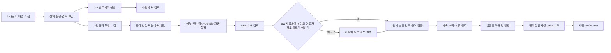

# BidOps 제품 요구사항 정의서

| 항목 | 내용 |
|---|---|
| 문서 상태 | 현재 제품 기준선·통합 PRD |
| 기준일 | 2026-09-01 |
| 제품 | BidOps — 공공조달 사업기회 의사결정 지원 시스템 |
| 대상 사용자 | 기획·사업개발 담당자, 운영자 |
| 현재 착수 단위 | 발주계획 C-2 `BM25 Top 300 + Qwen` |
| 관련 문서 | [`ADR.md`](ADR.md), [`ARCHITECTURE.md`](ARCHITECTURE.md), [`contracts.md`](contracts.md), [`business-rules.md`](business-rules.md) |

이 문서는 나라장터의 발주계획을 조기에 탐색하고, 사전규격 제안요청서를 검토한 뒤, 선택한
사업기회를 입찰공고까지 추적하는 제품의 목적과 요구사항을 통합한다. 모델과 자동화는 사람의
판단을 보조하며, 발주기관 연락·입찰서 제출·최종 참여 결정은 제품이 자동 수행하지 않는다.

## 1. 문제와 제품 목표

발주계획은 입찰공고보다 이른 사업 신호를 주지만 관측 규모가 3일 약 1,200건, 1주 약 2,000건에
이른다. 사전규격은 제안요청서가 공개되어 검토를 시작할 수 있지만 발주계획과 공식적으로
연결되지 않는 건도 있고, 첨부의 안전성·구조·보존 문제가 있다. 입찰공고와 정정공고가 올라온
뒤에는 사전규격과의 차이를 비교하고 사람의 Go/No-Go를 남겨야 한다.

BidOps의 목표는 다음 네 가지다.

1. 공개 조달 정보의 전체 모집단과 관측 이력을 보존해 놓친 사업을 다시 측정할 수 있게 한다.
2. 제한된 입력으로 검토 대상을 줄이되, 선별 결과를 적합성·자격·참여 결정으로 과장하지 않는다.
3. 문서·모델·사람 판단의 근거와 계보를 나중에 재구성할 수 있게 한다.
4. 사람이 실행·검토·추적·최종 결정을 통제하고, 실패·불확실·미측정 상태를 숨기지 않는다.

제품의 성공은 “자동으로 입찰한다”가 아니라 다음 질문에 답할 수 있는 것이다.

> 이 사업을 언제 발견했고, 어떤 원문과 회사 정보로 어떤 검토를 했으며, 누가 무엇을 확인하고
> 다음 행동을 결정했는가?

## 2. 제품 원칙

- 확인되지 않은 회사 역량·자격·실적과 공고 사실을 추정하지 않는다. 모르면 `unknown` 또는
  `null`과 확인 항목을 남긴다.
- 발주계획 relevance, 적합성 등급, 참여 준비 상태, 사전규격 권고, 추적 상태, 심층 의견,
  최종 Go/No-Go는 별도 축이다.
- 전체 입력·원문·정책·프로필·모델 binding·결과·리뷰를 불변으로 보존하고 재실행은 새 계보로
  만든다.
- 모델의 주장·숫자·요구사항·근거는 원문 위치와 연결하고 결정적 검증을 통과시킨다. 실패를
  성공이나 비관련으로 보정하지 않는다.
- 파이프라인은 versioned file과 subprocess 경계로 연결하고, 웹은 API만 소비한다.
- 외부 모델 전송은 목적별 allowlist, 최소 payload, 실행별 승인, 감사 기록이 모두 있을 때만
  허용한다. hosted OpenAI로 자동 fallback하지 않는다.

## 3. 사용자와 책임

| 사용자/주체 | 주요 목표 | 허용되는 결정 |
|---|---|---|
| 기획·사업개발 담당자 | 후보를 빠르게 비교하고 근거를 읽어 후속 검토를 선택 | 사람 relevance·우선순위·리뷰·추적 상태·최종 Go/No-Go |
| 운영자 | 실행 환경·정본 저장소·정책·모델·백업을 관리 | 정책 후보·품질 gate·운영 활성화·복구·secret 주입 |
| 수집·선별·보고 pipeline | 원문을 정규화하고 결정적 산출물을 생성 | 업무 결정을 확정하지 않음 |
| 문서 worker | 안전한 첨부를 구조화 | 문서 바이트·구조 결과만 생성, 업무 판단 금지 |
| 분석 worker | 고정 입력으로 제한된 모델 분석과 검증 실행 | 검증된 machine result 생성, 사람 결정을 대신하지 않음 |
| scheduler | 승인된 예약을 깨워 execution queue에 등록 | 정책 활성화·모델 호출·최종 참여 결정을 단독 수행하지 않음 |

현재 로그인·SSO·역할 기반 권한은 제공하지 않는다. 사내망 접근이 사용자 경계이고
`X-BidOps-Actor-Name`은 인증이 아닌 감사용 claimed name이다. 외부망에 노출하거나 이름을
권한으로 해석하는 배포는 SSO·역할 모델 도입 전 허용하지 않는다.

## 4. 핵심 사용자 흐름

### 4.1 발주계획 조기 탐색

1. 담당자 또는 승인된 실행이 수집 회차를 선택한다.
2. 전체 정규화 모집단, source hash, 정책과 binding을 확인한다.
3. C-2는 전체 제목을 BM25로 순위화하고 Top 300만 Qwen에 보낸다.
4. `relevant|uncertain`을 기본 검토 대상으로 제시하되, `filtered_out`, `not_relevant`,
   실패와 그 이유도 조회 가능하게 한다.
5. 사람 relevance·우선순위·메모는 모델 결과와 별도 revision으로 남긴다.

발주계획 단계는 사업의 조기 신호다. 여기서 등급·자격·추적·Go/No-Go를 자동 생성하지 않는다.

### 4.2 사전규격·심층 검토

사전규격은 발주계획 선택 여부와 상관없이 일반용역·기술용역 전체를 매일 수집한다.
`swBizObjYn`은 원문 값으로 저장하고 표시·필터에만 사용한다. 공식 연결이 없으면 사업명 검색
전략과 후보를 저장하며, `검색 미확인`을 사전규격 부재로 표시하지 않는다.

적합성 등급이 `우선 검토`인 사전규격은 문서 준비를 자동으로 진행한다. 안전 검사를 통과한
현재 문서로 묶음 초안을 만들고, 자기가 만든 초안만 확정한다. 사람이 만든 초안은 사람이
확정한다([ADR-0049](tracking/decisions/0049-prespec-auto-preparation-and-auto-deep-review.md)).
등급이 나중에 내려가도 이미 만든 묶음을 되돌리지 않는다.

RFP 개요 검토는 문서의 목차와 의미 있는 소제목에 따라 결정적으로 앞부분을 잘라 사업내용만
확인한다. 시작·끝이 모호하면 모델을 호출하지 않고 사람 검토로 보낸다.

개요 검토가 `completed`이고 권고가 `검토 종료`가 아니며 `SW사업대상=Y`인 건은 심층 검토를
시스템이 자동으로 만든다. 그 밖의 건은 화면이 **왜 자동으로 열리지 않았는지**를 안전한 사유
코드로 보여 주고 사람이 실행한다. 자동 시작은 분석의 시작만 열며 적합성 등급, 참여 준비
상태, 추적 선택, 최종 입찰 Go/No-Go 중 어느 것도 만들지 않는다.

심층 검토는 clean·구조화된 immutable bundle, 승인 profile, 분석 policy를 고정하고 다음 세
단계를 제한된 slice로 실행한다.

1. `requirements_and_evaluation`
2. `delivery_risk_economics`
3. `synthesis_and_validation`

각 claim은 문서 또는 승인 프로필의 evidence locator를 가져야 한다. 검증된 machine report와
사람의 full revision·final opinion은 별도 이력이다.

### 4.3 입찰공고 추적과 최종 결정

`계속 추적` 사업기회에 입찰공고·정정이 연결되면 담당자가 기준·비교 문서 snapshot을 명시하고
7개 범주를 비교한다. 시스템이 최신 문서나 정정 차수를 임의로 선택하지 않는다.

- delta의 계산 상태와 결과 상태를 분리한다.
- `unknown`·`failed`를 `unchanged`로 바꾸지 않는다.
- 기존 comparison과 결정을 수정하지 않고 새 sequence를 만든다.
- 새 authoritative 공고·정정·ready comparison이 생기면 기존 최종 결정의 currentness만
  `stale` 또는 `unknown`으로 표시한다.
- 최종 결정은 사람의 `go|no_go`이며 사유·비교 hash·문서 version fence를 보존한다.

## 5. 제품 범위

### 5.1 현재 제품 기준선

| 영역 | 현재 상태 | 제품 해석 |
|---|---|---|
| 기존 공고 pipeline | 수집·정규화·표본·다섯 관점 판정·HTML/YAML 산출물 구현 | 검증된 기존 기준선 |
| 관리자 API/UI | 회차·공고·리뷰·프로필 projection·지표·첨부·기회·문서 bundle·심층 검토 화면 제공 | 사람이 조회·검토하는 기반 |
| PostgreSQL/MinIO | 운영 정본 schema·object versioning·복구 경계 고정 | SQLite는 격리 테스트·일회성 이관만 |
| 사전규격 개요 | 절단 snapshot·attempt/result 계약·조회 화면에 더해 모델 실행 worker와 통일 client 연결까지 구현 | 실행은 `quality_status=unmeasured_reference\|mock_reference`인 참조 실행이다. 승인된 artifact와 사람 gold 측정이 남음 |
| 사전규격 자동 준비 | 등급 기반 자동 묶음·`SW사업대상=Y` 자동 심층 시작 구현([ADR-0049](tracking/decisions/0049-prespec-auto-preparation-and-auto-deep-review.md)) | 자동 시작이 만든 검토를 실행하는 경로에 결함이 남아 있다([findings](tracking/findings.md)) |
| 문서 segment·요구사항 inventory | 결정적 manifest 저장과 검증 연결 구현([ADR-0051](tracking/decisions/0051-deep-review-v2-deterministic-subset.md)) | 역할별 모델 분석과 Luna 외부 평가는 보류 |
| 입찰 delta | schema·REST·화면 계약 및 migration 경계 존재 | 실제 계산 worker/model adapter와 운영 실행은 남음 |
| C-2 선별 | 비교 실험·Phase 0 전용 schema/validator·binding 고정 | 제품 adapter·C-2 DB/API/worker는 미구현 |
| scheduler/always-on | 계약·상태·조건 설계와 기본 비활성 경계 | 운영 품질 승인 뒤 별도 활성화 |

코드·스키마·시안이 존재한다는 사실은 사용자 흐름이 운영 가능하다는 뜻이 아니다. 상세 구현
상태는 [`tracking/status.md`](tracking/status.md)를 따른다.

### 5.2 C-2 MVP 목표 범위

다음은 C-2 제품화를 완료했을 때의 목표 범위다. 현재 구현·계약 상태는 5.1과
tracking/status.md에서 별도로 관리한다.

- 사람이 source run과 binding을 선택하는 수동 실행
- 전체 모집단의 BM25 순위·Top 300·탈락 보존
- Top 300의 고정 25건 Qwen batch, 결과·실패·token·duration 계측
- `relevant|not_relevant|uncertain`와 `filtered_out`의 의미 분리
- 성공·부분 성공·실패·중단 및 제한된 재시도
- 실행·batch·attempt·artifact의 source/policy/profile/prompt/model digest
- 검토 후보·탈락·실패 필터와 사람 feedback revision
- PostgreSQL 적재, versioned object, 안전한 API projection과 감사
- scheduler 없이 fake E2E와 수동 운영 경계 검증

정확한 file·REST·DB field와 상태는 [`contracts.md`의 C-2 계약](contracts.md#c-2-phase-0-fixed-contract)을
따른다.

### 5.3 이후 생애주기 범위

- 사전규격 독립 일일 수집과 누적 화면
- 공식 식별자 연결 및 사람 확인 후보 연결
- 첨부 취득 큐·quarantine·ClamAV·문서 구조화
- RFP 개요 검토와 사람의 심층 검토 승인
- 심층 검토·근거·validation·리포트 revision
- `미선택|계속 추적|보류|종료` 상태와 재검토 신호
- 입찰공고·정정 감지, exact pair delta, 사람 Go/No-Go

### 5.4 명시적 제외

- 자동 입찰서 작성·제출, 발주기관 연락·협상·알림 발송
- 모델의 자동 최종 참여 결정 또는 추적 상태 변경
- hosted OpenAI·Codex로의 자동 fallback
- `unknown`, 실패, 미확인 자격을 부정 또는 0으로 바꾸는 기능
- 제목 유사도만으로 확정하는 사업기회 병합
- 회사 프로필 전문·RFP·첨부·리뷰를 발주계획 외부 모델에 보내는 기능
- 운영 데이터나 기존 리뷰를 in-place 수정하는 기능

## 6. 기능 요구사항

### 6.1 수집·정규화·관측

| ID | 요구사항 | 수용 기준 |
|---|---|---|
| FR-COL-01 | 발주계획·사전규격·입찰공고를 독립적으로 수집한다 | 조회 구간, timezone, endpoint, page·retry count와 원문 hash가 남는다 |
| FR-COL-02 | 수집된 전체 모집단을 보존한다 | 선택·탈락·미시도 레코드의 합이 정규화 모집단과 일치한다 |
| FR-COL-03 | 누적 identity와 회차 observation을 분리한다 | 동일 외부 ID 재관측은 새 observation이고 과거 snapshot은 불변이다 |
| FR-COL-04 | 확인 불가 필드를 보존한다 | `null`, `unknown_fields`, 사유를 0·빈 문자열로 치환하지 않는다 |
| FR-COL-05 | 연결 관계를 확정·후보·미확인으로 구분한다 | 공식 key가 없으면 사람 확인 전 authoritative ownership이 생기지 않는다 |

### 6.2 C-2 발주계획 선별

| ID | 요구사항 | 수용 기준 |
|---|---|---|
| FR-C2-01 | 실행 입력을 source run·population·policy·model binding에 고정한다 | enqueue 이후 입력 hash와 binding이 바뀌지 않는다 |
| FR-C2-02 | 전체 제목에 결정적 BM25를 적용한다 | 정규화·tie-break·Top 300이 반복 실행에서 byte-stable하다 |
| FR-C2-03 | BM25 Top 300만 Qwen에 보낸다 | payload에 Top 300 밖 plan이 없고 batch는 순서가 고정된 25건이다 |
| FR-C2-04 | 전체 결과를 stage별로 보존한다 | Top 300은 selected, 나머지는 `filtered_out`이며 Qwen 비관련과 다르다 |
| FR-C2-05 | Qwen 응답을 strict 검증한다 | 입력 ID가 정확히 한 번씩 있고 label·score·reason 범위를 벗어나면 batch 실패다 |
| FR-C2-06 | 실패를 별도 상태로 표시한다 | timeout·잘림·schema·binding 실패가 `not_relevant`나 성공으로 보이지 않는다 |
| FR-C2-07 | 실행은 수동 시작·비동기 조회를 지원한다 | 실행 생성은 202를 반환하고 상태·artifact·실패를 조회할 수 있다 |
| FR-C2-08 | 사람 feedback을 모델 결과와 분리한다 | relevance·priority·memo는 새 revision이며 grade/readiness/tracking/Go-No-Go를 바꾸지 않는다 |
| FR-C2-09 | 재실행은 새 계보를 만든다 | 기존 execution·batch·result·feedback이 수정되지 않는다 |

현재 고정된 C-2 방식은 ADR-0037에 따라 `BM25 Top 300 + Qwen`이다. 정확한 model revision,
prompt·profile·generation config digest는 계약과 실행 binding에만 기록하며 이 문서에 본문을
복사하지 않는다.

### 6.3 사전규격·문서 준비

| ID | 요구사항 | 수용 기준 |
|---|---|---|
| FR-DOC-01 | 사전규격을 업무구분 기준으로 전량 수집한다 | `swBizObjYn` 때문에 원문 레코드가 제거되지 않는다 |
| FR-DOC-02 | 연결 전략을 보존한다 | 후보마다 `search_strategy`, 시도 목록, 검색 시각, 사람 결정이 남는다 |
| FR-DOC-03 | 첨부를 안전하게 수용한다 | 허용 형식·50MiB·path escape·MIME/구조·ClamAV·SHA-256을 모두 통과해야 safe다 |
| FR-DOC-04 | 문서 버전을 불변으로 만든다 | 동일 파일명이라도 다른 bytes는 새 version이고 이전 bundle은 유지된다 |
| FR-DOC-05 | HWP 분석 정본을 고정한다 | HWP 원본을 보존하고 검증된 HWPX 변환 구조와 converter version을 기록한다 |
| FR-DOC-06 | 개요 절단을 결정적으로 저장한다 | 목차/소제목 대응을 사용하고 경계가 모호하면 `unknown`·사람 검토다 |
| FR-DOC-07 | 심층 검토 진입을 등급·SW 표시로 제한한다 | `우선 검토` 등급만 자동 문서 준비를 열고, `SW사업대상=Y`이며 개요가 `completed`·권고가 `검토 종료`가 아닌 건만 자동 시작한다. 그 밖에는 ready bundle 없이 전체 첨부 모델 분석이 시작되지 않으며 사람이 실행한다([ADR-0049](tracking/decisions/0049-prespec-auto-preparation-and-auto-deep-review.md)) |
| FR-DOC-08 | 문서 구조에서 요구사항 inventory와 segment manifest를 결정적으로 만든다 | 분류 출처는 `deterministic` 고정, `confidence`는 항상 `null`, 못 정한 경계는 `needs_human_review`다. 응답에 원문 text를 싣지 않는다([ADR-0051](tracking/decisions/0051-deep-review-v2-deterministic-subset.md)) |

### 6.4 심층 검토·근거·사람 결정

| ID | 요구사항 | 수용 기준 |
|---|---|---|
| FR-REV-01 | profile·policy·bundle을 시작 시 pinning한다 | 중간에 mutable current 문서를 다시 읽지 않는다 |
| FR-REV-02 | 분석을 세 stage로 실행한다 | stage 순서와 bounded slice·attempt가 보존된다 |
| FR-REV-03 | claim을 evidence에 연결한다 | 문서 page/section/table/cell 또는 profile locator가 없으면 완료되지 않는다 |
| FR-REV-04 | 결정적 검증을 적용한다 | 숫자·요구사항 ID·배점·기간·locator 불일치는 실패·사람 검토다 |
| FR-REV-05 | 리포트와 사람 수정은 full snapshot이다 | machine/human revision, parent, reason, validation이 append-only다 |
| FR-REV-06 | 추적 상태를 분리한다 | `미선택|계속 추적|보류|종료`는 개요 권고·등급·최종 결정과 별도다 |
| FR-REV-07 | 실행의 품질 표식을 결과와 함께 남긴다 | `quality_status`가 `measured|unmeasured_reference|mock_reference|null`이며, 참조 실행과 mock을 운영 완료·품질 근거·활성화 근거로 집계하지 않는다([ADR-0050](tracking/decisions/0050-unified-openai-compatible-model-client.md)) |

### 6.5 입찰 delta·최종 Go/No-Go

| ID | 요구사항 | 수용 기준 |
|---|---|---|
| FR-BID-01 | 비교 대상을 요청에서 명시한다 | 기준·비교 link, notice, bundle, document version, structure, hash fence가 모두 있다 |
| FR-BID-02 | 7개 범주를 비교한다 | 경제성, 기간·일정, 자격, 공동수급·하도급, 과업·요구사항, 평가, 제출 조건을 모두 다룬다 |
| FR-BID-03 | 계산·결과·materiality를 분리한다 | pending/running/failed/unknown과 unchanged를 혼동하지 않는다 |
| FR-BID-04 | 최종 결정은 사람만 기록한다 | `go|no_go`, 사유, actor 표식, request ID, comparison/result digest가 append-only다 |
| FR-BID-05 | 새 입력은 현재성을 무효화할 수 있다 | 과거 결정 row를 수정하지 않고 `current|stale|unknown` projection을 갱신한다 |

### 6.6 운영·감사·화면

| ID | 요구사항 | 수용 기준 |
|---|---|---|
| FR-OPS-01 | 실행·재시도·중지·복구를 상태로 남긴다 | active slot 1, FIFO, bounded retry, stale 자동 resume 금지 |
| FR-OPS-02 | 정책과 품질 gate를 명시적으로 활성화한다 | startup·migration·seed·scheduler가 정책을 자동 활성화하지 않는다 |
| FR-OPS-03 | 모든 변경을 안전하게 감사한다 | actor/request/aggregate/status/reason code/hash만 남기고 원문·secret은 제외한다 |
| FR-OPS-04 | 백업·복구를 지원한다 | 객체를 먼저 복구하고 DB active object hash를 대조한다 |
| FR-UI-01 | 서버 상태를 의미 그대로 표시한다 | 0·값 없음·계산 불가·미확인·실패·중단을 문자로 구분한다 |
| FR-UI-02 | 브라우저는 API만 사용한다 | DB·run·MinIO·모델 endpoint 직접 접근이 없다 |
| FR-UI-03 | 좁은 화면에서도 상태를 보존한다 | 색만으로 상태를 전달하지 않고 typed error·재시작 가능성을 표시한다 |

## 7. 비기능 요구사항

### 추적성·재현성

- 모든 pipeline JSON은 `schema_version`, producer, consumer를 가진다.
- 실행은 source run·population digest·policy·profile·prompt·model·generation config와
  승인 시점을 고정한다.
- 시간·token·비용을 측정하지 못하면 `null`로 남긴다. 과거 검증 결과를 현재 실행의 증거로
  재사용하지 않는다.
- 과거 산출물 importer는 핵심 identity·grade·readiness가 없으면 해당 판정을 거부하고,
  부수 필드 누락은 경고와 함께 있는 값만 적재한다.

### 보안·개인정보·외부 전송

- 운영 정본은 PostgreSQL 17 `bidops` schema와 versioned MinIO다.
- DB role과 MinIO namespace를 app·worker·migration·read-only backup 및 source·structure·
  quarantine·model-response로 분리한다.
- 문서 worker는 네트워크·DB·객체 자격증명 없이 scratch만 사용한다.
- API, 로그, 감사, 이미지, Git에 API key, 회사 프로필 전문, 첨부 원문, prompt, model response,
  내부 path/object key를 넣지 않는다.
- 외부 모델은 승인된 최소 회사 역량 projection과 허용된 공개 plan fields만 받는다.

### 동시성·실패·운영성

- screening active slot과 analysis worker concurrency는 1이다.
- 모델·문서 호출은 요청-응답 HTTP 안에서 무한 대기하지 않고 execution/attempt로 비동기화한다.
- worker lease와 fence가 만료되면 오래된 소유자가 결과를 commit할 수 없다.
- 앱 startup은 migration·seed·policy activation·모델 호출·수집을 하지 않는다.
- 목표 복구 지표는 RPO 4시간, RTO 8시간이며 실제 운영 훈련 전에는 목표 달성을 주장하지 않는다.

### UI·접근성

- 등급, readiness, tracking, final decision을 별도 라벨·action으로 표현한다.
- `값 없음`, `미확인`, `계산 불가`, 실제 0을 다른 문구와 표면으로 표현한다.
- 색상은 보조 수단이며 상태·경고·차단은 문자와 설명을 동반한다.
- 모든 API error는 human message가 아닌 안정 code로 분기한다.

## 8. 품질 게이트와 수용 기준

### 8.1 확인된 C-2 비교 결과

2026-08-27 00:00부터 2026-08-31 00:00 미만 KST의 일반용역·기술용역 625건에서
`BM25 Top 300 + Qwen`을 비교한 기록은 다음과 같다. 이 수치는 방식 선택의 근거이지 운영
활성화 승인이 아니다.

| 항목 | 측정 |
|---|---:|
| 모집단 / BM25 선택 / BM25 탈락 | 625 / 300 / 325 |
| Qwen 성공 / 실패 | 300 / 0 |
| 검토 유지 recall | 96.61% |
| 검토 유지 precision | 44.88% |
| 사람 검토 후보 | 127건 |
| Qwen duration | 598,947ms |
| Qwen input/output/total token | 23,725 / 20,458 / 44,183 |

BM25가 놓친 두 건은 현재 기록상 관련·우선순위 낮음·draft label이며, 이 누락 수용은 별도
정책·사람 승인으로 보존한다. 이 결과를 전체 운영 recall 목표로 일반화하지 않는다.

### 8.2 C-2 제품 완료 기준

- 고정 fixture에서 전체 모집단 보존, Top 300 경계, deterministic tie-break가 통과한다.
- Top 300 밖 plan이 Qwen payload에 들어가지 않는다.
- 25건 batch의 sequence·attempt·실패가 정확히 조회된다.
- 일부 실패 시 성공 subset과 실패 subset이 함께 보존되고 execution이 `부분 성공`이 된다.
- model·prompt·profile·policy·generation·input digest가 결과에서 역추적된다.
- fake provider로 모델 호출 없이 수동 실행부터 PostgreSQL projection까지 완주한다.
- API/UI가 실패와 미측정 지표를 비관련·0으로 표시하지 않는다.

### 8.3 운영 활성화 게이트

다음이 모두 충족되기 전에는 C-2 policy를 active 또는 always-on으로 승격하지 않는다.

1. C-2 대상 corpus의 사람 adjudication과 감사 표본 정책을 확정한다.
2. 승인 gold에서 recall, precision, 검토량, 중요 누락, 시간·token을 다시 계산한다.
3. 실제 private vLLM model artifact/revision digest와 payload binding을 확인한다.
4. fake/live 실행을 분리해 strict schema·failure·no-fallback·감사·hash를 검증한다.
5. 운영자가 정확한 policy·model·prompt·profile·generation binding을 명시적으로 승인한다.

심층 검토 품질 gate의 후보 기준은 필수 항목 recall 0.80 이상, 사람 판정 일치율 0.70 이상,
근거 부족 오판율 0.10 이하로 문서화되어 있으나, 대표 HWP/PDF와 사람 gold가 충분히 확보되어
실측 승인된 것으로 간주하지 않는다. 목표 recall·중요 누락 허용치·감사 표본률은 확정 전
`미측정` 또는 `승인 대기`로 남긴다.

## 9. 단계별 로드맵

| 단계 | 목적 | 현재 상태 |
|---|---|---|
| Phase 0 | 정책·file/REST/DB 계약·binding 고정 | C-2 계약 채택, 실행·활성화는 blocked |
| Phase 1 | 결정적 BM25·Qwen 결과 생산자 | 착수 대상 |
| Phase 2 | C-2 PostgreSQL table·loader·권한 | 계약만 고정, migration 후속 |
| Phase 3 | 수동 API·Qwen worker·telemetry | 후속, scheduler 없음 |
| Phase 4 | 발주계획 누적 검토 화면·feedback | 후속 |
| Phase 5 | 사람 gold·quality gate·수동 운영 승인 | 후속 |
| Phase 6 | daily scheduler·catch-up·월/목 큐 | Phase 0~5와 운영 훈련 뒤 별도 ADR |
| Phase 7 | 사전규격·심층 검토·입찰 delta 생애주기 완성 | 일부 기반 구현, end-to-end 미완료 |

Phase 6 이후에도 정책 활성화와 scheduler 활성화는 서로 다른 행위다. 실행 가능한 code가
존재해도 quality gate와 운영자 승인이 없으면 기본값은 비활성이다. 상세 작업 순서는
[`PLAN.md`](PLAN.md), 현재 문제와 후속은 [`tracking/status.md`](tracking/status.md)와
[`tracking/findings.md`](tracking/findings.md)를 따른다.

## 10. 용어·상태 경계

| 용어 | 의미 |
|---|---|
| 회차 `run` | 수집 구간과 원문·정규화·정책·실행 결과를 묶은 불변 snapshot |
| 발주계획 relevance | 조기 탐색 단계의 관련성·검토 후보 판단 |
| 등급 | `우선 검토|검토 권장|관찰 대상|제외` 적합성 축 |
| 참여 준비 상태 | `확인 완료|부분 확인 필요|참여 불가 확인|해당 없음` 자격 확인 축 |
| 개요 결과 | `추진 검토|조건부 추진 검토|보류|검토 종료` RFP 앞부분 기반 권고 |
| 추적 상태 | `미선택|계속 추적|보류|종료` 사람의 사업기회 감시 선택 |
| 심층 final opinion | 특정 report revision에 대한 사람 의견 |
| 최종 Go/No-Go | 입찰공고 변경을 본 뒤 사람이 기록하는 `go|no_go` |
| candidate link | 공식 key가 없어 사람 확인 전인 관계 후보 |
| bundle | 검토에 사용한 document version·structure의 확인 시점 snapshot |
| evidence | claim을 원문 위치 또는 승인 profile 항목에 연결하는 근거 |

정확한 enum·nullable·version·REST·DB 계약은 [`contracts.md`](contracts.md)가 우선한다.

## 11. 요구사항 변경 규칙

새 상태·필드·외부 전송·DB 관계·모델·scheduler 동작을 추가할 때는 PRD만 고치지 않는다.

1. 영향받는 업무 규칙·계약·보안·운영 문서를 찾는다.
2. 필요한 경우 새 ADR과 새 `schema_version`·migration을 만든다.
3. 과거 artifact·review·decision을 소급 수정하지 않는다.
4. 실패·`unknown`·`null` 의미와 사람 승인 지점을 수용 기준에 넣는다.
5. 코드·DB privilege·backup/restore·API/UI·테스트를 한 변경 범위로 검토한다.

이 문서는 제품 의도와 수용 기준의 정본이고, 구현 세부는 [`ARCHITECTURE.md`](ARCHITECTURE.md),
결정 근거는 [`ADR.md`](ADR.md), wire/DB 형태는 [`contracts.md`](contracts.md)에 둔다.

## 가상 SI 3사 데모 목표 계약 (2026-10-06 채택; DEMO-01~03 데모 브랜치 구현, DEMO-04~05 구현 전)

새 착수 목표는 가상 SI 3사의 사전규격 탐색·지식그래프 근거·심층검토·추적 결정 데모다. 기존 생애주기 장기 목표와 C-2 운영 계약은 유지한다.
[ADR-0070](tracking/decisions/0070-multi-company-knowledge-demo.md) · [공통 계약](work/demo-contract.md) · [기능 로드맵](work/constitution/roadmap.md).
