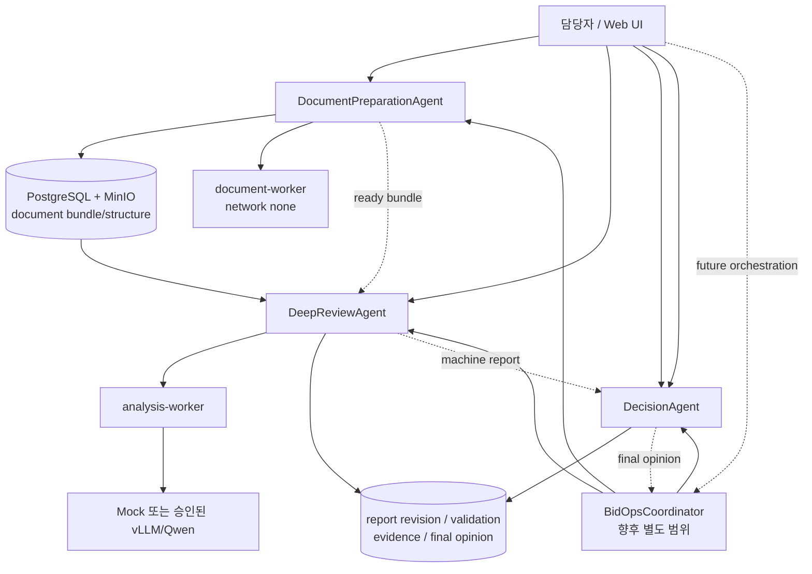
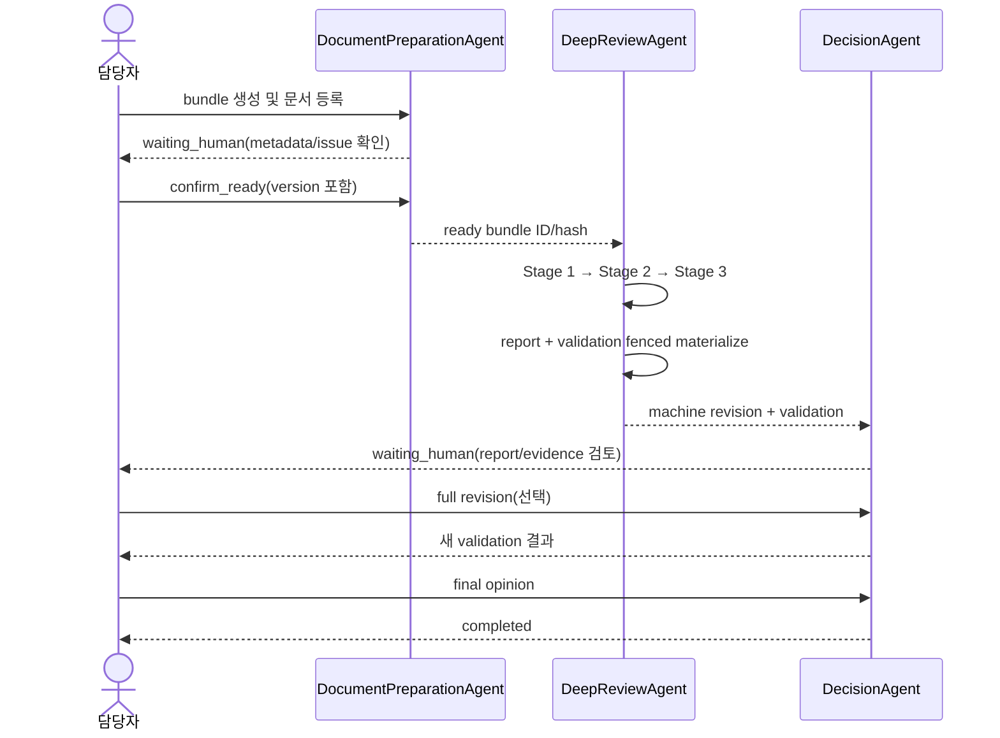

# BidOps Agent 워크플로우 설계

> - 상태: T8 구현 검토 완료본
> - 기준일: 2026-08-27
> - 기준 HEAD: `4f98a5c` (`feat(agent): add deterministic workflow acceptance`)
> - 적용 범위: 현재 Lean v1의 문서 준비 → 심층 검토 → 사람 의사결정 지원 흐름
> - 권위 계약: 승인된 Agent 사양, `docs/deep-review-erd.md`, `docs/contracts.md`

## 1. 결정 요약

현재 구현된 심층 검토 흐름을 다음 세 업무 Agent로 나눈다.

```text
DocumentPreparationAgent
  → DeepReviewAgent
  → DecisionAgent
```

- `DocumentPreparationAgent`는 분석 가능한 불변 입력 묶음을 만든다.
- `DeepReviewAgent`는 고정된 입력만 사용하여 3단계 분석, 결정적 검증, machine report 생성을
  완료한다.
- `DecisionAgent`는 사람이 근거를 확인하고 full revision과 최종 의견을 남기는 절차를 지원한다.
- `BidOpsCoordinator`는 이번 범위에서 구현하지 않으며, 향후 별도 승인할 orchestration layer로만
  예약한다.
- 앞단의 공고 수집·정규화·1차 선별은 향후 하나의 `OpportunityDiscoveryAgent`로 묶는다. 현재
  문서에서는 이름만 예약하고 구현하지 않는다.

Agent는 자율적으로 업무 결정을 내리는 주체가 아니라 기존 도메인 서비스와 상태 기계를 감싸는
application-level facade다. 최종 입찰 참여 결정, 입찰 제출, 발주처 연락은 자동화하지 않는다.

### 1.1 현재 구현 판정 (T8)

현재 HEAD에는 이 설계의 downstream 구현이 다음 범위까지 반영되어 있다.

- `web/backend/app/agents/common/`에 폐쇄형 공통 계약·안전 오류·순수 projection helper가 있다.
- `document_preparation`, `deep_review`, `decision` 각 패키지에 typed command, adapter, projection과
  단위 테스트가 있다.
- 기존 document bundle, deep review, report mutation router는 각각 해당 Agent adapter를 호출하고,
  조회 API와 기존 response model은 유지한다. 새 Agent REST API는 없다.
- `web/backend/app/services/agent_e2e.py`와 `app.cli.run_bc_e2e --t7`는 별도 저장소나 API를 추가하지
  않고 실제 DB snapshot에서 세 Agent projection을 읽어 연속 인수를 검증한다.
- `opportunity_discovery`, `BidOpsCoordinator`, Agent 전용 persistence는 구현하지 않았다.

`AgentRunView` 자체는 DB에 저장된 별도 정본이 아니라 기존 aggregate·attempt·stage·revision·validation·
opinion·audit 행에서 계산되는 read-only projection이다. T7 결과 JSON은 이 projection과 workflow
경계를 확인하는 운영자 증적이며 Qwen 품질 측정 결과가 아니다.

## 2. 설계 목표

1. 현재 구현된 DB, worker, 검증기와 REST 계약을 다시 만들지 않고 재사용한다.
2. Agent마다 입력, 출력, 현재 단계, 재시도와 사람 개입 조건을 같은 형식으로 관측한다.
3. 장시간 작업과 사람 대기를 하나의 `pending` 상태로 합치지 않는다.
4. 같은 명령의 중복 실행, worker lease 만료, 새 첨부와 재분석에서도 기존 결과를 보존한다.
5. Qwen/Mock 교체가 전체 workflow 계약에 영향을 주지 않게 한다.
6. Agent 계층이 기존 Lean v1의 14개 REST API와 25개 신규 테이블 폐쇄 계약을 깨지 않게 한다.

## 3. 범위와 비범위

### 3.1 이번 설계에 포함

- 세 Agent의 책임과 경계
- 세 Agent와 결정적 Mock provider를 이용한 연속 E2E의 경계
- 공통 명령·실행 상태·산출물 참조 계약
- 기존 도메인 상태를 공통 Agent 상태로 투영하는 규칙
- Agent 간 handoff 조건
- 멱등성, 동시성, 실패, 재실행, 감사 규칙
- 현재 서비스에 adapter를 추가하는 순서와 완료 조건

### 3.2 현재도 제외하거나 별도 승인인 범위

- 새로운 `/api/agents/*` REST API
- 범용 `agent_run`, `agent_message`, `agent_memory`, outbox 테이블
- Agent 간 자유 형식 자연어 대화나 계획 생성
- Coordinator 또는 `opportunity_discovery` 구현
- DecisionAgent의 자동 Go/No-Go 결정
- Qwen 품질 승인과 prompt 튜닝
- OpportunityDiscoveryAgent의 상세 구현
- SSO, 권한 체계, 외부 공개

## 4. 논리 구조



향후 `BidOpsCoordinator`는 정본 데이터를 복제하지 않는다. 각 Agent의 상태를 해당 도메인
aggregate에서 조회하고 다음 Agent를 시작할 수 있는지만 판단한다. 이번 범위에서는 Coordinator를
구현하지 않고 담당자가 기존 API의 명시적 mutation으로 각 Agent를 시작한다. Agent끼리 HTTP
loopback을 호출하지 않고 같은 application layer의 typed interface를 사용한다.

## 5. 공통 설계 원칙

### 5.1 도메인 상태가 정본이다

Agent 상태를 위한 별도 정본을 만들지 않는다.

- 문서 준비 정본: `document_bundle`, `document_version`, `document_structure`, `work_job`
- 심층 검토 정본: `deep_review`, `deep_review_attempt`, `deep_review_stage`, `work_job`
- 의사결정 정본: `report_revision`, `validation_run`, `final_opinion`
- 감사 정본: `audit_event`, 멱등성 정본: `idempotency_record`

공통 `AgentRunView`는 이 행들을 읽어 계산하는 projection이다. 따라서 projection을 다시 만들어도
업무 결과가 달라지지 않는다.

### 5.2 입력과 결과는 불변이다

- ready bundle은 확인 시점의 document/structure/hash를 고정한다.
- DeepReviewAgent는 ready snapshot, profile version, policy version만 읽는다.
- 새 첨부, 새 profile, 새 policy는 기존 분석을 수정하지 않고 새 review 계보를 만든다.
- machine/human report는 완전한 JSON snapshot으로 append-only 저장한다.
- 최종 의견은 대상 revision과 validation run을 함께 고정한다.

### 5.3 실행 성공과 업무 결과를 분리한다

`AgentRunStatus=completed`는 정해진 처리가 끝났다는 뜻이지 긍정적인 업무 판단을 뜻하지 않는다.

예를 들어 machine report의 validation이 `failed`여도 report와 실패 check가 정상적으로 저장됐다면
DeepReviewAgent 실행은 `completed`이고 `outcome_code=report_ready_validation_failed`다. 이 결과는
DecisionAgent가 실패 label을 유지한 채 사람에게 보여준다.

### 5.4 LLM은 제한된 도구다

LLM은 DeepReviewAgent 내부의 bounded invocation 도구로만 사용한다.

- DB, 원문 object store, 임의 파일 경로에 직접 접근하지 않는다.
- fixed input slice와 closed JSON schema만 입력·출력으로 사용한다.
- 모델 결과를 결정적 검증기가 자동 보정하지 않는다.
- Mock, vLLM/Qwen provider 차이는 invocation adapter 아래에 숨긴다.
- DecisionAgent는 기본적으로 LLM을 사용하지 않는다.

## 6. Agent 공통 계약

공통 계약은 우선 backend 내부 Python application contract로 도입한다. 외부 REST/JSON 계약으로
노출하려면 Lean v1 사양과 승인 API 목록을 별도로 변경해야 한다.

### 6.1 이름과 상태

```text
AgentName =
  opportunity_discovery  # 이름만 예약; 이번 범위에서 구현하지 않음
  | document_preparation
  | deep_review
  | decision

AgentRunStatus =
  queued
  | running
  | waiting_human
  | blocked
  | completed
  | failed
  | superseded
  | cancelled
```

| 상태 | 의미 |
|---|---|
| `queued` | 실행 요청이 접수됐지만 worker가 아직 claim하지 않음 |
| `running` | worker 또는 동기 mutation이 현재 처리 중 |
| `waiting_human` | 다음 진행에 파일, metadata 확인, revision 또는 최종 의견이 필요함 |
| `blocked` | 선행 aggregate가 준비되지 않았거나 안전·계약 조건상 시작할 수 없음 |
| `completed` | Agent의 완료 산출물이 append-only로 저장됨 |
| `failed` | 실행 실패가 안전한 error code와 함께 확정됨 |
| `superseded` | 더 새로운 bundle/review/attempt 계보로 대체되어 과거 결과가 더 이상 현재 실행이 아님 |
| `cancelled` | 명시적으로 지원되는 취소 action으로 실행을 종료함. 이번 범위에는 해당 action이 없음 |

`blocked`는 업무 위험 심각도 `차단`과 다른 운영 상태다. 아직 생성되지 않은 Agent 실행은 이 enum에
억지로 넣지 않고 향후 Coordinator의 slot 상태 `not_started`로만 표시한다. `superseded`는 immutable
계보의 도메인 상태이고 `cancelled`와 혼동하지 않는다. 이번 범위에는 실제 취소 기능과 취소 전이가
없다.

### 6.2 공통 참조 타입

```text
AgentAggregateRef = {
  aggregate_type: AgentAggregateType,
  aggregate_id: string
}

AgentArtifactRef = {
  artifact_type: AgentArtifactType,
  artifact_id: string,
  version: int | null,
  sha256: lowercase-hex-64 | null
}

AgentActorRef = {
  actor_kind: human | system,
  claimed_name: string | null
}

AgentSafeError = {
  code: AgentErrorCode,
  message: string,
  retryable: boolean,
  details: null
}

AgentWait = {
  reason_code: AgentWaitReason,
  message: string,
  required_actions: AgentAction[]
}
```

Artifact ref에는 object key, 내부 path, credential, 원문 byte, prompt, raw model output을 넣지 않는다.
`actor_kind=system`은 내부 worker만 사용할 수 있고 HTTP mutation은 항상 검증된 claimed name을 가진
`human`으로 기록한다.

현재 v1 구현의 `AgentSafeError`에는 `details` 필드가 존재하지만 값은 항상 `null`이어야 한다. 내부
exception이나 원문 위치를 details로 전달하지 않는다.

### 6.3 명령 envelope

모든 Agent 명령은 공통 header와 Agent별 closed payload를 가진다.

```text
AgentCommand[TAction] = {
  schema: "bidops.agent-command.v1",
  agent_name: AgentName,
  action: TAction,
  aggregate: AgentAggregateRef,
  actor: AgentActorRef,
  request_id: UUID | null,
  correlation_id: UUID | null,
  expected_version: int | null,
  input_refs: AgentArtifactRef[],
  payload: action-specific closed model
}
```

규칙:

1. `payload`는 임의 `dict`가 아니라 action별 Pydantic 모델이어야 한다.
2. 기존 API에서 `request_id`가 필수인 mutation은 같은 UUID를 adapter까지 그대로 전달한다.
3. optimistic concurrency 대상은 `expected_version` 또는 기존 payload의 `version`을 강제한다.
4. upload stream은 serialized command나 audit metadata에 넣지 않는다. 요청 수명 동안 제한된 stream
   capability로 adapter에 전달한다.
5. `correlation_id`는 Agent 연쇄 관측용이다. 기존 `audit_event.safe_metadata`와 작업 로그의 안전한
   metadata로 전달하되 새 DB 컬럼을 요구하지 않는다.

### 6.4 실행 view

```text
AgentStepView = {
  step_name: string,
  sequence: int,
  status: queued | running | waiting_human | blocked | completed | failed | superseded | cancelled,
  started_at: timestamp | null,
  completed_at: timestamp | null,
  last_error_code: string | null
}

AgentRunView = {
  schema: "bidops.agent-run.v1",
  agent_name: AgentName,
  run_id: string,
  aggregate: AgentAggregateRef,
  execution_ref: AgentArtifactRef | null,
  status: AgentRunStatus,
  outcome_code: string | null,
  current_step: string | null,
  steps: AgentStepView[],
  input_refs: AgentArtifactRef[],
  output_refs: AgentArtifactRef[],
  wait: AgentWait | null,
  error: AgentSafeError | null,
  available_actions: AgentAction[],
  correlation_id: UUID | null,
  created_at: timestamp,
  started_at: timestamp | null,
  updated_at: timestamp,
  completed_at: timestamp | null
}
```

`run_id`는 opaque string으로 취급한다. 별도 `agent_run` PK가 아니며 아래처럼 기존 ID에서
결정적으로 만든다.

- DocumentPreparationAgent: `document-preparation:{bundle_id}`
- DeepReviewAgent: `deep-review:{deep_review_id}:attempt:{attempt_id}`
- DecisionAgent: `decision:{deep_review_id}`

`AgentCommand.aggregate`는 명령의 대상이다. start 명령에서는 notice처럼 부모 aggregate를 가리킬
수 있고, 반환되는 `AgentRunView.aggregate`는 새로 생성되거나 선택된 Agent 소유 aggregate를
가리킨다. 예를 들어 `start_review` 명령 대상은 notice이고 반환 aggregate는 deep review다.

### 6.5 application interface

개념적 Python 계약은 다음과 같다.

```python
from typing import Generic, Protocol, TypeVar

StartCommandT = TypeVar("StartCommandT")
ActionCommandT = TypeVar("ActionCommandT")


class WorkflowAgent(Protocol, Generic[StartCommandT, ActionCommandT]):
    name: str

    def start(self, command: StartCommandT) -> AgentRunView: ...

    def act(self, command: ActionCommandT) -> AgentRunView: ...

    def status(self, aggregate: AgentAggregateRef) -> AgentRunView: ...
```

- `start`는 논리 Agent instance를 만들거나 기존 멱등 응답을 반환한다.
- `act`는 upload, confirm, retry, revision, final opinion 같은 Agent별 명시적 action을 수행한다.
- `status`는 쓰기 없이 기존 도메인 행에서 view를 계산하는 내부 projection helper다. 기존 GET
  service/API를 대체하거나 새 공개 endpoint로 노출하지 않는다.
- 범용 `cancel`은 Lean v1에서 지원하지 않는다. 향후 Agent별 capability와 상태 전이 계약이 승인된
  경우에만 action으로 추가한다. 이번 범위에는 실제 취소 action이 없다.
- `resume`은 숨은 자동 복구가 아니라 Agent별 `retry` 또는 사람 action으로 표현한다.

### 6.6 action별 closed command

| Agent/action | 명령 대상 | closed payload 핵심 | 반환 aggregate |
|---|---|---|---|
| DocumentPreparation `start_bundle` | notice | 빈 모델 | document bundle |
| DocumentPreparation `register_document` | document bundle | `request_id`; file stream은 별도 capability | document bundle |
| DocumentPreparation `update_document_metadata` | document version | role, effective date, replaces ID, is current, version | document bundle |
| DocumentPreparation `confirm_ready` | document bundle | request ID, bundle version, 모든 document ID/version | document bundle |
| DeepReview `start_review` | notice | request ID, ready bundle ID | deep review |
| DeepReview `retry_attempt` | deep review | request ID | deep review attempt |
| Decision `create_full_revision` | deep review | request ID, base revision ID, full report, reason, evidence IDs | deep review |
| Decision `record_final_opinion` | deep review | request ID, revision/validation ID, value, reason, acknowledgement | deep review |

조회 action은 command mutation으로 기록하지 않고 기존 read service와 projection을 사용한다.

### 6.7 projection 결정성

- projection 조회 시 현재 시각을 `created_at`, `updated_at` 또는 `completed_at`으로 생성하지 않는다.
- `updated_at`은 관련 aggregate, attempt, stage, revision, validation, opinion 중 실제로 저장된 가장
  최근 시각에서 계산한다.
- 과거 행에 correlation ID가 없으면 새 값을 만들지 않고 `null`로 반환한다.
- `available_actions`는 상태, version, active attempt, validation 상태에서 결정적으로 계산한다.
- 같은 DB snapshot은 항상 byte-semantic하게 같은 `AgentRunView`를 만들어야 한다.
- projection 계산은 audit event를 생성하거나 다른 write side effect를 만들지 않는다.

## 7. Agent별 책임

### 7.1 DocumentPreparationAgent

#### 책임

- 유효 등급이 `우선 검토`인지 확인
- document bundle 생성
- provider/manual 첨부 등록과 quarantine 저장
- MIME/magic/archive/PDF/ClamAV 안전 검사 조정
- credential-free document-worker 구조화 요청
- 역할, 효력일, 대체 문서, 현재본 metadata 확인
- blocking issue 계산
- 사람의 명시적 확인 후 ready snapshot 고정

#### 하지 않는 일

- 격리된 문서를 분석 모델에 전달
- HWP 변환 실패를 우회하여 HWP 원본을 LLM에 전달
- quarantine 수동 해제
- OCR text 직접 수정
- 분석 또는 최종 의견 생성

#### action

```text
start_bundle
register_document
update_document_metadata
confirm_ready
```

structure/page 조회는 Agent mutation이 아니라 기존 read service/API로 유지한다.

#### 입력과 완료 산출물

| 구분 | 내용 |
|---|---|
| 시작 입력 | notice ID, effective grade 근거 snapshot, claimed name |
| 진행 입력 | 제한된 upload stream, document version, metadata, bundle version |
| 완료 출력 | `bidops.document-bundle.v1` ready snapshot과 hash |
| handoff 조건 | bundle status가 `ready`, 모든 문서가 safe/structured, blocking issue 0 |

#### 상태 투영

| 기존 상태 | Agent 상태 | current step / outcome |
|---|---|---|
| `draft` | `waiting_human` | `register_documents` |
| `processing` | `running` | `scan_and_structure` |
| `needs_review` | `waiting_human` | `review_metadata_and_issues` |
| `ready` | `completed` | `outcome_code=ready_bundle` |
| `quarantined` | `failed` | `unsafe_document` 또는 안전한 실제 code |
| `failed` | `failed` | 마지막 safe worker error |
| `superseded` | `superseded` | `outcome_code=superseded_by_new_bundle` |

upload 완료만으로 Agent를 완료 처리하지 않는다. 새 첨부는 ready bundle을 수정하지 않고 새 bundle
revision과 새 DocumentPreparationAgent instance를 만든다.

#### 권한 경계

- Web/application service: PostgreSQL, quarantine/source/structure 목적별 credential, ClamAV
- document-worker: bounded scratch만 사용, DB/object credential 없음, `network_mode: none`
- Agent view: 내부 object key와 경로를 반환하지 않음

### 7.2 DeepReviewAgent

#### 책임

- ready bundle, active profile version, active policy version을 시작 시 고정
- 같은 입력 조합의 논리 `deep_review`와 재시도 단위 `deep_review_attempt` 관리
- 다음 3개 업무 stage를 순서대로 실행
  1. `requirements_and_evaluation`
  2. `delivery_risk_economics`
  3. `synthesis_and_validation`
- bounded invocation, deterministic chunk merge, closed schema 검증
- claim/evidence scope와 source hash 검증
- machine report, validation, evidence, audit를 fenced transaction에서 materialize

#### 하지 않는 일

- live attachment projection 재조회
- 문서 변환/OCR 재수행
- 모델 출력 자동 보정
- validation 실패 자동 승인
- 사람 revision 또는 최종 의견 생성

#### action

```text
start_review
retry_attempt
```

review status/report/evidence 조회는 기존 read service/API로 유지한다. `status`는 내부 projection
helper일 뿐 Agent mutation action이나 새 공개 API가 아니다.

#### 입력과 완료 산출물

| 구분 | 내용 |
|---|---|
| 입력 | ready bundle ID/hash, profile version ID/hash, policy version ID/hash |
| 실행 단위 | `deep_review_attempt` |
| 중간 출력 | 3개의 immutable `bidops.deep-review-stage.v1` |
| 완료 출력 | machine report revision, validation run, evidence refs |
| handoff 조건 | machine revision과 실제 validation run이 함께 존재 |

#### 상태 투영

| 기존 상태 | Agent 상태 | 설명 |
|---|---|---|
| review/attempt `queued` | `queued` | analysis worker claim 대기 |
| review/attempt `running` | `running` | 현재 stage를 `current_step`으로 표시 |
| attempt `completed`, machine report/validation 존재 | `completed` | DecisionAgent handoff 가능 |
| review/attempt `failed` | `failed` | 새 attempt action을 제공 |
| 조회 대상 attempt `superseded` | `superseded` | 새 attempt가 대체한 과거 계보를 보존 |

validation `passed`이면 `outcome_code=report_ready_validated`, `failed`이면
`outcome_code=report_ready_validation_failed`다. 후자도 실행 자체는 `completed`다. 반대로 review가
`completed`인데 machine report 또는 validation이 없으면 성공으로 투영하지 않고
`failed/processing_failed` invariant violation으로 취급한다.

#### 권한 경계

- analysis-worker: structure read, encrypted model-response write, DB analysis scope
- model invoker: DB/source object write 권한 없음
- remote vLLM: 승인된 literal IP/port와 `/v1` 경계에서만 egress 허용
- Mock: workflow 검증용이며 품질 승인 결과로 해석하지 않음

### 7.3 DecisionAgent

#### 책임

- machine/human report revision과 validation history 조회
- claim의 evidence와 원문 locator 확인 지원
- 사람의 full report revision 저장
- factual change의 evidence scope 확인과 새 validation 실행
- 시스템 권고와 분리된 사람 최종 의견 append
- validation 실패 의견의 acknowledgement와 reason 강제

#### 하지 않는 일

- 사람 대신 최종 의견 선택
- validation 실패 label 제거
- delta overlay 또는 기존 revision 덮어쓰기
- 새 review에 이전 사람 revision/final opinion 자동 승계
- claimed name을 인증된 신원으로 표현

#### action

```text
create_full_revision
record_final_opinion
```

report/evidence/status 조회는 기존 read service/API로 유지한다. DecisionAgent action은 full revision과
final opinion mutation만 표현한다.

#### 입력과 완료 산출물

| 구분 | 내용 |
|---|---|
| 입력 | deep review ID, current report revision ID/hash, validation run ID/status |
| 사람 수정 출력 | 새 human report revision과 새 validation run |
| 완료 출력 | 대상 revision/validation에 고정된 `final_opinion` |
| 완료 조건 | 최신 revision을 대상으로 한 최신 final opinion이 존재 |

#### 상태 투영

| 조건 | Agent 상태 | current step / outcome |
|---|---|---|
| machine report 미생성 | `blocked` | `await_machine_report` |
| report 존재, 최종 의견 없음 | `waiting_human` | `review_machine_report` |
| human revision 생성 후 최종 의견 없음 | `waiting_human` | `record_final_opinion` |
| final opinion이 최신 revision/validation을 가리킴 | `completed` | `outcome_code=final_opinion_recorded` |
| final opinion 이후 새 revision 생성 | `waiting_human` | 새 revision에 대한 의견 필요 |

validation 실패는 DecisionAgent 실행 실패가 아니다. 담당자가 실패 내용을 확인하고
`acknowledged_validation_failure=true`와 구체적인 reason을 제공해야 최종 의견을 저장할 수 있다.

## 8. Agent 간 handoff 계약



### 8.1 DocumentPreparation → DeepReview

다음을 모두 만족할 때만 handoff한다.

1. `document_bundle.status == ready`
2. ready documents가 비어 있지 않음
3. 모든 ready document의 safety status가 `safe`
4. 모든 structure ID와 structure payload hash가 snapshot에 존재
5. blocking issue가 없음
6. 사람의 `confirmed_by`, `confirmed_at`이 존재

### 8.2 DeepReview → Decision

다음을 모두 만족할 때만 handoff한다.

1. current attempt의 세 stage가 모두 `completed`
2. machine `report_revision`이 존재
3. 해당 revision의 실제 `validation_run`이 존재
4. report/evidence scope 검증 결과가 저장됨

validation status가 `failed`여도 handoff 자체는 허용한다. DecisionAgent가 실패 check와 acknowledgement
요구를 그대로 노출한다.

## 9. BidOpsCoordinator의 역할 — 향후 별도 범위

Coordinator는 세 Agent 위의 얇은 orchestration layer로 예약한다. 현재 HEAD와 T8 문서 범위에서는
만들지 않는다.

### 담당

- notice를 기준으로 현재 Agent instance와 상태를 조회
- 선행 완료 조건을 확인해 실행 가능한 다음 action 계산
- correlation ID 전달
- 중복 start 방지
- `waiting_human`, `failed`, `completed` 상태를 UI에 일관되게 집계
- 완료된 산출물 ref를 다음 Agent 명령의 input ref로 전달

### 금지

- Agent의 도메인 상태를 별도 row에 복제
- DB를 직접 수정하여 Agent 상태를 건너뜀
- unsafe 문서나 validation 실패를 자동 승인
- 최종 의견 자동 생성
- Agent 간 원문/prompt 전달

### 조정 규칙

```text
if document_preparation != completed:
    expose document preparation action
elif deep_review does not exist:
    allow start_review
elif deep_review in queued|running:
    poll/status only
elif deep_review == failed:
    allow retry_attempt
elif decision != completed:
    expose human decision actions
else:
    workflow completed
```

향후 초기 구현에서도 별도 coordinator daemon을 만들지 않는다. Web/API가 Agent projection을 조회하고
명시적인 사용자 mutation으로 다음 단계를 시작한다. 자동 조정이 필요해질 때 기존 `work_job`을
재사용할 수 있지만, 정확한 job type과 at-least-once 처리 계약을 먼저 승인한다. `audit_event`를
작업 queue나 outbox로 사용하지 않는다.

## 10. 기존 REST API와 Agent action 매핑

Lean v1의 승인된 14개 API는 그대로 유지한다.

| # | 기존 API | 담당 Agent/action |
|---:|---|---|
| 1 | `GET /api/notices/{notice_id}/document-bundles` | 기존 DocumentPreparation read service/API |
| 2 | `POST /api/notices/{notice_id}/document-bundles` | DocumentPreparation `start_bundle` |
| 3 | `POST /api/document-bundles/{bundle_id}/documents` | DocumentPreparation `register_document` |
| 4 | `PATCH /api/document-versions/{id}` | DocumentPreparation `update_document_metadata` |
| 5 | `POST /api/document-bundles/{bundle_id}/confirm` | DocumentPreparation `confirm_ready` |
| 6 | `GET /api/document-structures/{id}` | 기존 document structure read service/API |
| 7 | `GET /api/document-structures/{id}/pages/{page}` | 기존 document structure read service/API |
| 8 | `POST /api/notices/{notice_id}/deep-reviews` | DeepReview `start_review` |
| 9 | `GET /api/deep-reviews/{id}` | 기존 DeepReview read service/API |
| 10 | `POST /api/deep-reviews/{id}/attempts` | DeepReview `retry_attempt` |
| 11 | `GET /api/deep-reviews/{id}/report` | 기존 report read service/API |
| 12 | `POST /api/deep-reviews/{id}/report-revisions` | Decision `create_full_revision` |
| 13 | `POST /api/deep-reviews/{id}/final-opinions` | Decision `record_final_opinion` |
| 14 | `GET /api/evidence/{id}` | 기존 evidence read service/API |

Agent adapter를 추가해도 router의 request/response shape, stable error code, actor header, request ID,
optimistic concurrency 규칙은 바뀌지 않는다.

## 11. 멱등성·동시성·재시도

### 11.1 사용자 명령

- #3, #5, #8, #10, #12, #13은 기존 `idempotency_record` 규칙을 그대로 사용한다.
- 같은 operation/aggregate/claimed name/request ID와 같은 payload hash는 최초 응답을 재현한다.
- 같은 request ID에 다른 payload가 오면 `idempotency_conflict`다.
- #4와 #5는 document/bundle version, #12는 base revision을 이용해 stale write를 거부한다.

### 11.2 worker

- `FOR UPDATE SKIP LOCKED`로 짧게 claim하고 transaction을 닫는다.
- lease reclaim마다 fence를 증가시킨다.
- stage/report finish는 현재 owner/fence가 일치할 때만 저장한다.
- 모델/OCR 실행 중 DB transaction을 열어 두지 않는다.
- stale worker 결과는 저장하지 않는다.

### 11.3 재시도 의미

| 상황 | 재시도 방식 | 계보 보존 |
|---|---|---|
| transient document job 실패 | 같은 work job의 fenced reclaim 또는 새 안전 처리 | 기존 scan/job 감사 보존 |
| unsafe/구조 실패 문서 | 우회 재시도 금지, 대체/정정 문서 등록 | 기존 document version 보존 |
| 모델 timeout/잘린 JSON/schema 실패 | 같은 deep review 아래 새 attempt | 이전 attempt/stage 보존 |
| validation failed report | 모델로 자동 수정하지 않고 사람 검토 | 실패 validation 보존 |
| revision version conflict | 최신 revision 재조회 후 새 command | 기존 revision 보존 |
| 새 첨부/profile/policy | 새 bundle 또는 새 review | 이전 report/opinion 보존 |

## 12. 오류와 사람 개입

Agent adapter는 내부 exception을 공통 안전 오류로 변환하되 기존 REST stable code를 우선 사용한다.

```text
invalid_request
actor_name_required
actor_name_invalid
not_found
effective_grade_ineligible
bundle_not_ready
bundle_has_blocking_issues
unsafe_document
structure_unavailable
version_conflict
idempotency_conflict
active_attempt_exists
review_not_ready
evidence_out_of_scope
validation_failed
factual_change_evidence_required
final_opinion_reason_required
service_unavailable
processing_failed
```

`waiting_human`에는 오류 대신 `AgentWait`를 사용한다. 예:

```json
{
  "reason_code": "document_metadata_confirmation_required",
  "message": "문서 역할과 최신본 여부를 확인해야 합니다.",
  "required_actions": ["update_document_metadata", "confirm_ready"]
}
```

## 13. 감사와 관측

최소 관측 항목:

- agent name, aggregate type/ID, action
- request ID와 correlation ID
- actor kind와 claimed name snapshot
- attempt/stage sequence
- 시작·완료 시각과 latency
- provider/model/policy의 audit-safe ID/hash
- token/timeout/retry 같은 안전한 invocation metadata
- outcome code 또는 safe error code
- input/output artifact ID/version/hash

로그와 audit에는 원문 byte, 전체 prompt, raw model output, credential, object key, 내부 path를 넣지 않는다.
raw model response는 기존 encrypted object 경계에서만 보관한다.

## 14. backend 구조

Agent별 코드 소유권은 다음 구조로 고정한다.

```text
web/backend/app/agents/
  __init__.py
  common/
    __init__.py
    contracts.py               # 폐쇄 enum/ref/command/run view
    errors.py                  # 고정 안전 오류·대기 매핑
    projection.py              # 공통 순수 projection helper
  document_preparation/
    __init__.py
    commands.py
    projection.py
    agent.py
  deep_review/
    __init__.py
    commands.py
    projection.py
    agent.py
  decision/
    __init__.py
    commands.py
    projection.py
    agent.py
```

테스트도 `web/backend/tests/agents/` 아래에서 같은 경계를 따른다. 상위 조정자 폴더, 범용 registry,
factory framework는 이번 범위에 만들지 않는다.

기존 서비스 소유권은 유지한다.

```text
DocumentPreparationAgent
  └── DocumentBundleService + document work_job/worker

DeepReviewAgent
  └── DeepReviewService + analysis worker
      + DeepReviewValidation + ReportService.materialize_machine_report

DecisionAgent
  └── ReportService.create_revision/create_final_opinion
      + EvidenceService
```

router가 기존 service 대신 Agent adapter를 호출하도록 바꾸더라도 한 번에 전체를 교체하지 않는다.
먼저 adapter와 projection 테스트를 만들고, 기존 서비스 테스트와 동일 결과가 나오는 것을 확인한 뒤
endpoint별로 전환한다.

## 15. 구현 순서

### Phase 0 — 권위 문서 정합성 확인

1. `docs/deep-review-erd.md` SHA-256을 승인값
   `0d23875d71f539037bd5ee0b24f874a71d39d8466d1897f035023ef72092c77d`와 대조한다.
2. Agent 계약이 새 REST API/DB table을 만들지 않는다는 승인 범위를 확인한다.

### Phase 1 — 공통 계약과 projection

1. `app/agents/common/contracts.py`에 Pydantic 폐쇄 계약 작성
2. `app/agents/common/errors.py`에 고정 안전 오류·대기 매핑 작성
3. `app/agents/common/projection.py`에 DB write 없는 순수 helper 작성
4. `tests/agents/test_common_contracts.py`에 계약·projection 단위 테스트 작성

### Phase 2 — DocumentPreparationAgent adapter

1. 기존 bundle service를 typed action으로 감싸기
2. upload stream이 command/audit에 직렬화되지 않는지 검증
3. draft → processing → waiting_human → ready 상태 테스트
4. unsafe/failed/superseded와 새 bundle 계보 테스트

### Phase 3 — DeepReviewAgent adapter

1. review create/retry/status를 adapter로 감싸기
2. attempt/stage projection과 fence 회귀 테스트
3. report/validation 동시 materialize 불변성 확인
4. validation failed와 execution failed 구분 테스트

### Phase 4 — DecisionAgent adapter

1. report/evidence 조회와 full revision action 연결
2. factual change evidence와 optimistic concurrency 테스트
3. final opinion/validation acknowledgement 테스트
4. 최신 revision 기준 완료 상태 투영 테스트

### Phase 5 — Coordinator (향후 별도 범위)

1. 세 Agent의 상태를 notice workflow view로 조합 (이번 워크트리에서는 구현하지 않음)
2. 다음 허용 action 계산
3. 중복 start와 실패 retry 경계 테스트
4. Web UI가 coordinator view를 사용할지는 별도 API 계약 승인 후 결정

## 16. 테스트와 완료 조건

### 16.1 공통 계약

- closed enum과 extra field 거부
- actor human/system 경계
- request/correlation ID 전달
- artifact ref에 path/object key/credential이 없는지 확인
- 같은 domain state가 항상 같은 AgentRunView를 만드는지 확인

### 16.2 상태·실패

- document draft/processing/needs_review/ready/quarantined/failed/superseded 전부 투영
- deep review queued/running/completed/failed와 attempt superseded 투영
- 세 stage 현재 단계와 안전한 last error 표시
- validation failed를 Agent failed로 오분류하지 않음
- 최신 revision을 가리키지 않는 final opinion을 Decision 완료로 오분류하지 않음

### 16.3 E2E

Mock provider로 다음 흐름을 재현한다.

```text
DocumentPreparationAgent completed
→ DeepReviewAgent completed(report + validation)
→ DecisionAgent waiting_human
→ human revision + revalidation
→ final opinion
→ DecisionAgent completed
→ 새 첨부
→ 새 DocumentPreparation/DeepReview 계보
→ 이전 revision/final opinion 보존
```

완료 검증 명령은 기존 기준을 유지한다.

```text
./run-tests.sh
./web/run-web-tests.sh
web/backend/.venv/bin/pytest web/backend/tests
cd web/frontend && npm run build
git diff --check
```

## 17. 설계 게이트와 T8 구현 검토

### 17.1 ERD hash

T1에서 확정한 `docs/deep-review-erd.md` SHA-256은
`0d23875d71f539037bd5ee0b24f874a71d39d8466d1897f035023ef72092c77d`다. diff는 토폴로지 표기의
`Ollama / Qwen`을 현재 runtime 표현인 `vLLM / Qwen`으로 바꾼 한 줄이며, schema·table·column·제약
의미 변경은 없다. 따라서 Qwen은 승인된 실제 품질 결과를 뜻하지 않고, vLLM은 provider/runtime 표현을
뜻한다. 실제 Qwen 승인은 이번 범위에서 제외한다.

### 17.2 외부 Agent API

현재 Lean v1은 신규 API 14개를 폐쇄 계약으로 둔다. 공통 `AgentRunView`를 Web UI에 직접 노출하는
새 endpoint가 필요하면 편의상 추가하지 않고 승인된 Agent 사양과 `docs/contracts.md` 변경 승인을
먼저 받는다. 초기 구현은 내부 adapter와 기존 API 응답을 유지한다.

### 17.3 Agent 저장소

Lean v1 신규 application table은 25개로 닫혀 있다. 별도 `agent_run`이나 event/outbox 테이블은
추가하지 않는다. 장기적으로 durable coordinator가 필요하면 Lean v2 계약으로 다룬다.

### 17.4 현재 구현·검증 경계

- T1~T7 commit에서 common contract → 세 Agent projection/adapter → 기존 mutation router 연결 →
  deterministic T7 acceptance 순서가 보존된다. 상세 commit 순서와 충돌 지점은
  `docs/worktree-agent-boundary-and-merge-direction.md`에 있다.
- T7 실제 격리 실행은 PostgreSQL, MinIO, ClamAV, document worker 2개, analysis worker, web을
  사용했고 `mock-analysis`/`bidops-deterministic-mock-v1`, 외부 OpenAI/Codex/Qwen 호출 0건,
  종료 active WorkJob 0건, `passed=true`를 확인한 뒤 격리 자원을 정리했다.
- 이 결과는 상태 전이·영속화·검증·계보 증적이다. `mock_quality.evaluated=false`이며 실제 Qwen
  품질 gate를 통과했다는 뜻이 아니다.
- 최종 리뷰에서 `Run.screening_basis`를 원문 보존형 `TEXT`로 이관했다. 깨끗한 PostgreSQL 17에
  `data/runs/20260817-20260823`를 두 번 적재해 공고 40건·판정 40건, 동일 run ID, 102자 설명의
  무절단 보존을 확인했다.

## 18. 최종 경계

이 설계에서 Agent가 보장하는 것은 다음이다.

```text
안전하고 고정된 입력
→ 재현 가능한 분석 실행
→ 검증 상태가 보존된 보고서
→ 근거를 확인한 사람의 최종 의견 기록
```

Agent가 보장하거나 자동화하지 않는 것은 다음이다.

```text
회사 자격의 추정 확정
최종 입찰 참여 승인
입찰 제출
발주처 연락
validation 실패의 자동 해제
```
