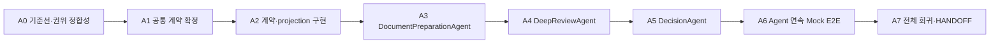

# Downstream Agent 구현 계획·완료 기록

> - 상태: T8 구현 검토 완료본
> - 기준일: 2026-08-27
> - 대상 워크트리: `bidops-deep-review`
> - 기준 HEAD: `4f98a5c` (`feat(agent): add deterministic workflow acceptance`)
> - 선행 설계: `docs/agent-workflow-design.md`
> - 기존 구현 기준: Lean v1/T7 runtime과 현재 worktree의 검증 문서

## T8 현재 판정

T1에서 계획한 common contract → 세 Agent projection/adapter → 기존 mutation router 연결 →
결정적 Mock 연속 인수의 구현이 T1~T7 commit으로 완료됐다. T8은 코드 변경이 아니라 현재 HEAD와
실제 검증 결과를 문서에 반영하는 작업이다.

| 확인 항목 | 현재 결과 |
|---|---|
| Agent common contract/projection | 구현됨: `web/backend/app/agents/common/` |
| DocumentPreparationAgent | 구현됨: bundle 생성·문서 등록·metadata·ready 확정 adapter/projection |
| DeepReviewAgent | 구현됨: review 생성·attempt retry·3 stage/report projection |
| DecisionAgent | 구현됨: full revision·revalidation·final opinion projection/adapter |
| 기존 REST 연결 | 14개 Lean v1 endpoint의 mutation만 해당 adapter로 연결; response/read 계약 유지 |
| T7 연속 인수 | 실제 격리 PostgreSQL/MinIO/ClamAV/document worker 2개/analysis worker/web에서 Mock으로 `passed=true` |
| T8 코드 변경 | 없음. 문서 7개만 수정하며 commit을 만들지 않음 |

Mock 결과의 `passed=true`는 상태 전이·저장·검증·계보 인수 결과다. `mock_quality.evaluated=false`이므로
실제 Qwen 품질 evidence나 사업 판단 승인으로 사용하지 않는다.

## 1. 목표와 종료점

현재 Lean v1 구현을 다시 작성하지 않고 application-level Agent adapter로 감싼 결과를 유지한다.

```text
DocumentPreparationAgent
  → DeepReviewAgent
  → DecisionAgent
```

이 워크트리의 완료 지점은 다음과 같으며 T1~T7에서 충족됐다.

1. 공통 Agent 계약과 결정적 상태 projection이 구현되어 있다.
2. 세 Agent가 기존 service, worker, DB 상태를 재사용한다.
3. 기존 REST API 14개의 request/response 계약이 바뀌지 않는다.
4. Mock provider를 이용한 세 Agent 연속 E2E가 통과한다.
5. 새 첨부 이후 새 bundle/review 계보와 이전 결과 보존이 확인된다.
6. 별도 통합 워크트리에서 후속 변경을 안전하게 합칠 수 있는 HANDOFF가 준비되어 있다.

다음 작업은 이 워크트리의 범위가 아니다.

- `OpportunityDiscoveryAgent` 구현
- `BidOpsCoordinator` 구현
- 새 Agent REST API 또는 Web UI 계약
- 전체 UI 디자인 개편
- 실제 Qwen 품질 승인
- SQLite 운영 cutover와 운영 복구 훈련
- main 병합과 릴리스

## 2. 현재 기준선 (T8)

T8 문서 검토 시작 시 확인한 값이다. T1의 dirty worktree 기록은 아래 §2.1에 역사적 기록으로
보존하고, 통합 기준으로는 이 표와 현재 HEAD를 사용한다.

| 항목 | 값 |
|---|---|
| branch | `bidops-deep-review` |
| HEAD | `4f98a5c9ed986b534403df4c8feebaf3ebdbfab0` |
| T8 시작 tracked/untracked 변경 | 없음 (clean worktree) |
| T8 코드 변경 | 없음 (지정 문서만 갱신) |
| 현재 ERD SHA-256 | `0d23875d71f539037bd5ee0b24f874a71d39d8466d1897f035023ef72092c77d` |
| T1 승인 ERD SHA-256 | `0d23875d71f539037bd5ee0b24f874a71d39d8466d1897f035023ef72092c77d` |

T8은 `git reset`, `git checkout --`, 삭제 파일 복원, 광범위한 정리 명령을 사용하지 않는다.
문서 변경은 현재 worktree에 남기며 commit/push/merge/release는 수행하지 않는다.

현재 Mock E2E 기준선은 다음 흐름을 이미 검증했다.

```text
upload
→ scan/structure
→ ready
→ Stage 1/2/3
→ machine report/validation/evidence
→ human full revision/revalidation
→ final opinion
→ 새 attachment/bundle/review
→ 이전 결과 보존
```

Agent화 이후에도 이 기준선보다 기능이 줄어들면 안 된다.

## 2.1 계획 작성 당시 T1 기준선·변경 분류 (역사)

T1 시작 HEAD는 `29daf4a`였으며, handoff 작성 시점부터 존재한 dirty 변경을 다음처럼 분류했다.
아래 네 범주의 관련 변경만 기준 커밋에 포함하고, 당시 T1에서 새로 구현하는 것은 package marker와
권위 문서 정합성뿐이다. `.dryforge/`는 읽거나 수정하거나 커밋하지 않는다.

| 분류 | 포함 변경 | 포함 근거 |
|---|---|---|
| 승인된 Lean v1/T7 runtime | `.env.example`, `docker-compose.t7.yml`, `docs/architecture.md`, `docs/engineering-notes.md`, `docs/operations.md`, `docs/reference/company-profile.md`, `docs/security.md`, `web/backend/app/cli/import_profile_policy.py`, `app/config.py`, `app/db.py`, `app/document_mcp/processor.py`, `app/policies/analysis-policy-lean-v1.json`, `app/services/assets.py`, `app/services/deep_reviews.py`, `app/services/document_bundles.py`, `app/services/input_versions.py`, `app/services/reports.py`, `pyproject.toml`, `requirements.txt` 및 대응 회귀 테스트 | PostgreSQL/MinIO/ClamAV, immutable bundle·report·validation, Lean v1 정책·보안 경계를 정합화한다. |
| vLLM·결정적 mock/reference | `docker-compose.t7.remote-vllm.yml`, `docker-compose.t7.mock-reference.yml`, `docker-compose.t7.codex-reference.yml`, `app/services/vllm_client.py`, `app/services/mock_analysis_client.py`, `app/services/codex_exec_client.py` 및 `test_mock_analysis_client.py`, `test_codex_exec_client.py`, `ollama_client.py` 삭제 | vLLM은 현재 runtime 표현이고 Mock은 품질 승인이 아닌 재현 가능한 workflow 기준선이다. Ollama client 삭제는 vLLM client로 bounded provider 경계를 대체한 결과다. Codex는 reference 전용이다. |
| E2E·문서 | `HANDOFF.md`, `docs/e2e-bc-acceptance.md`, `docs/e2e-flow-overview.html`, `docs/mock-workflow-e2e-result.md`, `docs/tracking/status.md`, `docs/tracking/findings.md`, `web/backend/app/cli/run_bc_e2e.py`, `app/cli/score_candidate_quality.py`, `app/services/bc_e2e.py`, `app/services/candidate_quality.py` 및 `test_acceptance_clis.py`, `test_bc_e2e.py`, `test_candidate_quality.py`, `deep-review-cold-session-handoff.md` 삭제 | 결정적 Mock E2E와 B→C 인수 절차·증적·남은 승인 조건을 기록한다. 이전 cold-session handoff는 새 HANDOFF로 대체되어 복원하지 않는다. |
| 이번 Agent 설계 | `docs/agent-workflow-design.md`, `docs/agent-workflow-implementation-plan.md`, `docs/worktree-agent-boundary-and-merge-direction.md`, 지정 package marker 6개 | 세 Agent와 결정적 Mock E2E의 후속 구현 경계를 문서화한다. 공통 계약·실제 Agent 구현은 후속 작업이며 T1에서 만들지 않는다. |

현재 확인된 관련 없음 변경은 없다. 새 공개 API, DB table/column/migration, UI, Coordinator,
`opportunity_discovery` 구현, 실제 Qwen 품질 승인은 기준 커밋에 포함하지 않는다.

## 3. 구현 원칙

1. **adapter 우선**: 기존 service와 worker를 복제하거나 대체하지 않는다.
2. **DB 추가 금지**: 별도 `agent_run`, message, memory, outbox 테이블을 만들지 않는다.
3. **API 추가 금지**: Lean v1의 승인된 REST API 14개를 유지한다.
4. **도메인 정본**: Agent 상태는 bundle/review/attempt/revision/opinion 행에서 계산한다.
5. **결정적 projection**: 조회 시 현재 시각이나 임의 ID를 생성하지 않는다.
6. **실행과 판단 분리**: validation 실패 report가 정상 저장되면 Agent 실행은 완료다.
7. **사람 최종 결정**: DecisionAgent가 final opinion 값을 자동 선택하지 않는다.
8. **provider 중립**: 공통 계약은 Mock/vLLM/Codex endpoint에 종속되지 않는다.
9. **점진적 연결**: 계약 → projection → Agent별 adapter → E2E 순서로 진행한다.
10. **작은 회귀 범위**: 각 단계가 통과한 뒤 다음 Agent로 이동한다.

## 4. 실행 그래프



Agent들이 같은 서비스와 aggregate를 공유하므로 구현은 순차 진행한다. 이 워크트리 안에서 병렬로
같은 backend 파일을 수정하지 않는다.

## 5. A0 — 기준선과 권위 계약 정합성 (완료)

### 목표

현재 변경을 잃지 않는 기준선을 만들고 코드 구현을 막고 있는 ERD hash 불일치를 해소한다.

### 작업

1. `git status --short -- bidops-agent` 결과를 기능별로 분류한다.
   - Lean v1/T7 runtime 변경
   - Mock/Codex/vLLM reference provider 변경
   - E2E runner와 문서
   - 이번 Agent 설계
   - 출처가 불명확하거나 관련 없는 변경
2. 현재 삭제 상태인 다음 파일을 이유 확인 없이 복원하지 않는다.
   - `docs/deep-review-cold-session-handoff.md`
   - `web/backend/app/services/ollama_client.py`
3. `docs/deep-review-erd.md`의 `vLLM / Qwen` 표기가 현재 runtime 의도와 맞는지 diff로 확인한다.
4. 표기가 schema 의미 변경이 아닌 runtime 표현 변경임을 확인하고, ERD SHA를
   `0d23875d71f539037bd5ee0b24f874a71d39d8466d1897f035023ef72092c77d`로 고정한다. `.dryforge/`는
   이번 T1의 접근 범위가 아니다.
5. 구현 전 기준 테스트를 다시 실행해 현재 실패와 신규 실패를 구분할 수 있게 한다.

### 검증

```text
git diff --check
web/backend/.venv/bin/pytest web/backend/tests
cd web/frontend && npm run build
```

Mock/reference 집중 테스트도 별도로 기록한다.

```text
test_mock_analysis_client
test_bc_e2e
test_deep_reviews
test_document_bundles
test_reports
test_t7_runtime_contract
```

### 완료 조건

- ERD의 SHA가 승인값과 일치하고 runtime 표현 변경이 schema 의미 변경이 아님이 기록되어 있다.
- 변경 파일마다 소유 목적이 식별되어 있다.
- 기준 테스트 결과와 실패 원인이 기록되어 있다.
- 운영 DB/object store와 실제 Qwen/Codex가 호출되지 않았다.

### 중단 조건

- ERD의 schema 의미가 동결 사양과 다름
- target 파일에 출처를 확인할 수 없는 사용자 변경이 겹침
- 테스트가 운영 DB나 운영 object storage를 가리킴

## 6. A1 — 공통 Agent 계약 확정 (완료)

### 목표

코드를 작성하기 전에 downstream 세 Agent와 향후 OpportunityDiscoveryAgent가 함께 사용할 수 있는
최소 계약을 확정한다.

### 설계 보강

`docs/agent-workflow-design.md`를 다음 기준으로 보강한다.

1. `AgentName`에 향후 사용될 `opportunity_discovery`를 예약한다.
   - 이번 워크트리에서는 구현하지 않는다.
2. `BidOpsCoordinator`는 Agent enum이 아니라 orchestration layer로 유지한다.
3. upstream `docs/agent-runtime.md`의 screening execution을 다음처럼 매핑 가능하게 한다.
   - queue 대기 → `queued`
   - 실행 중 → `running`
   - 사람 검토 대기 → `waiting_human`
   - 성공/부분 성공 산출물 고정 → `completed`와 별도 outcome
   - 새 계보로 대체됨 → `superseded`
   - 명시적 취소가 지원되는 실행만 → `cancelled` (이번 범위에는 취소 기능 없음)
4. provider URL이나 모델 프로토콜을 공통 명령에 넣지 않는다.
5. 기존 REST response를 유지하기 위한 generic 결과 계약을 확정한다.

권장 결과 형태:

```text
AgentActionResult[TDomain] = {
  run: AgentRunView,
  result: TDomain
}
```

- router는 `result`를 기존 response model로 반환한다.
- coordinator와 내부 E2E는 `run`을 사용한다.
- `TDomain`은 action별 명명된 Pydantic model이며 임의 `dict`가 아니다.

### 결정해야 하는 closed 목록

- Agent name
- Agent run status
- Agent별 action name
- wait reason code
- outcome code
- artifact type
- common safe error mapping
- available action 계산 규칙

### 검증

- 기존 Lean v1 API/error enum과 충돌하지 않음
- `OpportunityDiscoveryAgent`를 나중에 추가할 때 schema v1 의미를 소급 변경할 필요가 없음
- actor, request ID, version, correlation ID 책임이 명확함
- upload stream과 raw payload가 공통 직렬화 계약에 들어가지 않음

### 완료 조건

- 공통 계약에 열린 의미의 `dict`, 자유 문자열 status, provider endpoint가 없음
- public REST 또는 DB schema 변경 없이 adapter를 구현할 수 있음
- 설계 문서와 구현 계획의 용어가 일치함

## 7. A2 — 공통 계약과 projection 구현 (완료)

### 목표

DB write 없이 도메인 상태를 동일한 `AgentRunView`로 표현하는 기반을 만든다.

### 신규 파일

```text
web/backend/app/agents/__init__.py
web/backend/app/agents/common/contracts.py
web/backend/app/agents/common/errors.py
web/backend/app/agents/common/projection.py
web/backend/tests/agents/test_common_contracts.py
```

### 구현

1. Pydantic v2 closed model로 다음을 구현한다.
   - `AgentAggregateRef`
   - `AgentArtifactRef`
   - `AgentActorRef`
   - `AgentSafeError`
   - `AgentWait`
   - `AgentStepView`
   - `AgentRunView`
   - `AgentActionResult[TDomain]`
2. 공통 `WorkflowAgent` Protocol을 정의한다.
3. run ID를 기존 aggregate/execution ID에서 결정적으로 생성한다.
4. 관련 행의 저장 시각으로만 `updated_at`을 계산한다.
5. 과거 데이터에 correlation ID가 없으면 `null`을 유지한다.
6. status/outcome/wait/error/available actions를 순수 함수로 계산한다.
7. 내부 path, object key, credential, prompt/raw response가 artifact ref에 들어가지 못하게 한다.

### 테스트

- unknown enum과 extra field 거부
- human/system actor 경계
- 동일 입력 snapshot의 동일 projection
- 읽기 projection의 DB/audit side effect 0건
- timestamp/UUID를 조회 시 새로 생성하지 않음
- safe metadata allowlist

### 완료 조건

- 기존 service/router import 없이 계약 단위 테스트가 통과함
- projection helper가 SQLAlchemy model을 그대로 API에 노출하지 않음
- migration과 새 table이 없음

## 8. A3 — DocumentPreparationAgent 구현 (완료)

### 목표

bundle 생성부터 사람의 ready 확인까지를 하나의 장기 실행 Agent로 표현한다.

### 신규/수정 대상

```text
web/backend/app/agents/document_preparation/commands.py
web/backend/app/agents/document_preparation/projection.py
web/backend/app/agents/document_preparation/agent.py
web/backend/tests/agents/test_document_preparation.py
web/backend/app/routers/document_bundles.py       # 최소 delegate 변경만 허용
```

기존 `DocumentBundleService`, asset/ClamAV/document worker는 그대로 유지한다.

### action

```text
start_bundle
register_document
update_document_metadata
confirm_ready
```

structure/page 조회는 Agent mutation이 아니라 기존 read service로 유지한다.

### 구현

1. 기존 actor/request ID/version 검사를 adapter가 손실 없이 전달한다.
2. multipart stream은 command/audit에 직렬화하지 않는다.
3. 기존 service 결과와 AgentRunView를 `AgentActionResult`로 반환한다.
4. 상태를 다음처럼 투영한다.
   - draft → waiting_human/register_documents
   - processing → running/scan_and_structure
   - needs_review → waiting_human/review_metadata_and_issues
   - ready → completed/ready_bundle
   - quarantined/failed → failed
   - superseded → superseded/`outcome_code=superseded_by_new_bundle`; `cancelled`는 별도 예약 상태이며
     이번 범위에 실제 취소 기능은 없다.
5. unsafe/structure failure/blocking issue에서는 ready action을 제공하지 않는다.
6. ready bundle은 mutation 이후 다시 계산한 정본 행에서 projection한다.

### 테스트

- bundle 없음 → 생성 → upload → processing → needs_review → ready
- MIME/ClamAV/structure 실패와 safe error
- version conflict와 duplicate request
- actor name 누락/invalid/system 거부
- 새 첨부 시 기존 ready bundle 불변
- 같은 bytes의 content object 재사용과 새 document version
- Agent 사용 전후 기존 endpoint response semantic 동일

### 완료 조건

- ready 확인 전 Agent가 completed가 되지 않음
- ready snapshot hash와 output artifact ref가 일치함
- 기존 document security 테스트가 모두 통과함

## 9. A4 — DeepReviewAgent 구현 (완료)

### 목표

ready bundle을 입력으로 review/attempt/stage/report 생성을 하나의 분석 Agent로 표현한다.

### 신규/수정 대상

```text
web/backend/app/agents/deep_review/commands.py
web/backend/app/agents/deep_review/projection.py
web/backend/app/agents/deep_review/agent.py
web/backend/tests/agents/test_deep_review.py
web/backend/app/routers/deep_reviews.py            # 최소 delegate 변경만 허용
```

기존 `DeepReviewService`, analysis worker, validator, report materializer와 provider adapter는 유지한다.

### action

```text
start_review
retry_attempt
```

status/report/evidence read는 기존 read service/API로 유지한다. `status`는 내부 projection helper일
뿐 Agent mutation action이나 새 공개 API가 아니다.

### 구현

1. ready bundle/profile/policy ID와 hash를 input artifact ref로 만든다.
2. logical review ID와 execution attempt ID를 분리한다.
3. current attempt의 세 stage를 `AgentStepView`로 투영한다.
4. 기존 work job lease/fence를 우회하지 않는다.
5. machine report와 validation이 함께 존재할 때만 completed로 표시한다.
6. validation 결과에 따라 outcome을 분리한다.
   - passed → `report_ready_validated`
   - failed → `report_ready_validation_failed`
7. review completed인데 report/validation이 없으면 `processing_failed` invariant 오류로 표시한다.
8. current attempt가 failed 또는 completed일 때 retry action을 제공하고 active attempt가 있으면
   금지한다. failed 과거 attempt만 superseded로 표시하며 completed 과거 attempt는 completed와 기존
   report/validation을 보존한다.

### 테스트

- queued/running과 세 stage current step
- Stage 1 → 2 → 3 순서와 completed step
- timeout, 잘린 JSON, schema 실패 후 attempt 실패
- 새 attempt와 이전 attempt/stage 보존
- stale fence write 거부
- validation failed와 Agent execution failed 구분
- report materialize 실패 rollback
- provider/model audit metadata와 secret/path 비노출
- 기존 endpoint response semantic 동일

### 완료 조건

- DeepReviewAgent가 live attachment/document projection을 다시 읽지 않음
- machine report/validation fenced finish 불변식 유지
- Mock provider로 단일 Agent 분석이 완료됨

## 10. A5 — DecisionAgent 구현 (완료)

### 목표

machine report 이후 evidence 확인, 사람 full revision, 재검증, final opinion 절차를 하나의
human-in-the-loop Agent로 표현한다.

### 신규/수정 대상

```text
web/backend/app/agents/decision/commands.py
web/backend/app/agents/decision/projection.py
web/backend/app/agents/decision/agent.py
web/backend/tests/agents/test_decision.py
web/backend/app/routers/reports.py                 # 최소 delegate 변경만 허용
```

기존 `ReportService`, `EvidenceService`, validation service를 유지한다.

### action

```text
create_full_revision
record_final_opinion
```

report/evidence/status 조회는 기존 read service를 통해 제공하되 DecisionAgent 상태 projection과 같은
scope 검사를 사용한다. DecisionAgent action은 mutation만 표현한다.

### 구현

1. machine report가 없으면 blocked/await_machine_report로 표시한다.
2. report가 있고 최신 revision에 대한 final opinion이 없으면 waiting_human이다.
3. human revision을 full immutable snapshot으로 저장하고 새 validation run을 연결한다.
4. factual change evidence ID와 review scope를 기존 규칙대로 확인한다.
5. validation failed final opinion은 acknowledgement와 reason을 강제한다.
6. latest final opinion이 최신 revision/validation을 가리킬 때만 completed다.
7. final opinion 후 새 revision이 생기면 다시 waiting_human으로 투영한다.
8. Agent가 opinion 값을 생성하거나 추천하지 않는다.

### 테스트

- report 미생성 blocked
- report 생성 후 waiting_human
- evidence locator/scope 조회
- full revision parent/reason/concurrency
- factual change evidence 누락 거부
- passed validation final opinion
- failed validation acknowledgement/reason
- final opinion 후 새 revision의 waiting_human 복귀
- append-only history와 기존 opinion 보존
- 기존 endpoint response semantic 동일

### 완료 조건

- system recommendation과 final opinion이 분리됨
- 사람 claimed name이 저장되지만 인증으로 표현되지 않음
- 기존 report/evidence/revision/opinion 회귀가 모두 통과함

## 11. A6 — 세 Agent 연속 Mock E2E (완료)

### 목표

실제 PostgreSQL, MinIO, ClamAV, document/analysis worker와 Mock provider로 세 Agent의 handoff를
검증한다. Qwen/Codex는 호출하지 않는다.

### 시나리오

```text
DocumentPreparationAgent.start_bundle
→ register_document(공고 PDF, RFP HWP)
→ scan/structure polling
→ metadata 확인
→ confirm_ready
→ DocumentPreparationAgent.completed

→ DeepReviewAgent.start_review
→ Stage 1/2/3 polling
→ machine report + validation + evidence
→ DeepReviewAgent.completed

→ DecisionAgent.waiting_human
→ evidence 조회
→ full human revision
→ revalidation
→ final opinion
→ DecisionAgent.completed

→ 새 attachment
→ 새 bundle/review
→ 이전 machine/human revision과 final opinion 보존
```

### 실제 구현

- 기존 `bc_e2e.py`는 B→C 공통 실행기로 유지하고, 별도 `agent_e2e.py`와 `run_bc_e2e --t7` 경로를
  추가했다.
- `PersistedAgentProjectionReader`가 새 API나 Agent persistence 없이 새 DB session에서 세 projection을
  읽는다.

기존 REST E2E와 Agent E2E의 assertion은 공통 실행기를 재사용하며 private service 내부를 복사하지
않는다.

### 필수 assertion

- 각 Agent run ID, status, current step, outcome code
- input/output artifact ID/version/hash
- stage 순서와 attempt sequence
- validation passed/failed의 실행 상태 분리
- wait reason과 available actions
- actor/request/correlation ID audit
- queued/running work job 0건으로 종료
- provider=`mock-analysis`, model=`bidops-deterministic-mock-v1`
- `policy_quality.deployable=false`
- OpenAI/Codex/Qwen 호출 0건

### 완료 조건

- 같은 고정 fixture로 반복 실행 가능
- 실패 후 retry와 새 계보가 재현됨
- 운영 DB/object storage를 사용하지 않음
- 이전 Mock E2E의 기능 assertion이 줄어들지 않음

## 12. A7 — 전체 회귀, 문서와 HANDOFF (T8에서 검증 완료)

### 목표

T1~T7에서 구현한 downstream Agent 기준선을 현재 HEAD와 실제 검증 결과에 맞게 고정하고,
후속 통합자가 코드 경계·증적·미해결 문제를 재현할 수 있게 한다. T8에서는 코드나 Compose를
변경하지 않는다.

### 전체 검증

```text
./run-tests.sh
./web/run-web-tests.sh
web/backend/.venv/bin/pytest web/backend/tests
cd web/frontend && npm run build
git diff --check
```

Compose 검증에서는 격리 project name과 Mock override를 사용한다.

```text
COMPOSE_PROJECT_NAME=<isolated-agent-e2e>
docker-compose.t7.yml
docker-compose.t7.mock-reference.yml
```

### T8에서 확인한 결과

| 명령 | 결과 |
|---|---|
| `./run-tests.sh` | 성공, unittest 64개(28 + 13 + 21 + 2) |
| `./web/run-web-tests.sh` | 성공, backend `356 passed, 4 skipped, 6 warnings`; frontend Vite build 성공 |
| `web/backend/.venv/bin/pytest web/backend/tests` | 성공, `356 passed, 4 skipped, 6 warnings in 20.02s` |
| `cd web/frontend && npm run build` | 성공, Vite 6.4.3, 135 modules transformed, 1.88s |
| `git diff --check` | T8 문서 수정 완료 후 최종 실행 결과를 이 문서와 status에 기록 |

처음 `./web/run-web-tests.sh`를 실행할 때는 저장소가 기대하는 `web/backend/.venv`가 없어
`/usr/bin/python3: No module named pytest`로 종료 코드 1이었다. `.gitignore` 대상인 격리 virtualenv에
`requirements.txt`를 설치한 뒤 같은 명령을 다시 실행해 위 성공 결과를 얻었다. 첫 실패를 통과로
간주하지 않는다.

### 문서 갱신

- `docs/agent-workflow-design.md`: 구현 결과와 최종 상태 mapping
- `docs/mock-workflow-e2e-result.md`: Agent run 증적
- `docs/tracking/status.md`: 완료/남은 작업
- `docs/tracking/findings.md`: 실제 PostgreSQL ingest 실패와 남은 승인 조건
- `docs/worktree-agent-boundary-and-merge-direction.md`: 현재 commit 경계와 통합·충돌 절차
- `HANDOFF.md`: 통합 워크트리의 다음 작업으로 교체

`docs/e2e-flow-overview.html`은 T8 범위 밖이라 갱신하지 않는다. Agent 증적의 권위는
`docs/mock-workflow-e2e-result.md`와 T7 결과 schema다.

### commit 경계

T1~T7 구현은 실제로 9개 commit에 순서대로 고정돼 있다. short hash와 파일별 충돌 기준은
`docs/worktree-agent-boundary-and-merge-direction.md` §6.1과 §7.1에 기록했다. T8은 문서 7개만
수정하고 새 commit을 만들지 않는다. 관련 없는 사용자 변경을 이 묶음에 포함하지 않는다.

통합자는 common contract → 세 Agent → router 연결·멱등성 → PDF guard → T7 acceptance 순서를
보존한다. 문서와 HANDOFF는 T8의 현재 diff로만 확인하고, T1~T7 코드 commit에 섞지 않는다.

### 완료 조건

- 세 Agent의 공통 계약과 adapter가 코드에서 사용됨
- 기존 API/DB schema/security boundary가 유지됨
- 전체 Mock E2E와 회귀 테스트가 통과함
- 실제 Qwen 품질 승인으로 오해할 표현이 없음
- Coordinator와 upstream Agent가 구현되지 않음
- 통합 작업자가 필요한 ID, 상태, 파일, 테스트 명령을 HANDOFF만 보고 재현 가능
- 깨끗한 PostgreSQL ingest의 `Run.screening_basis` 길이 오류가 미해결로 명시됨

## 13. 예상 작업량

기존 도메인 구현을 재사용한다는 전제의 순수 개발 예상이다.

| 단계 | 예상 |
|---|---:|
| A0 기준선·hash 정합성 | 0.5일 |
| A1 계약 확정 | 0.5일 |
| A2 공통 계약/projection | 0.5~1일 |
| A3 DocumentPreparationAgent | 0.5~1일 |
| A4 DeepReviewAgent | 1~1.5일 |
| A5 DecisionAgent | 0.5~1일 |
| A6 Agent Mock E2E | 1일 |
| A7 전체 회귀/HANDOFF | 0.5일 |
| 합계 | 약 4.5~7일 |

환경 장애, Docker 이미지 재취득, 기존 dirty 변경의 출처 확인, ERD 재승인 대기는 포함하지 않는다.

## 14. 진행 보고 규칙

각 단계 종료 시 다음 형식으로 보고한다.

```text
단계:
변경 파일:
구현한 계약:
통과한 테스트:
실패/경고:
보존한 기존 변경:
다음 단계 입력:
```

다음 상황은 즉시 보고하고 작업을 멈춘다.

- 새 DB table 또는 새 public API 없이는 구현할 수 없음
- ERD/spec의 의미 충돌
- 운영 DB/object storage를 가리키는 설정 발견
- 원문/prompt/credential/internal path가 로그 또는 Agent view에 노출
- validation 실패를 자동 통과시키는 요구가 발생
- 사용자 소유 변경을 덮어써야만 진행 가능

## 15. 최종 체크리스트

- [x] A0 기준선과 ERD hash 정합성
- [x] A1 공통 계약 최종 확정
- [x] A2 contracts/projections 구현 및 단위 테스트
- [x] A3 DocumentPreparationAgent 구현 및 회귀
- [x] A4 DeepReviewAgent 구현 및 회귀
- [x] A5 DecisionAgent 구현 및 회귀
- [x] A6 세 Agent Mock E2E
- [x] A7 전체 테스트와 통합 HANDOFF
- [x] 새 Agent API/DB table 없음
- [x] OpportunityDiscoveryAgent/Coordinator/UI 구현 없음
- [x] T8에서 commit/push/merge/release 미수행
