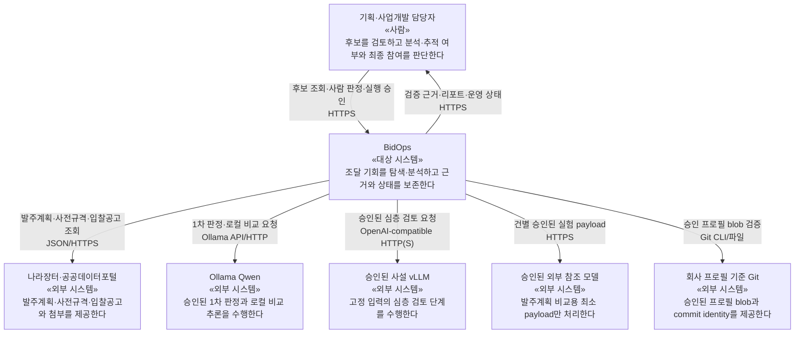
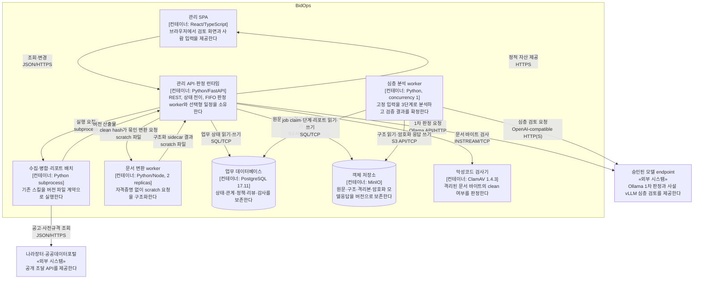

# BidOps 시스템 구성

BidOps는 나라장터의 발주계획을 조기에 탐색하고, 사전규격의 제안요청서를 근거로 사업기회를 검토한 뒤, 선택된 기회를 입찰공고까지 추적하는 사내 의사결정 지원 시스템이다. 자동 제출·발주기관 연락·최종 참여 결정은 수행하지 않는다.

## 요구와 품질 목표

주요 사용자는 기획·사업개발 담당자이며, 운영자는 격리된 실행 환경·정본 저장소·백업과 모델 연결을 관리한다. 시스템은 공개 조달 정보와 사내 판단을 결합하되 모델 판정을 사람의 승인으로 가장하지 않아야 한다.

| 우선순위 | 품질 목표 | 아키텍처 대응 |
|---|---|---|
| 1 | 근거 추적성 | 확정 사실과 숫자를 문서 위치·원문 해시·불변 입력 버전에 연결하고 결정적 검증을 통과시킨다. |
| 2 | 재현성과 불변성 | 회차·문서 묶음·프로필·정책·모델 입력·리포트를 버전으로 고정하며 정정과 재실행은 새 식별자로 남긴다. |
| 3 | 사람 통제와 안전한 실패 | 추적 선택과 최종 Go/No-Go를 분리하고, 문서·모델·검증 실패 또는 승인 없는 외부 전송은 성공으로 보정하지 않는다. |

## 제약 조건

| 제약 | 현재 적용 |
|---|---|
| 실행 환경 | 운영 이미지는 Python 3.12와 Node 22를 사용하고, PostgreSQL은 17.11 image digest에 고정한다. 프론트엔드와 Python 의존성은 lockfile로 설치한다. |
| 운영 정본 | PostgreSQL 17의 `bidops` schema와 versioned MinIO가 정본이다. SQLite는 격리 테스트와 일회성 이전 입력에만 허용한다. |
| 사용자 경계 | 자체 로그인·세션·역할 권한이 없으며 사내망 접근 제한이 현재 진입 경계다. 담당자 이름은 감사 표식이지 인증 정보가 아니다. |
| 기존 파이프라인 | 수집·병합·리포트 스킬은 내부 import가 아니라 subprocess와 `schema_version`이 있는 파일 계약으로 연결한다. |
| 시작과 일정 | 앱 startup은 migration·seed·정책 활성화·모델 호출을 수행하지 않는다. 스케줄러와 always-on은 기본 비활성이다. |
| 외부 통신 | 기본 Compose network는 내부망이고 목적별 egress overlay만 외부 통신을 연다. hosted OpenAI로 자동 fallback하지 않는다. |
| 외부 모델 자료 | 실행 단위의 payload 미리보기와 사람 승인이 있는 허용 필드만 전송한다. 제안요청서·첨부·리뷰·회사 프로필 전문은 발주계획 비교용 외부 모델에 보내지 않는다. |
| 발주계획 제품화 | 고정 3일 모집단의 키워드·BGE-M3 ColBERT·Qwen·Luna 비교와 사람 정답 보고서가 승인되기 전에는 운영 선별기를 구현·활성화하지 않는다. |

## 전체 구성

아래 두 C4 뷰는 현재 코드와 `docker-compose.t7.yml`에서 확인한 실행 경계를 보여 준다. 발주계획·사전규격 중심의 아직 구현되지 않은 흐름은 현재 컨테이너에 섞지 않고 뒤의 목표 데이터 흐름과 구현 상태에서 따로 구분한다.

### 시스템 컨텍스트(C4 1단계)



### 컨테이너 구성(C4 2단계)

기본 Compose의 네트워크는 내부망이다. 나라장터·Ollama·사설 vLLM 통신은 목적별 egress overlay와 운영자 승인이 있을 때만 열리며, 스케줄러는 별도 컨테이너가 아니라 FastAPI 프로세스 안에서 기본 비활성 상태로 존재한다.



### 목표 데이터 흐름

```text
나라장터 발주계획 API ─┐
                       ├─ 수집·정규화 ─ 선별 정책 ─ 사업기회 연결 ─ PostgreSQL
나라장터 사전규격 API ─┤                                  │
                       │                                  ├─ FastAPI ─ React 관리 화면
나라장터 입찰공고 API ─┘                                  │
                                                          ├─ MinIO 원문·구조·모델응답
                                                          └─ 실행 대기열·감사 기록

사전규격/입찰 첨부 ─ ClamAV ─ 격리 scratch ─ 문서 변환 worker ─ 구조화 문서
구조화 문서 + 고정 프로필·정책 ─ 분석 worker ─ 검증 ─ 불변 리포트 ─ 사람 의견
```

| 구성요소 | 역할 | 의존 방향과 경계 |
|---|---|---|
| `skills/bidops-collect` | 나라장터 응답 보존·정규화, 후보 신호와 감사 표본 생성 | 공개 API를 읽어 버전 있는 파일을 만든다. DB와 웹 코드를 호출하지 않는다. |
| `skills/bidops-screen` | 고정 입력과 판정 파일을 일대일 검증·병합 | 모델 호출과 DB 적재를 소유하지 않는다. 입력에 없는 판단을 만들지 않는다. |
| `skills/bidops-report` | 검증된 판정으로 HTML·호환 YAML을 결정적으로 렌더링 | 등급·준비 상태·근거를 다시 계산하지 않는다. |
| 발주계획 선별 실험 | 키워드, BGE-M3 ColBERT, Qwen, Luna를 같은 3일 입력에서 비교 | 일회성 CLI와 불변 파일 계약은 구현됐지만 웹·DB·scheduler와 연결하지 않는다. 모델 binding·사람 정답·비교 결과가 승인되기 전에는 운영 구성요소가 아니다. |
| 사업기회 연결 계층 | 발주계획·사전규격·입찰공고를 내부 사업기회로 묶음 | 공식 통합번호는 확정 관계로, 유사도 관계는 사람 확인 전 후보로만 저장한다. 아직 구현 전이다. |
| FastAPI | REST 계약, 상태 전이, 적재, 실행 대기열, 정책·감사 경계 | 스킬은 별도 프로세스와 파일로 호출하고 React에는 API만 제공한다. 회사 프로필은 승인된 구조화 항목·`unknown` projection으로 제한해야 하지만 legacy 조회 경로에는 아직 구현 격차가 있다. |
| PostgreSQL 17 | 회차·공고·판정·리뷰·정책·사업 문서·실행·감사의 정본 | `bidops` 스키마를 사용한다. SQLite는 격리 테스트와 일회성 이관 입력에만 남는다. |
| MinIO | 원문, 구조화 결과, 격리본, 암호화된 모델 응답 보존 | 목적별 버킷과 자격증명을 분리한다. DB에는 객체 위치·버전·해시를 고정한다. |
| 문서 변환 worker | HWP/HWPX/PDF 구조화 | FastAPI·ClamAV가 clean 판정과 같은 SHA-256을 묶은 뒤 넘긴 요청만, 네트워크·DB·객체 저장소 자격증명 없이 원자적 scratch에서 처리한다. |
| 분석 worker | 고정된 문서·프로필·정책으로 심층검토 수행 | 구조 읽기와 암호화된 모델응답 쓰기만 허용하며 동시성은 1이다. |
| React 관리 화면 | 탐색 후보, 검토 대기열, 리포트, 운영 상태 표시 | DB·파일·모델에 직접 접근하지 않는다. |
| 스케줄러 | 서울 시간 기준 예약과 누락 기간 회수 | 같은 DB 실행 대기열에 작업을 넣을 뿐 판정이나 모델 호출을 직접 수행하지 않는다. |

## 사업기회 수명주기

### 발주계획 조기 탐색

운영 목표는 발주계획을 매일 수집하고 월요일·목요일에 사람이 누적 후보를 검토하는 것이다. 관측 규모는 3일 약 1,200건, 1주 약 2,000건이다. 발주계획은 일반용역·기술용역을 수집하며 SW사업대상 여부로 선제 제거하지 않는다. 계획 단계의 제목·기관·예산·예정 시기는 조기 신호이지 참여 가능성의 확정 근거가 아니다.

선별 방식은 고정 3일치 입력에서 네 후보를 비교한 뒤 정한다. 원 API 응답은 한 번만 받아 모든 후보가 공유하며, 각 후보의 점수·순위·이유·버전을 함께 저장한다. 선택된 사업만 남기지 않고 탈락 기록과 감사 표본을 보존해야 누락률을 측정할 수 있다.

### 사전규격 중심 검토

사전규격은 일반용역·기술용역을 발주계획 선택 여부와 관계없이 매일 독립 수집한다. `SW사업대상`으로 선제 제거하지 않고 수집한 값을 그대로 보존해 화면 표시와 필터로만 쓴다([ADR-0024](tracking/decisions/0024-prespec-collect-all-flag-sw.md)). 발주계획은 사전규격의 필수 선행 기록이 아니므로 선택된 계획만 조회하는 경로는 전체 수집을 대신할 수 없다.

사전규격의 관련 규격서·제안요청서는 악성코드 검사와 구조화를 거친다. 저비용 선별 뒤 사람이 심층검토 실행을 승인하면 분석 worker가 요구사항·평가·자격·위험·경제성을 검토하고 결정적 검증을 통과한 초기 리포트를 만든다. 사용자는 결과를 보고 `계속 추적`, `보류`, `종료` 중 하나를 선택한다. 이 선택은 조사 비용과 추적 우선순위를 정할 뿐 최종 입찰 참여 승인이 아니다.

### 입찰공고 추적

`계속 추적` 사업에 입찰공고나 정정공고가 연결되면 사전규격 당시 문서와 공고의 금액·기간·자격·평가·제출 조건 차이를 계산한다. 중요한 변경이 있으면 새 문서 묶음과 새 심층 리포트를 만들고 이전 결과를 유지한다. 변경이 없더라도 어떤 버전끼리 비교했는지 남긴다. 최종 Go/No-Go는 담당자가 내리며 시스템은 제출이나 외부 연락으로 이어지지 않는다.

## 목표 실행 흐름

다음 흐름은 발주계획부터 입찰공고까지의 목표 생애주기이며, 구현 여부는 뒤의 현재 구현과 런타임 뷰에서 구분한다.

1. 수집기가 서울 시간 구간과 API 응답을 불변 회차로 고정한다.
2. 정규화기는 안정 외부 식별자, 원문 해시, 확인 불가 필드와 출처를 보존한다.
3. 선별 정책은 후보·점수·이유를 만들고 탈락 레코드를 삭제하지 않는다.
4. 공식 통합번호가 있으면 외부 레코드를 같은 사업기회에 연결한다. 번호가 없고 기관·사업명이 유사하면 후보 관계만 만들고 사람 확인을 기다린다.
5. 사전규격이 들어오면 발주계획 선택 여부와 무관하게 대기열에 나타난다. 사람이 심층검토를 승인하기 전에는 고비용 분석을 시작하지 않는다.
6. 문서 원문은 MinIO 격리 버킷에 저장되고 ClamAV의 clean 판정과 같은 SHA-256이 확인된 요청만 네트워크 없는 변환 worker로 전달된다.
7. 구조화 결과, 회사 프로필, 분석 정책과 모델 식별자는 시도 생성 시 고정된다. 분석 worker는 세 단계를 순서대로 실행하고 검증·근거·리포트를 같은 완료 전이에서 확정한다.
8. 입찰공고가 연결되면 새 버전을 기존 리포트와 비교한다. 기존 문서·리포트·사람 의견을 수정하지 않는다.
9. React는 API가 반환한 상태와 근거만 표시하며 사람의 추적 결정과 최종 의견을 감사 기록에 남긴다.

## 현재 구현과 목표 연결

현재 코드는 입찰공고 수집·다섯 관점 판정·보고 파일 계약, PostgreSQL 기반 관리 API, 문서 묶음·심층검토·리포트, 모델 품질 게이트와 스케줄 대기열을 제공한다. 발주계획 선별에는 동일한 3일 모집단을 동결하고 키워드·BGE-M3 ColBERT·Qwen·Luna 결과와 사람 라벨을 비교하는 일회성 실험 CLI가 생겼지만, 승인되지 않은 설정은 fail closed하고 제품 웹·DB·scheduler와 연결하지 않는다. 사업기회 연결, 사전규격 독립 수집·화면, 문서 준비 화면, 실패 단계 재시작 화면, 입찰공고 변경분 검토는 목표 흐름에 속하지만 아직 완결되지 않았다.

T7 조립의 **알려진 운영 배포 차단 조건은 2026-09-01에 전부 해소했다.** runtime image의 회사자료 포함, profile 원문·filesystem source 응답, hosted Codex 심층 payload, legacy mutation의 actor·감사 누락, 불완전 객체 restore, host-wide 관리 port, MinIO versioning fail-open이 순서대로 닫혔다. legacy 첨부는 quarantine·MIME/구조·ClamAV·source object 검증 경계와 named-volume 호환 보관을 적용했고, broad worker DB 권한은 명시적 역할·동작·컬럼 allowlist로 교체했다. 남은 것은 경계 결함이 아니라 **운영 환경 훈련**이다 — 실제 secret, MinIO allow/deny, egress firewall, backup·restore를 운영에서 아직 한 번도 검증하지 않았다.

현재 판정 실행은 `screening_execution.queue_no` 오름차순과 활성 슬롯 하나를 사용한다. 심층검토 작업은 PostgreSQL 행 잠금과 lease fence로 claim한다. 두 실행 계열은 서로의 모델 결과를 직접 수정하지 않고 버전 있는 입력·산출물과 API를 통해 연결된다.

## 구현된 런타임 뷰

### 문서 준비와 ready 묶음 확정

1. 담당자가 `우선 검토` 공고에 draft 문서 묶음을 만든다. FastAPI는 공고 row를 잠그고 이전 revision을 확인한 뒤 생성자와 감사 이벤트를 같은 DB transaction에 기록한다.
2. 업로드 바이트는 DB transaction 밖에서 MinIO quarantine namespace에 먼저 저장된다. 서버는 파일 크기·이름·경로·해시를 확인한 뒤 ClamAV INSTREAM 검사 결과를 같은 SHA-256에 묶는다.
3. clean scan envelope가 있는 요청만 `/scratch`에 원자적으로 기록된다. 네트워크와 자격증명이 없는 `document-worker`가 요청 파일을 claim하고 경로·원문 해시·scan envelope를 다시 검증한 뒤 HWP/HWPX/PDF를 구조화한다.
4. FastAPI는 sidecar의 request ID, source SHA-256, 크기와 구조 schema를 검증한다. 성공한 원문·구조·페이지 이미지는 목적별 MinIO namespace에 쓰고 객체 version·hash, 문서 계보, idempotency 결과와 안전한 감사 metadata를 PostgreSQL에 commit한다.
5. 묶음 확정 시 FastAPI는 공고 → 묶음 → 첨부 → current 문서 → 구조 순서로 잠근다. 모든 current 문서가 clean·safe이고 구조와 원문 계보가 일치할 때만 불변 `DocumentBundleItem` snapshot을 만들고 상태를 `ready`로 전이한다.

검사 불가, 악성 판정, MIME 불일치, 변환 timeout, 구조 hash 불일치와 확인 범위 누락은 blocking issue다. 이 경우 원문은 격리 상태로 보존되지만 ready 묶음과 심층 검토 입력은 만들지 않는다.

### 심층 검토와 불변 리포트

1. 담당자가 `우선 검토` 공고의 ready 묶음으로 심층 검토를 요청한다. FastAPI는 활성 profile·analysis policy, 품질 상태, bundle 계보와 provider 승인을 확인하고 입력 식별자·해시를 감사 snapshot에 고정한다.
2. 같은 공고·묶음·profile·policy 조합은 중복 생성하지 않는다. 새 검토에는 queued attempt, 하나의 work job과 `requirements_and_evaluation` → `delivery_risk_economics` → `synthesis_and_validation` 세 stage가 생성된다.
3. `analysis-worker`는 PostgreSQL `SKIP LOCKED`로 작업 하나를 claim하고 lease fence를 증가시킨 뒤 commit한다. 모델 I/O 중에는 DB transaction을 열어 두지 않으며 각 호출 전에 현재 lease를 갱신한다.
4. worker는 확인 시점의 bundle 구조, profile, policy를 복사해 고정하고 stage별 bounded slice를 승인된 vLLM에 보낸다. 각 응답 조각은 다음 호출 전에 schema·claim ID·evidence ID·원문 인용 위치 검증을 통과해야 한다.
5. 완료된 stage는 불변으로 남는다. 세 stage가 모두 끝나면 worker가 claim·evidence·validation·machine report와 감사 이벤트를 만들고, 같은 lease-fenced transaction에서 attempt·review·job을 `completed`로 전이한다.

provider 오류, schema 위반, 근거 불일치 또는 stale lease는 성공으로 보정하지 않는다. 안정 오류 코드와 실패 상태만 보존하며, 재시도는 기존 attempt를 수정하지 않고 사람이 새 attempt를 만든다.

## 배포 뷰

기준 배포는 `docker-compose.t7.yml`이며 모든 명령은 worktree별 `COMPOSE_PROJECT_NAME`으로 volume과 컨테이너를 격리한다. 아래 표는 기본 stack과 명시적 profile·overlay를 함께 보여 준다.

| 실행 단위 | network | 영속 또는 공유 경계 | 외부·권한 경계 |
|---|---|---|---|
| `web` | `database`, `storage`, `scanning` | `pipeline-data`, `pipeline-reports`, `document-scratch` | host의 웹 port를 publish한다. app DB 역할과 source·structure·quarantine 자격증명을 사용한다. |
| `document-worker` 2 replicas | `network_mode: none` | `document-scratch`만 공유 | HTTP listener, DB·MinIO·모델 자격증명이 없다. |
| `analysis-worker` | `database`, `analysis` | PostgreSQL과 MinIO structure/model-response | concurrency 1이다. 사설 vLLM은 `model-egress` overlay에서만 접근한다. |
| PostgreSQL 17.11 | 내부 `database` | `postgres-data` | owner·migrate·app·worker·ro-backup 역할을 분리하고 migration 뒤 table·operation·column allowlist를 다시 적용한다. |
| MinIO | 내부 `storage`, `analysis` | `minio-data` | source·structure write/read·quarantine·model-response별 자격증명을 분리한다. |
| ClamAV 1.4.3 | 내부 `scanning` | 정본 volume 없음 | `web`의 문서 바이트 검사만 받으며 미확인 결과는 clean이 아니다. |
| `postgres-init`, `migrate`, `minio-init` | 필요한 내부 network | 기존 DB·객체 volume | 운영자가 명시적으로 실행하는 일회성 초기화 단계이며 앱 startup이 대신하지 않는다. |
| `ro-backup`, `ops` | `backup`, `ops` profile에서만 시작 | host backup 또는 `recovery-backup` | 일상 application stack에 포함되지 않는 운영자 경계다. |

기동 순서는 PostgreSQL·MinIO·ClamAV 준비 → `postgres-init` → Alembic `migrate` → `minio-init` → `document-worker`·`web`·`analysis-worker`다. `web`의 판정 worker와 나라장터 수집은 `screening-egress`, 심층 검토 모델 호출은 `model-egress`를 별도로 추가하며, overlay만으로 목적지 제한을 보장하지 않으므로 host firewall allowlist가 함께 필요하다.

| volume | 보존 내용 | 복구 의미 |
|---|---|---|
| `postgres-data` | 업무 상태·관계·리뷰·정책·감사 | 객체 복구 뒤 DB를 복원하고 active object hash를 대조한다. |
| `minio-data` | 원문·구조·quarantine·암호화 모델 응답의 version | 정본 객체를 먼저 복원하며 source version과 target version mapping이 필요하다. |
| `pipeline-data`, `pipeline-reports` | 기존 스킬의 version 파일과 파생 보고서 | 컨테이너 재생성 뒤에도 파일 계약과 재현 이력을 유지한다. |
| `document-scratch` | 진행 중인 변환 요청·sidecar | 임시 handoff이며 정본 백업 대상이 아니다. |
| `recovery-backup` | ops profile의 복구 입력 | application runtime과 분리된 운영자 작업 공간이다. |

## 아키텍처 결정

ADR의 배경·대안·결과는 아래 원문에만 두며 이 문서에서 반복하지 않는다. 전체 상태 표는 [결정 목록](tracking/decisions/index.md)에서 관리한다.

| 번호 | 결정 | 현재 효력 |
|---|---|---|
| [0001](tracking/decisions/0001-artifact-boundary.md) | 기존 스크립트를 기준선으로 유지하고 산출물로 연결 | 채택 |
| [0002](tracking/decisions/0002-sqlite-wal.md) | 운영 저장소로 SQLite WAL 사용 | 대체됨 |
| [0003](tracking/decisions/0003-strict-producer-tolerant-importer.md) | 생성자는 엄격하게, 과거 산출물 적재기는 경고 허용 | 채택 |
| [0004](tracking/decisions/0004-admin-visual-density.md) | 관리자 화면의 여유형 RootLab 시각 체계 | 채택 |
| [0005](tracking/decisions/0005-hybrid-attachment-acquisition.md) | 첨부 확보를 기관 링크와 수동 등록의 혼합으로 구성 | 채택 |
| [0006](tracking/decisions/0006-db-review-canonical.md) | 리뷰 정본은 DB, YAML은 호환 내보내기 | 채택 |
| [0007](tracking/decisions/0007-immutable-runs.md) | 회차를 불변 스냅샷으로 보존 | 채택 |
| [0008](tracking/decisions/0008-versioned-user-policy.md) | 정책을 사용자 편집 가능한 불변 버전으로 관리 | 채택 |
| [0009](tracking/decisions/0009-name-attribution-intranet.md) | 초기 작성자 식별은 이름 입력, 파일별 권한 분리는 생략 | 채택 |
| [0010](tracking/decisions/0010-hwpx-canonical-input.md) | HWP는 헤드리스 변환한 HWPX를 분석 정본으로 사용 | 채택 |
| [0011](tracking/decisions/0011-local-qwen-openai-fallback.md) | Qwen 우선, OpenAI는 검증 실패 후 건별 승인 보조 경로 | 대체됨 |
| [0012](tracking/decisions/0012-human-governed-feedback.md) | 피드백은 변경 제안을 만들고 사람이 새 정책을 승인 | 채택 |
| [0013](tracking/decisions/0013-screening-orchestrator-boundary.md) | 판정 단계만 애플리케이션 안 오케스트레이터로 전환 | 채택 |
| [0014](tracking/decisions/0014-in-process-scheduler.md) | 정기 실행은 웹 프로세스 내부 스케줄러로 구동 | 채택 |
| [0015](tracking/decisions/0015-versioned-screening-policy.md) | 판정 기준은 불변 정책 버전을 정본으로 관리 | 채택 |
| [0016](tracking/decisions/0016-daily-run-rejudgment.md) | 일간 회차와 제한된 재판정 | 채택 |
| [0017](tracking/decisions/0017-human-enabled-quality-gate.md) | 품질 게이트 통과 후 담당자가 상시 운영을 활성화 | 채택 |
| [0018](tracking/decisions/0018-partial-artifact-on-screening-failure.md) | 판정 실패 건은 제외하고 회차를 부분 산출물로 표시 | 채택 |
| [0019](tracking/decisions/0019-screening-input-contract.md) | 판정 대상은 새 입력 계약으로 정의하고 병합기 수용 버전만 넓힘 | 채택 |
| [0020](tracking/decisions/0020-postgresql-minio-canonical.md) | PostgreSQL과 versioned MinIO를 운영 정본으로 사용 | 채택 |
| [0021](tracking/decisions/0021-filter-experiment-before-implementation.md) | 발주계획 선별은 비교 실험 후 구현 | 채택 |
| [0022](tracking/decisions/0022-plan-prespec-centered-lifecycle.md) | 발주계획과 사전규격을 중심으로 기회 생애주기를 구성 | 채택 |
| [0023](tracking/decisions/0023-company-profile-minimal-projection.md) | 회사 프로필 조회는 승인된 최소 projection만 제공 | 채택 |

## 외부 시스템 경계

| 외부 시스템 | 들어오는 값 | 나가는 값 | 실패 처리 |
|---|---|---|---|
| 나라장터·공공데이터포털 | 발주계획, 사전규격, 입찰공고, 첨부와 변경 이력 | API 인증키가 포함된 조회 요청 | 페이지별 실패를 제한 재시도하고 성공 페이지를 보존한다. 빈 응답을 0건으로 확정하기 전에 응답 상태를 확인한다. |
| Ollama `qwen3.8:27b` | 1차 판정에 허용된 공고·프로필 절 | 구조화 단계별 JSON | 태그·digest 불일치, timeout, 잘린 출력은 실패로 남기고 외부 서비스로 자동 전환하지 않는다. |
| 사설 vLLM | 승인된 구조화 문서와 고정 분석 입력 | OpenAI 호환 형식의 구조화 응답 | 허용된 단일 주소·모델 식별자가 아니면 호출 전에 중단한다. |
| 실험용 Luna·Sol | 공개 발주계획 정보와 승인된 회사 역량 요약 | 선별 후보와 참고 평가 | 건별 전송 내용 확인이 없으면 호출하지 않는다. 회사 프로필 원문·제안요청서·첨부·리뷰는 보내지 않는다. |
| ClamAV | 격리된 첨부 바이트 | 검사 판정과 원문 해시 | 검사 실패·미확인은 clean으로 취급하지 않고 변환을 시작하지 않는다. |
| Git | 승인된 역사 회사 프로필 blob | 프로필 bytes와 commit identity | 승인 commit을 찾을 수 없거나 vendored digest가 다르면 비교 실행을 만들지 않는다. |

## 저장 경계

- 실행·회차·정책·프로필·문서 묶음·리포트는 생성 뒤 제자리에서 수정하지 않는다. 재실행과 정정은 새 식별자와 관계를 만든다.
- PostgreSQL에는 업무 상태와 객체 식별자를 저장하고, 원문·구조·모델응답 바이트는 목적별 MinIO 객체로 보존한다.
- `data/runs`와 실행 파일은 기존 스킬 소비자와 재현 검증을 위한 파일 계약이다. DB가 이를 임의로 대체하거나 과거 파일을 다시 쓰지 않는다.
- scratch는 자격증명이 없는 변환 요청의 제한된 임시 경계일 뿐 정본 저장소가 아니다.
- 모델 응답은 확정 근거가 아니다. 원문 위치와 결정적 검증을 통과한 주장만 리포트의 확인 사실이 된다.

## 품질 요구

| 품질 시나리오 | 통과 조건 | 현재 근거와 상태 |
|---|---|---|
| 불변 회차 재실행 | 같은 기간·정책을 다시 처리해도 기존 원문·판정·리포트를 수정하지 않고 새 execution 또는 attempt와 계보를 만든다. | 파일·DB 계약과 idempotency fence가 구현돼 있다. 운영 데이터에서의 장기 보존 검증은 별도다. |
| 근거 추적 | 확정 claim의 문서·프로필 근거가 확인된 bundle/profile version, source SHA-256과 페이지·절·표·요구사항 ID 중 가능한 가장 구체적인 위치를 가진다. | stage·report validator가 구현돼 있다. 다양한 실제 HWP/PDF에 대한 사람 gold는 부족하다. |
| 문서 안전 실패 | ClamAV 오류·미확인·감염, MIME 불일치, 변환 실패 또는 source hash 불일치가 있으면 문서를 `safe`나 bundle `ready`로 전이하지 않는다. | Lean document와 legacy notice attachment 경계 모두 quarantine·검사 후 safe만 수용한다. legacy는 기존 schema 호환 local copy도 named volume에 둔다. |
| 모델 안전 실패 | timeout·잘림·schema·근거 검증 실패를 성공 결과로 합치거나 hosted OpenAI로 자동 fallback하지 않는다. | 1차 판정과 심층검토에 제한 재시도·실패 artifact가 있다. 실제 운영 model artifact 고정과 품질 승인은 남아 있다. |
| 단일 활성 처리 | 1차 판정은 FIFO·active slot 1·concurrency 1을 유지하고, 심층검토 worker는 concurrency 1과 lease fence로 stale owner의 완료를 막는다. | 설정·DB claim·worker startup 검사가 구현돼 있다. 운영 장시간 장애·재claim 훈련은 별도다. |
| 모델 품질 활성화 | 고정 40건에서 등급 재현성 80% 이상, 한 관점 불일치 집중 50% 이하, 유효 10건 이상일 때 `우선 검토` 10~25%, 사람 근거 동의 70% 이상, 근거 부족 10% 이하, 관점 분할 40% 이상을 모두 만족한다. | 계산·승인 gate는 정의돼 있지만 실제 40건 운영 승인은 없다. 계산 불가와 불완전 표본은 통과가 아니다. |
| 백업과 복구 | 목표 RPO 4시간·RTO 8시간 안에 versioned object → 빈 PostgreSQL → active hash 검증 순서로 복구한다. | 목표와 script 초안만 있으며 target version mapping과 실제 복구 훈련이 없어 현재는 충족을 주장할 수 없다. |

## 위험과 기술 부채

아래 항목은 운영 승격 전에 해소하거나 명시적으로 차단해야 한다. 상세 재현 조건과 접근 방법은 각 finding을 따른다.

| 위험 | 영향 | 현재 대응 |
|---|---|---|
| [개발용 Codex 심층 검토의 외부 전송 범위 초과](tracking/findings.md#개발용-codex-심층-검토-경로가-외부-전송-허용-범위를-넘는다) | RFP와 회사 profile slice가 승인 범위를 넘어 hosted provider로 전송될 수 있다. | reference overlay와 provider를 사용 금지 상태로 유지한다. |
| [런타임 이미지의 회사자료 포함](tracking/findings.md#런타임-이미지에-회사-프로필-자료가-포함된다) | registry·build cache·image export로 회사자료가 확산될 수 있다. | **해결**(A-1). 세 경로를 build context에서 막고 read-only bind mount로 주입한다. |
| [프로필 조회 API의 원문·경로 노출](tracking/findings.md#프로필-조회-api가-원문과-서버-경로를-노출한다) | 사내망 조회자에게 필요한 범위를 넘는 회사자료와 서버 배치가 노출된다. | **해결**(A-3). ADR-0023의 최소 projection으로 교체하고 승인 snapshot에 고정해 fail closed한다. |
| [legacy 첨부의 안전 경계 우회](tracking/findings.md#legacy-첨부-업로드가-악성코드-검사와-객체-격리를-우회한다) | 과거에는 검사하지 않은 파일이 다운로드 가능하고 container 재생성 때 바이트가 유실될 수 있었다. | quarantine·MIME/구조·ClamAV·source 검증 후 legacy row와 named-volume 호환 사본을 만들며, `stored_path`는 wire에서 제거했다. |
| [MinIO versioning fail-open](tracking/findings.md#minio-versioning-초기화가-실패해도-stack이-계속-기동한다) | DB가 가리키는 object version의 불변성을 보장할 수 없다. | **해결**(2026-09-01). bucket마다 enabled 상태를 되읽어 아니면 init service를 실패로 끝낸다. |
| [불완전한 객체 복구 계약](tracking/findings.md#객체-복구가-원본-version-id와-복구-대상-version-id를-혼동한다) | 정상 복구 실패와 active object 누락을 구분하지 못할 수 있다. | **해결**(A-6). source→target mapping을 기록하고 DB에서 active manifest를 생성해 일대일 대조한다. |
| [관리 port의 host-wide publish](tracking/findings.md#postgresql과-minio-관리-port가-모든-host-interface에-publish된다) | LAN에서 API 경계를 우회해 DB·객체 저장소에 접근할 수 있다. | **해결**(2026-09-01). 세 mapping이 `BIDOPS_ADMIN_BIND_HOST` 기본값 `127.0.0.1`로 bind하고 원격 관리는 opt-in이다. |
| [legacy mutation의 actor·감사 누락](tracking/findings.md#legacy-mutation-일부가-담당자-이름과-감사-기록-없이-실행된다) | 리뷰와 일부 run/subprocess mutation은 아직 변경 주체와 승인 이력을 일관되게 추적할 수 없다. | 첨부·포털·screening policy 7개 mutation은 기존 actor parser와 같은 transaction의 append-only `AuditEvent`로 편입했다. |
| [screening v3와 report renderer 단절](tracking/findings.md#현재-보고서-renderer가-screening-v3를-처리하지-못한다) | 새 판정 실행이 기존 HTML·feedback 흐름으로 이어지지 않는다. | v2 의미를 유지한 명시적 v3 adapter와 partial/failure 표시가 필요하다. |
| [모델 artifact 고정 부족](tracking/findings.md#사설-vllm-model-artifact가-불변-digest로-고정되지-않았다)·[실제 사람 gold 부족](tracking/findings.md#실제-심층-검토-품질-corpus와-사람-gold가-부족하다) | 같은 모델명이 다른 bytes를 가리키거나 Mock 결과를 실제 판단 품질로 오인할 수 있다. | image·model digest를 고정하고 승인된 실제 HWP/PDF 사람 gold로 gate를 다시 측정해야 한다. |
| [담당자 이름의 인증 부재](tracking/findings.md#담당자-이름은-신원을-증명하지-않는다) | 리뷰·정책·외부 전송 승인자의 실제 신원을 보장하지 못한다. | 현재는 사내망 경계만 신뢰하며, 외부 노출 전에 SSO subject와 역할 권한을 도입해야 한다. |

## 용어

| 용어 | 이 문서에서의 의미 |
|---|---|
| 사업기회 | 발주계획·사전규격·입찰공고가 같은 조달 목적이라고 확인된 내부 추적 단위. 유사도만 있는 관계는 사람 확인 전 후보다. |
| 등급 | 회사와 사업의 전략·기술 적합성인 `우선 검토`, `검토 권장`, `관찰 대상`, `제외`. 자격 충족 상태가 아니다. |
| 참여 준비 상태 | 입찰 자격 확인 정도인 `확인 완료`, `부분 확인 필요`, `참여 불가 확인`, `해당 없음`. 등급과 별도 축이다. |
| 심층 추적 승인 | 사전규격 분석과 입찰공고 감시를 계속하라는 사람 결정. 최종 입찰 참여 승인이 아니다. |
| Go/No-Go | 공고와 변경 조건을 검토한 뒤 담당자가 내리는 최종 입찰 참여 결정. 모델이나 추적 선택이 대신하지 않는다. |
| 회차(run) | 수집 구간·원문·정책·프롬프트·모델·프로필·생성 설정을 고정한 불변 처리 snapshot. |
| 문서 묶음(bundle) | 한 공고의 current 문서와 구조·해시·역할을 확인 시점에 고정한 심층검토 입력 snapshot. |
| 실행(execution) | 수집·판정·심층검토처럼 독립 상태와 산출물을 갖는 처리 단위. 재실행은 기존 execution을 덮지 않는다. |
| 시도(attempt) | 한 심층검토 execution 안의 실행 시도. 실패·완료 뒤 재시도는 새 attempt로 남는다. |
| claim·lease fence | worker가 PostgreSQL job 하나를 일정 시간 소유한다는 표식과 세대 번호. 이전 소유자는 fence가 바뀐 뒤 완료를 commit할 수 없다. |

---

마지막 확인: 2026-08-28 (기준 커밋 f6fe35a)
