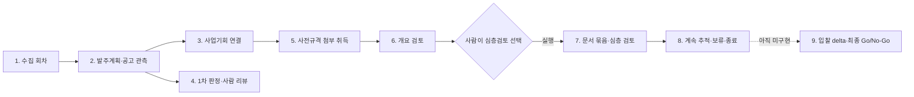

# BidOps 데이터베이스 이해하기

> 기준일: 2026-09-08
> 기준 소스: PostgreSQL 17 `bidops` 스키마, 코드의 Alembic head `0020_prespec_company_fit`, 현재 업무 계약 (운영 DB 적용 여부와 별개)
> 대상 독자: 기획·사업개발 담당자, 운영자, 처음 프로젝트를 보는 개발자

## 한 문장으로 이해하기

BidOps DB는 공고의 최신값만 모아 둔 목록이 아니라, **어떤 회차에 무엇을 보았고, 어떤 근거로 어떻게 판정했으며, 사람이 무엇을 선택했는지 되짚을 수 있게 보존하는 업무 원장**이다.

실제 첨부 파일 바이트와 큰 구조화 결과는 MinIO에 두고, PostgreSQL에는 업무 상태, 관계, 버전, 해시, 객체 위치를 저장한다.

## 먼저 알아둘 현재 기준

현재 코드의 Alembic head 기준으로 아래 업무 사전에서 설명하는 테이블은 **73개**다. PostgreSQL 자체의 Alembic 관리 테이블 `alembic_version`은 이 수에 포함하지 않는다.

기존 업무 사전의 71개에 설명형 PDF 개요와 회사 핏 이력 각 1개를 추가했다. ORM `Base.metadata`는 등록된 모든 표 **79개**를 센다. 모듈 소유 기준으로는 core 2 + lifecycle 10 + screening 28 + deep_review 39 = 79이다. 업무 사전의 수와 전체 등록 수를 구분한다.

| 구분 | 테이블 수 | 담당하는 일 |
|---|---:|---|
| 수집·사업기회 | 7 | 회차, 발주계획·공고의 누적 관측, 같은 사업의 연결 |
| 1차 판정·사람 리뷰 | 11 | 모델 판정, 근거, 반론, 확인 항목, 사람 보정과 개정 이력 |
| 첨부 취득 | 3 | 첨부 메타데이터, 다운로드 큐, 기관 포털 정보 |
| 문서 준비 | 8 | 파일 객체, 악성코드 검사, 문서 버전·구조·묶음 |
| 사전규격 개요 검토·회사 핏 | 7 | 앞부분 절단 snapshot, 모델 실행·결과·상태 전이 계보, 설명형 PDF 개요, 회사 핏 이력 |
| 문서 segment·요구사항 inventory | 3 | 결정적 segment manifest, segment, 요구사항 ID 항목 |
| 심층 검토 | 17 | 고정 입력, 단계별 분석, 주장·근거, 리포트·검증·사람 의견 |
| 판정 실행·품질·일정 | 12 | 실행 큐, 재시도, 프로필 snapshot, 품질 게이트, 정책·일정·감사 |
| 입찰 delta·최종 결정 | 5 | 문서 쌍 고정, 비교 시도, 항목·근거, 사람 Go/No-Go |
| 합계 | **73** | 업무 사전 기준, `alembic_version` 제외 |

테이블이 있다는 사실과 그 업무가 운영 가능하다는 사실은 다르다. 사전규격 개요에는 모델 worker와 검증 결과 API가 있지만 참조 실행을 운영 품질 승인으로 취급하지 않는다. `0020` 회사 핏도 기본 비활성·참조 실행 전용이다. `0015`의 입찰 delta 5개 테이블은 endpoint까지 있지만 비교 계산 worker와 모델 binding이 없어 `pending`·`running`에서 더 진행되지 않는다. **스키마의 존재**와 **워크플로우의 운영 가능 여부**를 같은 뜻으로 해석하면 안 된다.

## 핵심 개념 6가지

### 1. 회차(`run`)

한 번의 수집 또는 판정 작업을 식별한다. 언제부터 언제까지를 보았는지, 상태와 건수는 무엇인지 남긴다. 같은 외부 공고가 다음 회차에 다시 나타나도 공고 자체를 복제하지 않고 관측 이력을 추가한다.

### 2. 누적 원본과 관측(`notice`/`order_plan` + `*_observation`)

- `notice`, `order_plan`: 외부 식별자별 현재 누적 투영이다.
- `notice_observation`, `order_plan_observation`: 각 회차에서 실제로 보았던 snapshot과 변경 해시다.

예를 들어 같은 사전규격을 월요일과 화요일에 수집하면 `notice`는 한 건이고 `notice_observation`은 회차별로 두 건이 된다.

### 3. 사업기회(`opportunity`)

발주계획, 사전규격, 입찰공고가 같은 조달 목적을 가리킨다고 확인됐을 때 이를 하나로 묶는 내부 추적 단위다. 실제 연결 근거는 `opportunity_link`에 남긴다. 공식키 연결과 유사 후보 연결을 구분하며, 후보는 사람 확인 전까지 확정 관계가 아니다.

### 4. 현재값과 개정 이력

화면이 빠르게 읽는 현재값과 과거를 증명하는 이력을 분리한다.

- 현재 판정: `judgment`; 불변 이력: `judgment_revision`
- 현재 사람 리뷰: `review`; 불변 이력: `review_revision`
- 현재 개요 상태: `prespec_overview_review`; 불변 절단본: `prespec_overview_snapshot`
- 심층 리포트 이력: `report_revision`
- 사람의 심층 의견 이력: `final_opinion`

수정은 과거 행을 덮어쓰는 방식이 아니라 새 revision을 추가하는 방식이 기본이다.

### 5. 문서 버전과 묶음(`document_version`, `document_bundle`)

파일이 다시 올라오거나 변환 결과가 바뀌면 새 문서 버전을 만든다. 심층 검토를 시작할 때는 검토에 사용한 버전들을 `document_bundle`로 고정한다. 이후 최신 파일이 바뀌어도 과거 리포트가 무엇을 읽었는지 재현할 수 있다.

### 6. 사람이 고른 값과 시스템 상태

DB 안의 상태가 모두 같은 종류의 의사결정은 아니다. 특히 아래 값은 서로 대신하지 않는다.

| 값 | 뜻 | 대체할 수 없는 값 |
|---|---|---|
| 적합성 등급 | 회사와 사업의 전략·기술 적합성 | 참여 준비 상태, 추적 승인 |
| 참여 준비 상태 | 자격 확인 정도 | 적합성 등급 |
| 개요 검토 결과 | RFP 앞부분을 본 저비용 권고 | 자격 판정, 심층 추적 선택 |
| `계속 추적/보류/종료` | 사람이 고른 사업기회 추적 상태 | 최종 입찰 참여 승인 |
| 심층 `final_opinion` | 해당 리포트에 대한 사람 의견 | 최종 입찰 Go/No-Go |
| 최종 입찰 Go/No-Go | 입찰공고 시점의 사람 결정 | **현재 DB에는 아직 없음** |

## 사용자 워크플로우로 보는 DB



### 1단계. 수집 회차를 연다

중심 테이블은 `run`이다.

- 수집 기간과 시간대, 실행 상태, 입력·처리 건수를 기록한다.
- 잘못된 회차를 새 회차가 대체할 수 있지만 기존 회차를 조용히 덮지 않는다.
- 앱 시작 시 migration, seed, 정책 활성화, 모델 호출을 자동 수행하지 않는다.

운영자가 보는 의미는 “이 데이터가 어느 실행에서 왔는가?”에 대한 최상위 답이다.

### 2단계. 발주계획과 공고를 누적 관측한다

| 대상 | 현재 누적 투영 | 회차별 관측 |
|---|---|---|
| 발주계획 | `order_plan` | `order_plan_observation` |
| 사전규격·입찰공고 등 | `notice` | `notice_observation` |

`order_plan_unty_no`와 `notice_key`가 외부 식별자의 중복 저장을 막는다. 관측 테이블은 같은 대상과 같은 회차 조합을 한 번만 허용하고, snapshot schema, JSON, SHA-256을 한 묶음으로 보존한다.

사전규격은 별도 `pre_spec` 테이블이 아니라 `notice.source_type='pre_spec'`인 공고로 저장된다. 첨부 메타데이터는 `attachment`에 연결된다.

중요한 제한도 있다. 발주계획의 키워드·ColBERT·Qwen·Luna 실험 점수, 순위, 사람 정답을 운영 DB에 저장하는 제품 테이블과 API는 아직 없다. 현재 발주계획 선별 실험은 파일·CLI 경계다.

### 3단계. 같은 사업을 하나의 사업기회로 연결한다

`opportunity`가 내부 추적 단위이고 `opportunity_link`가 연결 근거다.

- `stage`: `order_plan` 또는 `notice`
- `link_type`: 공식 관계인지 후보 관계인지 구분
- `status`, `human_decision`: 확정, 확인 대기, 수락·거절 같은 상태와 사람 결정
- `external_no`: 대상 행이 아직 수집되지 않았어도 원문에 있던 공식번호를 먼저 보존

한 발주계획이나 공고는 동시에 여러 사업기회의 확정 소유 대상이 될 수 없다. 공식 관계가 뒤늦게 두 사업기회를 연결하더라도 안전한 조건에서만 병합하고, 병합된 `opportunity` 행은 삭제하지 않은 채 `merged_into_opportunity_id`로 이력을 남긴다.

제목 유사도만으로 candidate link를 자동 생성하는 완결된 앱 경로는 현재 없다. 공식키가 없으면 같은 사업이라고 추정하지 않는다.

### 4단계. 공고를 1차 판정하고 사람이 검토한다

현재 1차 판정 대상은 발주계획이 아니라 회차에서 관측된 `notice`다.

1. `screening_execution`이 실행 전체를 고정한다.
2. `screening_attempt`가 공고·단계별 성공 또는 실패를 남긴다.
3. 결과 발행 시 `judgment` 현재값과 `judgment_revision` 불변 이력이 생성된다.
4. 다섯 관점은 `perspective`, 근거는 `screening_evidence`에 저장된다.
5. 반론, 확인할 항목, 유사 실적은 각각 `counterargument`, `verification_item`, `matched_performance`에 저장된다.
6. 사람이 보정하면 `review` 현재값과 `review_revision` 새 이력이 생기고, 답변은 `verification_answer`에 저장된다.

적합성 등급은 `우선 검토/검토 권장/관찰 대상/제외`, 참여 준비 상태는 `확인 완료/부분 확인 필요/참여 불가 확인/해당 없음`이다. 두 축은 독립이다. 근거가 없으면 `unknown` 또는 `null`을 유지하며, 높은 등급만으로 자격 확인 완료를 만들지 않는다.

### 5단계. 사전규격 첨부를 안전하게 취득한다

`attachment`는 원문 첨부의 메타데이터이고, 실제 취득 작업은 `attachment_fetch`가 관리한다.

```text
attachment
  └─ attachment_fetch: 대기 → 진행 → 완료 | 차단 | 실패
                              └─ 완료 시 document_version 연결
```

다운로드 자격은 단순히 목록에 보였다는 이유로 생기지 않는다. 업무 규칙에 맞는 추적 연결과 상태를 다시 평가해 큐에 넣는다. worker는 lease와 증가하는 fence 값으로 작업 소유권을 증명하므로, 오래된 worker가 뒤늦게 성공 상태를 덮어쓰는 것을 막는다.

### 6단계. 파일을 검사·구조화하고 개요 검토를 준비한다

파일 처리 계보는 다음과 같다.

```text
attachment
  → content_object        파일 내용의 SHA-256 identity
  → content_scan          악성코드 검사 결과
  → document_version      업무상 문서 버전과 안전 상태
  → document_structure    구조화 결과의 snapshot
  → document_block        페이지·순서·locator 단위 블록
```

실제 파일 바이트는 MinIO에 있고 PostgreSQL은 object key, version, hash와 상태를 보존한다. 검사 전 파일이나 차단된 파일을 정상 문서처럼 사용하지 않는다.

사전규격의 저비용 개요 검토는 다음 다섯 테이블을 사용한다.

- `prespec_overview_review`: 공고별 현재 준비·실행 상태와 현재 snapshot 포인터
- `prespec_overview_snapshot`: 어떤 문서·구조·원문 해시의 어느 구간을 잘랐는지 기록한 불변 입력
- `prespec_overview_attempt`: 모델 실행의 순서와 불변 입력·binding, 제한된 현재 상태
- `prespec_overview_result`: 검증을 통과한 구조화 결과를 attempt당 최대 하나로 보존
- `prespec_overview_attempt_event`: `queued/running/completed/failed/cancelled` 상태 전이의 append-only 기록

`0014`는 phase 2의 DB 계보와 무결성 제약을 추가했다. attempt 입력과 binding은 생성 뒤 바꿀 수 없고, 상태 전이는 먼저 event를 남긴 뒤 허용된 방향으로만 진행되며, 검증 결과는 별도 불변 행에 한 번만 저장한다. 다만 승인된 사설 모델 binding, 실제 모델 호출·결과 검증 서비스, 새 결과 API 계약은 아직 운영 완료로 볼 수 없다. binding이 없으면 `awaiting_model`, 절단 경계가 불명확하면 `needs_human_review`에 머물러야 한다. 참고용 mock은 `reference_only`, `deployable=false`이고 운영 완료로 세지 않는다.

주의할 점은 현재 `GET /api/pre-specs/{notice_id}/overview-reviews`가 단순 조회만 하지 않는다는 것이다. 준비 가능한 clean 문서와 구조가 있으면 review와 snapshot을 생성하거나 상태를 전진시킬 수 있다.

v4 PDF 준비는 별도 `prespec_v4_pdf_snapshot` → `prespec_v4_target` →
`prespec_v4_attempt` 계보다. `0023_rhwp_snapshot`은 native rhwp 준비에 필요한
변환 HWPX(HWP만)·구조·문단/페이지 대응표의 참조를 nullable 열로 추가한다.
원문·PDF·변환 HWPX는 `source`, 구조·native page-text·대응표는 `structure` 객체이며,
`0024_section_candidates`는 같은 `structure` namespace의 절 후보(`bidops.section-candidates.v1`) 참조 세 열을 nullable로 더한다(셋이 함께 null이거나 함께 채워지고, 0024 이전 snapshot은 null로 남아 계속 재사용된다).
각 location ID가 정확한 MinIO version을 고정한다. 저장과 재사용 모두 객체 해시와
버전을 확인한다. renderer 전체 JSON의 해시와 font/config 해시가 캐시를 구분한다.
기존 문서 구조와 pages·blocks가 다르면 덮어쓰지 않고 준비를 실패시킨다.

`prespec_v4_attempt.validation_warnings`는 이후 WP-3의 경고 저장을 위한 nullable
JSONB다. 허용 상태 전이에서만 변경하며 종료된 attempt와 모든 snapshot은 불변이다.
변환 실패는 안전 코드만 attempt와 감사 로그에 남긴다. 이 migration은 기존 행을
보정하지 않으며 native 참조나 경고가 남아 있으면 downgrade를 거부한다.

### 7단계. 승인된 문서 묶음으로 심층 검토한다

사람이 심층 검토를 실행하기 전 먼저 `document_bundle`을 만든다. `document_bundle_item`은 검토할 문서 버전과 순서를 snapshot으로 고정한다.

심층 검토 계보는 다음과 같다.

```text
document_bundle + profile_version + analysis_policy_version
  → deep_review
    → deep_review_attempt
      → deep_review_stage (정확히 3단계)
        → claim ↔ evidence_ref
          → report_revision
            → validation_run → validation_check
              → final_opinion (사람 의견)
```

세 단계는 다음 값만 허용한다.

1. `requirements_and_evaluation`
2. `delivery_risk_economics`
3. `synthesis_and_validation`

`claim`은 분석 문장, `evidence_ref`는 문서나 회사 프로필의 구체적 근거 위치, `claim_evidence`는 둘의 연결이다. 리포트의 사실을 고치면 새 `report_revision`을 만들고 필요한 근거를 `report_revision_evidence`로 연결한다.

검증 실패 결과는 자동 보정하지 않는다. 사람이 실패를 인지하고 이유를 남긴 경우에만 그 상태를 명시한 `final_opinion`을 추가할 수 있다. 이 의견도 최종 입찰 Go/No-Go는 아니다.

### 8단계. 사람이 추적 상태를 선택한다

사람은 `opportunity.tracking_status`에 `미선택/계속 추적/보류/종료` 중 하나를 선택한다.

- `계속 추적`: 새 문서와 입찰공고를 계속 감시
- `보류`: 정보나 선행 조건이 부족해 결정을 미룸
- `종료`: 현재 사업기회의 능동 추적을 끝냄
- `미선택`: 아직 사람 선택이 없음

`recheck_signal`은 시스템이 다시 보라고 알리는 신호일 뿐 사람의 추적 선택이 아니다. 담당자 이름도 현재 로그인 인증값이 아니라 감사 표식이다.

### 9단계. 입찰공고 변경과 최종 결정을 다룬다 — 아직 미구현

업무 규칙에는 사전규격 대비 입찰공고의 금액, 계약기간, 참가자격, 공동수급, 평가방식, 배점, 제출물, 기한, 요구사항 변경을 비교하도록 정의되어 있다. 그러나 현재는 다음을 저장할 운영 테이블·migration·endpoint가 없다.

- 비교할 기준/대상 문서 묶음 쌍
- delta 실행과 변경·무변경·불명확·실패 결과
- 알림 전달 상태
- append-only 최종 입찰 Go/No-Go

따라서 기존 `final_opinion`이나 `tracking_status`를 최종 입찰 결정으로 재사용하면 안 된다.

## PostgreSQL과 MinIO의 역할 경계

| PostgreSQL에 저장 | MinIO에 저장 |
|---|---|
| 공고·발주계획과 회차별 관측 | 원본 첨부 파일 바이트 |
| 사업기회 연결과 사람 선택 | 완전한 문서 구조 JSON |
| 실행·재시도·검증 상태 | 격리된 의심 파일 |
| 문서 버전, object key, version ID, SHA-256 | 암호화한 모델 원응답 |
| 판정·리뷰·리포트의 불변 이력 | 용량이 큰 파생 객체 |

DB 외래키는 MinIO 객체가 실제로 존재하는지 보장할 수 없다. 복구할 때는 객체를 먼저 복원한 뒤 DB를 복원하고, 활성 객체의 version과 hash를 검증해야 한다.

## 왜 이렇게 복잡한가 — 설계 근거

순진하게 만들면 `deep_report(notice_id, summary, decision, updated_at)` 한 테이블이면 된다.
그 설계는 다음 다섯 질문에 하나도 답하지 못한다.

| 질문 | 단일 테이블의 답 |
|---|---|
| 이 보고서의 "사업 예산 12억"은 어느 파일 몇 페이지에서 나왔나 | 모름 |
| 3주 전 담당자가 승인할 때 본 보고서 내용이 무엇이었나 | 덮어써서 사라짐 |
| 그 뒤 첨부가 교체됐는데 판단은 옛날 문서 기준이었나 | 모름 |
| 같은 입력으로 다시 돌리면 같은 결과가 나오나 | 검증 불가 |
| 이 결론은 원문 근거인가 모델이 지어낸 것인가 | 구분 불가 |

공공조달은 금액이 크고 판단 근거를 나중에 소명해야 한다. **언제, 무엇을 근거로, 누가
판단했는지가 사후에 그대로 재구성되어야 한다.** `CLAUDE.md`의 강제 게이트("추정하지 않는다",
"근거는 원문 위치와 연결한다", "자동 보정하지 않는다")가 스키마 수준으로 내려온 결과가
이 테이블 수다.

### 설계를 지배하는 3원칙

**1. 불변과 추가(append-only)** — 분석 결과, 보고서, 검증, 최종 의견은 `UPDATE`하지 않는다.
수정은 새 행으로 표현한다. 수정 이력이 부가 기능이 아니라 저장 방식 그 자체다.

**2. 고정(pinning)과 스냅샷** — 분석을 시작하는 순간 입력(문서 묶음·회사 프로필·분석 정책)을
그 시점 상태로 박제한다. 이후 원본이 바뀌어도 이미 만들어진 보고서의 근거는 흔들리지 않는다.

**3. 근거 없는 주장 금지(evidence-first)** — 모델이 만든 모든 문장은 `claim` 한 행이 되고,
각 claim은 `evidence_ref`로 원문 위치를 가리켜야 한다. 근거를 못 대면 그 claim은
`unsupported`로 남아 사람에게 넘어간다. 빈칸은 지어내지 않고 `unknown`으로 남는다.

### 스키마가 규칙을 강제하는 방법

애플리케이션 코드로 검사하는 규칙은 언젠가 우회된다. 마이그레이션 스크립트, 일회성 수정
쿼리, 새로 짠 endpoint가 검사를 건너뛴다. 그래서 아래 규칙은 스키마에 넣었다.

| 기법 | 어디에 쓰였나 | 무엇을 막나 |
|---|---|---|
| Content-addressed storage | `content_object.sha256`이 정체성 | 같은 파일 중복, "이 파일이 그 파일이 맞나"의 검증 불가 |
| Snapshot / pinning | `document_bundle_item`의 `_at_confirmation` 컬럼 | 확정 이후의 원본 변경이 과거 판단을 바꾸는 것 |
| Append-only revision chain | `report_revision`이 parent를 가리킴 | 이력 소실. 델타가 아니라 전체 스냅샷이라 재구성 로직이 없다 |
| 복합 FK로 범위 강제 | `deep_review`에 `UNIQUE(id, bundle_id)`를 두고 `evidence_ref`가 `(deep_review_id, bundle_id)`로 참조 | 근거가 **다른 분석의 번들**을 가리키는 것. 확정 후 추가된 문서를 근거로 쓰는 것 |
| 부분 unique index | `work_job`의 `WHERE status IN ('queued','running')` | "진행 중인 작업은 대상당 하나". 완료 이력은 몇 개든 쌓인다 |
| Fencing token | `lease_fence` 단조 증가 정수 | 락 만료 후 좀비 worker가 옛 결과를 덮어쓰는 것 |
| Idempotency key | `(claimed_name, operation, aggregate_type, aggregate_id, request_id)` + request 해시 | 재시도가 같은 mutation을 두 번 적용하는 것 |

복합 FK는 이 설계에서 가장 독특한 부분이다. 부모에 불필요해 보이는 unique를 만들고 자식이
복합 FK로 참조하면, 범위를 벗어난 참조가 DB 수준에서 불가능해진다.
`FK(validation_run_id, validation_status_at_opinion) → validation_run(id, status)`도 같은
기법이며, 최종 의견이 기록한 검증 상태가 실제 상태와 다를 수 없게 만든다.

### 삭제 정책 — 왜 대부분 RESTRICT인가

기본값은 `RESTRICT`/`NO ACTION`이고 `CASCADE`는 두 군데뿐이다.

| 관계 | 정책 | 이유 |
|---|---|---|
| run/notice → 업무 이력 | RESTRICT | 공고를 지우면 판단 이력이 통째로 사라진다. archive만 허용 |
| judgment → 판정 detail | CASCADE | "판정 전체 교체"라는 명시적 연산일 때만 |
| review → verification_answer | CASCADE | review PUT 전체 교체일 때만 |
| attachment → document_version | SET NULL | `document_version`이 출처 스냅샷을 이미 갖고 있어 고아가 되지 않는다 |
| content/document/structure/bundle → 계보 | RESTRICT | 정본 계보는 끊지 않는다 |
| profile/policy → deep_review | RESTRICT | 분석이 참조 중인 기준을 못 지운다 |
| deep_review → attempt/claim/report | RESTRICT | 분석 산출물은 지우지 않는다 |

일반 CRUD 앱은 `CASCADE`를 편의로 쓴다. 여기서는 반대다. **삭제가 조용히 번지는 것이 가장
위험**하므로, 지우려면 자식부터 명시적으로 처리하게 만들어 지금 무엇을 지우는지 자각시킨다.

## DB가 강제하는 중요한 안전장치

### 중복과 잘못된 관계 방지

- 외부 공고 키와 발주계획 통합번호는 유일해야 한다.
- 같은 대상·같은 회차의 관측은 하나만 허용한다.
- 한 공고나 발주계획의 authoritative 사업기회 소유자는 하나만 허용한다.
- 한 첨부의 같은 문서 version과 current 문서는 중복될 수 없다.
- 문서 묶음 안의 ordinal은 중복될 수 없다.
- revision sequence와 attempt sequence는 같은 범위에서 중복될 수 없다.

### 상태와 필수값의 짝 강제

- 완료 상태면 완료 시각과 결과가 있어야 한다.
- 진행 중인 첨부 취득에는 lease 정보가 있어야 한다.
- 추적 상태를 사람이 선택했다면 작성자와 시각이 있어야 한다.
- hash는 64자리 소문자 SHA-256 형식이어야 한다.
- `reference_only` 결과는 배포 가능 상태가 될 수 없다.
- evidence는 문서 또는 프로필 중 정확히 한 출처만 가리켜야 한다.

### 불변 이력 보호

DB trigger가 다음 이력의 `UPDATE`와 `DELETE`를 거부한다.

- `judgment_revision`
- `review_revision`
- `prespec_overview_snapshot`
- `prespec_overview_result`
- `prespec_overview_attempt_event`

`prespec_overview_attempt`는 phase 2에서 전체 행 불변 대신 **입력 계보 불변 + 제한된 lifecycle 전이** 방식으로 바뀌었다. 입력 snapshot·sequence·hash·모델 binding은 수정할 수 없고, 상태는 대응하는 event가 있을 때만 `queued → running/failed/cancelled`, `running → completed/failed/cancelled`로 전이할 수 있다.

다만 `notice_observation`, `order_plan_observation`에는 동일한 append-only trigger가 없다. 특히 `run` 삭제가 외래키 cascade를 통해 관측을 간접 삭제할 수 있으므로, 불변 회차를 지키는 서비스와 운영 절차가 함께 필요하다.

## 실행 큐와 품질 통제

`screening_execution`은 전역 FIFO 순서를 갖고 동시에 활성화할 실행을 하나로 제한한다. `screening_attempt`는 단계별 시도와 실패 사유를 남긴다. 실행은 사용한 run, 정책, 회사 프로필 snapshot, 모델·prompt·generation digest를 고정하므로 결과가 어떤 입력에서 나왔는지 추적할 수 있다.

`quality_gate`는 고정 표본으로 pass A/B를 비교하고, `quality_gate_evaluation`과 `quality_gate_review`가 기계 평가와 사람 검토를 분리한다. `screening_policy`는 한 번에 하나만 활성화된다. `schedule_setting`, `schedule_reservation`, `schedule_execution`, `always_on_state`는 자동 실행 계약을 저장하지만 기본값은 비활성이다.

PostgreSQL 전용 trigger·권한·동시성 테스트는 필수 환경이 없으면 skip될 수 있다. 전체 테스트가 녹색이라는 사실만으로 운영 DB 게이트가 검증됐다고 판단하면 안 된다.

## DB 계정과 권한

이 계정들은 웹 사용자 역할이 아니라 PostgreSQL 런타임 역할이다. 현재 애플리케이션에는 로그인·RBAC가 없다.

| 역할 | 목적 | 권한 방향 |
|---|---|---|
| owner/migrate | schema와 migration 관리 | 운영 절차에서만 사용 |
| app | API 요청 처리 | 읽기와 업무별 제한된 쓰기 |
| worker | 첨부·문서·분석 작업 | worker가 맡은 테이블과 열만 갱신 |
| ro_backup | 백업·감사 조회 | 전체 읽기 전용 |

권한은 새 테이블에 자동으로 넓게 부여하지 않는 allowlist 방식이다. 새 테이블을 추가하면 역할별 `GRANT`와 권한 회귀 테스트를 함께 수정해야 한다.

## 자주 묻는 질문

### 같은 공고를 여러 번 수집하면 중복되지 않나?

공고 identity인 `notice`는 하나로 누적하고, 회차별로 `notice_observation`을 추가한다. 그래서 현재값과 과거 관측을 모두 볼 수 있다.

### 모델 판정이나 사람 리뷰를 고치면 과거가 사라지나?

화면용 현재 투영은 갱신되지만, 정본 이력은 새 `judgment_revision` 또는 `review_revision`으로 추가된다. 이전 revision은 수정·삭제할 수 없다.

### 첨부가 바뀌면 과거 리포트가 새 파일을 보게 되나?

아니다. 새 `document_version`을 만들고 새 검토에는 새 `document_bundle`을 사용한다. 기존 리포트는 당시 확정한 bundle을 계속 가리킨다.

### 정보가 없으면 어떤 값을 저장하나?

검증되지 않은 사실은 `unknown` 또는 `null`로 남긴다. 모델 추론이나 외부 상식으로 `confirmed`로 올리지 않는다.

### 데이터를 삭제해 정리하면 되지 않나?

업무 이력은 삭제보다 supersede, merge lineage, 종료 상태, 새 revision을 사용한다. 특히 회차 원본, 관측, 기존 리뷰와 검토 근거를 임의로 덮어쓰거나 삭제하면 안 된다.

### 담당자 이름은 로그인한 사용자인가?

아니다. 현재 담당자 이름은 감사 표식일 뿐 인증 결과가 아니다. 실제 로그인과 역할 기반 권한은 아직 구현 전이다.

### 근거를 페이지 번호 문자열로만 저장하면 안 되나?

`evidence_ref`가 `structure_id`까지 들고 있는 이유는 페이지 번호가 추출기 버전에 따라
달라지기 때문이다. "어떤 구조화 결과의 몇 페이지"여야 재현된다.

### 같은 공고를 두 번 분석하려는데 unique 제약에 걸린다

`unique(notice_id, bundle_id, profile_version_id, policy_version_id)`다. 입력이 정말 같으면
기존 분석을 보면 되고, 다시 돌리려면 새 **attempt**를 만든다. 문서 개정으로 새 번들이
생기거나 정책이 갱신되면 자연히 새 `deep_review`가 된다.

### OCR이 글자를 잘못 읽었는데 DB에서 고치면 안 되나?

v1에는 인앱 OCR 교정이 없다. `미확인`으로 남기거나, 담당자가 정정 파일을 **새 document
version**으로 다시 등록한다.

### 첨부 파일을 지우고 싶다

일반 업무 흐름에서 attachment를 물리 삭제하지 않는다. `retired_at`, `retired_reason`,
`retired_by_name`으로 은퇴 처리한다.

## 업무 테이블 73개 빠른 사전

### A. 수집·사업기회 7개

| 테이블 | 쉬운 설명 |
|---|---|
| `run` | 수집·판정 실행의 회차와 상태 |
| `notice` | 사전규격·입찰공고 등을 외부키별로 누적한 현재 투영 |
| `notice_observation` | 특정 회차에서 본 공고 snapshot과 변경 정보 |
| `order_plan` | 발주계획을 공식 통합번호별로 누적한 현재 투영 |
| `order_plan_observation` | 특정 회차에서 본 발주계획 snapshot과 변경 정보 |
| `opportunity` | 같은 조달 목적을 묶어 사람이 추적하는 내부 사업기회 |
| `opportunity_link` | 사업기회와 발주계획·공고의 공식 또는 후보 연결 근거 |

### B. 1차 판정·사람 리뷰 11개

| 테이블 | 쉬운 설명 |
|---|---|
| `judgment` | 공고별 현재 모델 판정 투영 |
| `judgment_revision` | 판정의 append-only 버전과 실행 계보 |
| `perspective` | 다섯 관점별 판정 내용 |
| `screening_evidence` | 관점 판정을 뒷받침하는 근거와 확실성 |
| `counterargument` | 낙관적 판정에 대한 반론 검토 |
| `verification_item` | 사람이 추가로 확인해야 할 질문 |
| `matched_performance` | 공고와 연결한 회사 수행실적 후보 |
| `review` | 공고별 현재 사람 리뷰 투영 |
| `review_revision` | 사람 리뷰의 append-only 버전 |
| `verification_answer` | 확인 항목에 대한 사람 답변 |
| `ingest_warning` | 적재 중 발생한 부분 산출물·계약 경고 |

### C. 첨부 취득 3개

| 테이블 | 쉬운 설명 |
|---|---|
| `attachment` | 공고가 제공한 첨부 메타데이터 |
| `attachment_fetch` | 첨부 다운로드·검사 큐의 상태와 lease. 자격 사유는 `sw_business_object`·`tracked_order_plan`·`both`·`priority_grade` 넷이다 |
| `agency_portal` | 기관별 원문 포털 접근 정보 |

### D. 문서 준비 8개

| 테이블 | 쉬운 설명 |
|---|---|
| `content_object` | 파일 내용 SHA-256을 기준으로 한 객체 identity |
| `content_object_location` | MinIO bucket·object key·version 같은 저장 위치 |
| `content_scan` | 악성코드 검사 결과 |
| `document_version` | 첨부와 연결된 업무상 문서 버전·안전 상태 |
| `document_structure` | 문서 구조화 결과와 구조 hash |
| `document_block` | 페이지·순서·locator 단위의 문서 블록 |
| `document_bundle` | 한 번의 심층 검토에 사용할 문서 집합 |
| `document_bundle_item` | bundle에 고정된 문서 버전과 순서 snapshot |

### D-2. 문서 segment·요구사항 inventory 3개

| 테이블 | 쉬운 설명 |
|---|---|
| `document_segment_manifest` | 문서 구조 하나에 대한 결정적 segment 판. taxonomy version·추출 규칙 hash·coverage·경고를 담는다 |
| `document_segment` | 순서가 있는 의미 단위. 분류 label, 시작·끝 위치, 요구사항 ID, 상태를 담는다 |
| `requirement_inventory_item` | 문서에서 읽어 낸 요구사항 ID 항목 |

세 표는 append-only이며 runtime role에 `SELECT`·`INSERT`만 준다. 분류는 규칙으로만 하므로
`classification_source`가 `deterministic` 고정이고 `confidence`는 항상 비어 있다. 규칙이
바뀌면 기존 행을 고치지 않고 새 행이 생긴다. 자세한 계약은
[심층 검토 ERD](deep-review-erd.md)의 8.1절이다.

### E. 사전규격 개요 검토·회사 핏 7개

| 테이블 | 쉬운 설명 |
|---|---|
| `prespec_overview_review` | 사전규격별 개요 검토의 현재 상태 |
| `prespec_overview_snapshot` | 앞부분 절단 범위와 원문·구조 hash를 고정한 입력 |
| `prespec_overview_attempt` | 개요 모델 실행의 불변 입력·binding과 제한된 lifecycle 상태. worker lease는 `lease_owner`·`lease_expires_at`에 남는다 |
| `prespec_overview_result` | 검증된 구조화 결과의 immutable payload와 digest |
| `prespec_overview_attempt_event` | attempt 상태 전이의 append-only event |
| `prespec_page_overview` | PDF 페이지 근거를 가진 설명형 개요의 불변 출력·검증 기록 |
| `prespec_company_fit_attempt` | 개요·승인 프로필·정책을 고정한 회사 핏 판정·사유·사용량 이력 |

### F. 심층 검토 17개

| 테이블 | 쉬운 설명 |
|---|---|
| `profile_version` | 분석에 사용한 회사 프로필 버전 |
| `profile_evidence` | 프로필 사실을 뒷받침하는 승인 근거 |
| `analysis_policy_version` | 심층 분석 정책·prompt의 불변 버전 |
| `deep_review` | 공고·bundle·profile·policy 조합을 고정한 심층 검토 |
| `deep_review_attempt` | 심층 검토 실행 시도 |
| `deep_review_stage` | 세 단계별 실행 상태와 결과 참조 |
| `claim` | 리포트에 들어갈 분석 주장 |
| `evidence_ref` | 문서 또는 프로필의 구체적 근거 위치 |
| `claim_evidence` | 주장과 근거의 다대다 연결 |
| `report_revision` | 기계·사람 리포트의 append-only 버전 |
| `report_revision_evidence` | 사람이 사실을 고친 revision의 근거 연결 |
| `validation_run` | 리포트 전체 검증 실행 |
| `validation_check` | 개별 검증 항목의 통과·실패 결과 |
| `final_opinion` | 특정 검증·리포트에 대한 사람의 append-only 의견 |
| `work_job` | worker가 가져가는 심층 검토 작업과 lease fence |
| `idempotency_record` | 같은 요청의 중복 실행과 충돌 방지 |
| `audit_event` | 주요 사람·서비스 변경의 안전한 감사 로그 |

### G. 판정 실행·품질·일정 12개

| 테이블 | 쉬운 설명 |
|---|---|
| `screening_execution` | 판정 실행 큐의 전체 상태와 고정 입력 digest |
| `screening_attempt` | 공고·단계별 시도와 실패 정보 |
| `company_profile_snapshot` | 실행에 사용한 회사 프로필 파일·Git 기준선 snapshot |
| `quality_gate` | pass A/B 품질 검증 단위 |
| `quality_gate_evaluation` | 품질 지표와 통과 여부 계산 결과 |
| `quality_gate_review` | 품질 게이트 근거에 대한 사람 검토 |
| `screening_policy` | 판정 정책과 품질 게이트 binding |
| `schedule_setting` | 정기 실행 시간·활성화 설정 |
| `schedule_reservation` | scheduler가 확보한 실행 예약 |
| `schedule_execution` | 예약과 실제 판정 실행의 연결 |
| `always_on_state` | always-on 단일 상태와 중지 이유 |
| `screening_audit_event` | 판정 runtime·scheduler 전용 append-only 감사 로그 |

### H. 입찰 delta·최종 결정 5개

| 테이블 | 쉬운 설명 |
|---|---|
| `bid_delta_comparison` | 비교에 쓸 문서 쌍을 정확히 고정한 불변 스냅샷 |
| `bid_delta_attempt` | 비교 계산 시도와 실패 사유 |
| `bid_delta_item` | 사전규격과 입찰공고 사이에서 달라진 항목 |
| `bid_delta_evidence` | 각 항목의 양쪽 원문 위치 |
| `bid_final_decision` | 사람의 최종 Go/No-Go, append-only |

계산 worker와 모델 binding은 아직 없다. 내부 binding을 확인할 수 없으면 API가 `503`으로 fail closed한다.

## 아직 DB에 없거나 완결되지 않은 영역

- 발주계획 선별 실험의 방식별 score·rank·reason·사람 정답을 저장하는 운영 테이블/API
- 제목·유사도 기반 candidate opportunity 연결 생성의 완결된 앱 경로
- 사전규격 overview의 **품질 측정**. 모델 실행 worker와 검증 서비스, 런타임 권한, API 계약은 구현됐으나 실행 결과에 `quality_status=unmeasured_reference|mock_reference` 표식이 붙는 참조 실행 단계다. 승인된 artifact와 사람 gold 측정이 남아 있다
- deep-review-v2의 역할별 모델 분석과 segment의 모델 보조 분류 (결정적 segment·요구사항 inventory만 `0018`에 있다)
- 입찰공고 delta의 비교 계산 worker와 모델 binding (테이블·endpoint는 `0015`에 있으나 실행 주체가 없다)
- delta 결과 알림 전달 이력
- SSO, 웹 사용자, 역할 기반 권한

테이블이 있다는 이유만으로 화면·worker·운영 절차까지 완성됐다고 해석하지 않아야 한다. 반대로 업무 규칙이나 ADR에 목표 구조가 적혀 있다는 이유만으로 현재 DB에 구현됐다고 가정해서도 안 된다.

## 원본 확인 위치

- [업무 상태와 의사결정 규칙](business-rules.md)
- [REST·파일·DB 소비자 계약](contracts.md)
- [현재 구조와 목표 데이터 흐름](ARCHITECTURE.md)
- [보안과 PostgreSQL·MinIO 경계](security.md)
- [운영·백업·복구 절차](operations.md)
- [현재 구현 상태](tracking/status.md)
- SQLAlchemy 모델: [core](../web/backend/app/core/models.py) · [lifecycle](../web/backend/app/lifecycle/models.py) · [screening](../web/backend/app/screening/models.py) · [deep_review](../web/backend/app/deep_review/models.py)
- [Alembic migration](../web/backend/alembic/versions/)
- [런타임 DB 권한 allowlist](../scripts/runtime-privileges.sql)
- [심층 검토 ERD 계약](deep-review-erd.md)

### 설명형 PDF 개요 기록 (0019)

`prespec_page_overview`는 권고 없는 새 출력의 불변 저장소다. 기존 `prespec_overview_result`의
검증 통과·권고 lifecycle 계약을 바꾸지 않는다. `document_version_id`는 공고와 복합 FK로
묶이며 `pdf_location_id`·`input_location_id`는 버전이 고정된 객체 위치를 가리킨다.
원출력 JSONB, 근거 검사와 원실행 실패 이력, 모델·정책·프롬프트·원문·PDF digest를
보존한다. 변경·삭제는 trigger로 거부하고 같은 실행·공고의 내용 변경도 적재기가 거부한다.


### 회사 핏 이력: `prespec_company_fit_attempt`

개요 뒤 회사 업무 부합 여부를 판단한 별도 실행 이력이다. migration `0020_prespec_company_fit`에서 추가한다. 페이지 개요 또는 추출형 개요 결과 하나, 그 문서, 승인 프로필, 활성 심층 정책을 FK로 묶고 핏 정책 전문/모델 바인딩/구조화 입력을 불변 JSON과 digest로 저장한다. 같은 입력은 한 번만 실행한다. queued → running → completed/failed/needs_human_review로 전이하고, queued의 오래된 입력은 failed로 닫을 수 있다. lease 만료 후 자동 재개하지 않는다. 종결 행과 입력은 DB trigger/ORM으로 보호한다. 결과·사유·사용량은 이 테이블이 정본이며 자동 준비 표시 상태는 여전히 조회 시 계산한다.
