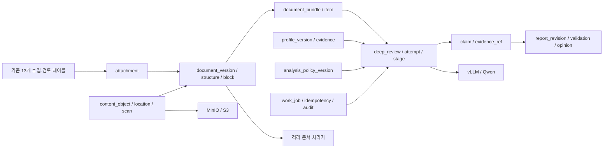
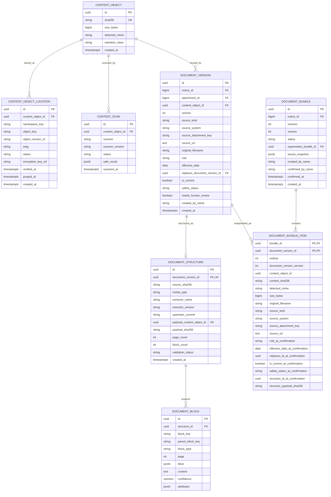
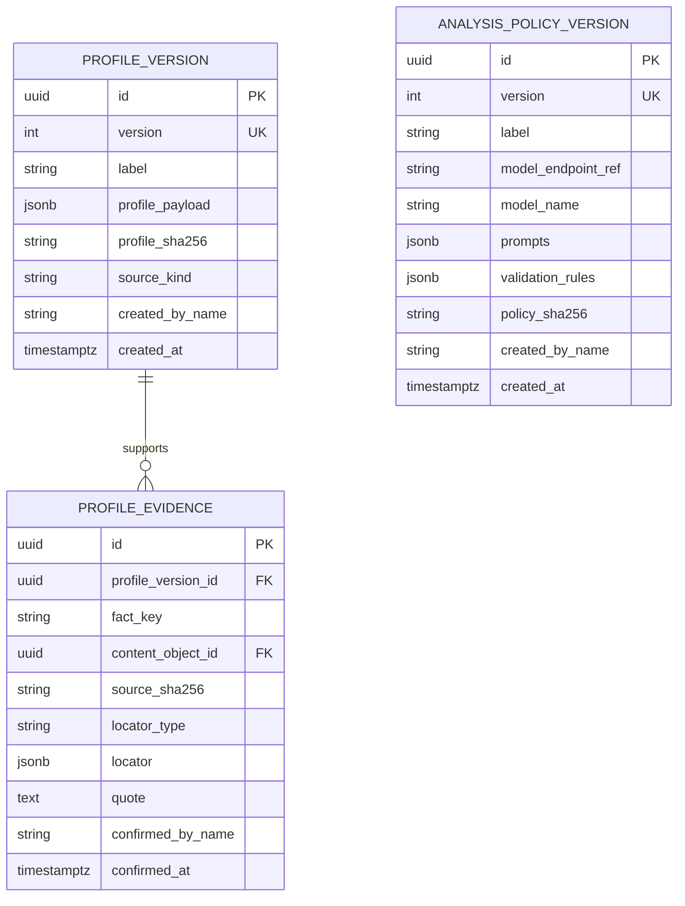
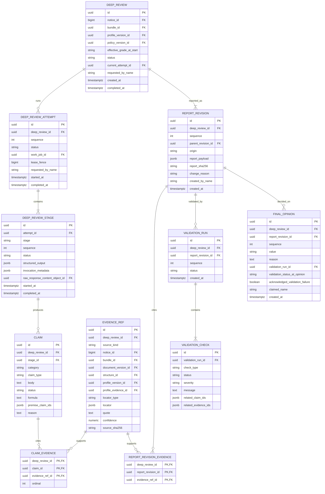
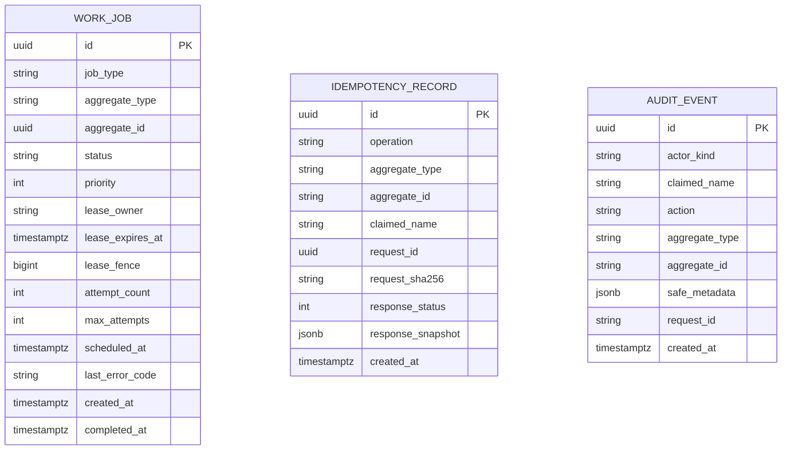

# BidOps 심층 검토 PostgreSQL ERD — Lean v1

> 상태: Lean v1 최종 승인·동결 — 구현·검증 기준 계약
> 기준일: 2026-08-25
> 대상: PostgreSQL 정본 전환, 안전한 첨부 구조화, Qwen 근거 기반 보고서

이 문서는 Lean v1의 DB 권위 계약이다. Mermaid는 관계 개요이고, 본문의 제약·이관
대조·삭제 정책이 실제 Alembic DDL의 기준이다. 기존 SQLite 컬럼은 명시적 승인 없이
폐기하지 않는다.

## 1. 축소 원칙

- PostgreSQL database `bidops`의 단일 application schema `bidops`를 사용한다. 기능별
  다중 schema와 교차 schema 권한 설계는 v1에 도입하지 않는다.
- 기존 13개 SQLite 테이블을 전량 이관하고 신규 테이블은 25개로 제한한다.
- 사람 식별은 인증되지 않은 이름 문자열뿐이다. v1에는 `actor` 테이블을 만들지 않고
  mutation 행에 `claimed_name` snapshot을 직접 저장한다.
- content bytes, 업무상 document version, 확인된 bundle, 분석 attempt와 report revision을
  분리한다. 이 구분은 재현성을 위한 핵심 경계이므로 축소하지 않는다.
- ready bundle은 확인 시점 입력 snapshot이다. 분석·보고서는 live attachment/document
  projection을 다시 읽지 않는다.
- machine output, report revision, validation, final opinion은 append-only다. 수정은 새
  revision/행으로만 표현한다.
- 원본과 전체 document structure JSON은 S3 호환 객체 저장소에 두고 PostgreSQL에는
  hash, versioned location과 근거 조회용 block projection만 둔다.
- 모든 시각은 `timestamptz`/UTC, 금액은 `numeric`, 외부 신규 ID는 UUID다. UUID는
  애플리케이션에서 생성하며 v1은 추가 PostgreSQL extension에 의존하지 않는다.
- Langfuse, SSO, 범용 retention control plane은 단계 2다. v1 분석은 이들 없이 완결된다.
- 3개 분석 stage는 업무 결과의 경계다. 각 stage 안에서는 입력을 문서·요구사항 단위의 제한된
  slice로 나누어 여러 번 호출할 수 있으며, 전체 원문을 하나의 거대 prompt로 보내지 않는다.
- v1 심층 분석 profile/policy는 배포 운영자가 import하는 설정이며 사용자 편집 기능이 아니다.
  향후 사용자 편집을 제공할 때는 관리 화면과 새 immutable version 생성을 함께 도입한다.

## 2. 규모 변화

| 구분 | 기존 확장안 | Lean v1 |
|---|---:|---:|
| 기존 SQLite 테이블 | 13 | 13 |
| 신규 테이블 | 약 53 | 25 |
| 전체 모델 엔터티 | 66 | 38 |
| 분석 단계 | 7 | 3 |
| 구현 작업 | 11 | 7 |

## 3. 전체 관계

## 4. 기존 데이터와 이름 기록

### 4.1 기존 13개 테이블

`run`, `notice`, `judgment`, `perspective`, `evidence`, `counterargument`,
`verification_item`, `matched_performance`, `attachment`, `agency_portal`, `review`,
`verification_answer`, `ingest_warning`을 전량 이관한다. 기존 `evidence`만 신규 분석
근거와 구분하기 위해 `screening_evidence`로 rename한다.

| SQLite 테이블 | PostgreSQL 처리 |
|---|---|
| `run` | integer/string PK와 모든 컬럼 유지, JSON은 `jsonb` |
| `notice` | integer PK와 분류·지역·match·raw JSON 등 모든 컬럼 유지 |
| `judgment` | `notice_pk→notice_id`, 나머지 전량 유지 |
| `perspective`, `verification_item`, `matched_performance` | 전량 유지 |
| `evidence` | `screening_evidence`로 rename, 전량 유지 |
| `counterargument` | `text→body`, 나머지 유지 |
| `review` | `notice_pk→notice_id`; `reviewer`는 `reviewer_snapshot`으로 보존 |
| `verification_answer` | review 내부 전체 교체 detail로 유지 |
| `attachment` | `url→source_url`, `stored_path→legacy_stored_path`; legacy extract 상태 원문 보존 |
| `agency_portal` | `note` 포함 전량 유지 |
| `ingest_warning` | `context_json→context_jsonb`, 나머지 유지 |

import 도구가 manifest에 없는 legacy 컬럼을 발견하면 폐기하지 않고 중단한다. integer PK를
그대로 적재한 뒤 모든 sequence에 `setval`을 적용한다.

### 4.2 이름-only attribution

- 사람 mutation은 정규화된 `claimed_name`과 작성 당시 표시 문자열을 행에 저장한다.
- 이름은 인증·권한·동일인 판별 수단이 아니다. 같은 이름을 하나의 UUID identity로
  합치지 않는다.
- worker mutation은 `actor_kind='system'`과 null `claimed_name`을 사용한다. HTTP에서
  `system`을 선택할 수 없다.
- 기존 `review.reviewer_snapshot`을 claimed name과 자동 병합하거나 재작성하지 않는다.
- 향후 SSO는 검증된 issuer/subject 기반의 새 actor를 만들고 과거 이름 행은 계속
  `미인증 이름 기록`으로 남긴다. 이름·이메일 기반 자동 병합은 금지한다.

### 4.3 attachment retirement

`attachment`에 `source_system`, `source_attachment_key`, `last_seen_at`, `retired_at`,
`retired_reason`, `retired_by_name`을 추가한다.

- provider attachment는 `source_attachment_key IS NOT NULL`일 때 partial unique
  `(notice_id, source_system, source_attachment_key)`를 사용한다.
- 수동 업로드는 파일명·URL로 deduplicate하지 않는다.
- 일반 업무 흐름에서 attachment를 물리 삭제하지 않는다.

## 5. 신규 document 모델 — 8개 테이블

핵심 규칙:

- `content_object.sha256`는 byte identity다. 같은 bytes가 여러 업무 document version에
  사용될 수 있다.
- location의 `namespace_key`는 배포 설정의 `source`, `structure`, `quarantine`,
  `model-response` namespace를 참조한다. credential/endpoint 비밀은 DB에 저장하지 않는다.
- bytes를 먼저 기록하고 다시 읽어 SHA-256/size를 검증한 뒤 location과 업무 참조를 commit한다.
- upload는 quarantine에만 쓰고 MIME/magic/archive/PDF/ClamAV 검사를 통과한 bytes를 source
  location에 새로 기록한다. v1에는 수동 안전 해제가 없다. 검사 불가·불확실은 계속 격리한다.
- bytes가 없는 provider attachment는 사용자가 입력한 임의 URL을 fetch하지 않는다. 검증된
  `source_system`별 connector가 allowlist host/TLS/redirect/DNS-IP/timeout/50 MiB 제한 아래
  기존 `source_url`을 취득해 quarantine으로만 기록한다. 취득 실패·변경·소실은 blocking
  bundle issue이며, 성공한 bytes의 hash를 기존 URL metadata와 함께 새 document version에 고정한다.
- 구조 전체 `bidops.document-structure.v1` JSON이 정본이다. `document_block`은 locator 조회
  projection이고 page metadata와 table cell 좌표는 payload 및 block `attributes`에 둔다.
- OCR 오류는 `미확인`으로 남기거나 담당자가 정정 파일을 새 document version으로 다시
  등록한다. 인앱 OCR text 수정과 별도 correction 테이블은 v1에 없다.
- bundle issue는 ready 전 계산하고 확인 시 `issues_snapshot`에 고정한다. unresolved blocking
  issue가 있으면 ready 전환을 거부한다.
- ready 전환은 bundle/document/structure를 잠근 한 트랜잭션에서 수행한다. item snapshot은
  UPDATE/DELETE하지 않고 정정은 새 version과 새 bundle을 만든다.
- `document_bundle_item`은 unique `(bundle_id, document_version_id,
  structure_id_at_confirmation)`를 가져 evidence composite FK의 기준이 된다. ready 시
  출처상 nullable인 URL·대체 ID 외 snapshot 필드는 non-null이다.
- 안전 상태가 나중에 차단되면 과거 snapshot은 바꾸지 않지만 신규 분석·원문 열람은 막고
  과거 보고서에 경고한다.

## 6. 신규 knowledge 모델 — 3개 테이블

- 기존 company profile Markdown을 최초 immutable `profile_version`으로 import한다.
- v1 profile evidence는 안전 검사를 통과한 업로드 파일만 허용한다. URL capture/SSRF 취득은
  단계 2다.
- `fact_key`는 immutable profile payload 안의 안정 key다. import/validation이 fact 존재와
  locator를 검사한 뒤 evidence를 저장한다.
- `profile_evidence`는 unique `(profile_version_id, id)`를 두어 분석 evidence가 pinned
  profile version 밖의 증빙을 참조하지 못하게 한다.
- policy prompts와 규칙은 한 immutable JSON payload로 저장한다. prompt별 테이블과 activation
  event/pointer는 만들지 않는다.
- active profile/policy ID는 배포 설정으로 지정한다. 분석 생성 시 존재·hash를 확인해
  `deep_review`에 고정한다.
- v1에는 profile/policy 생성·복제·활성화 웹 UI/API가 없다. 변경은 검증된 server import CLI와
  새 immutable version으로만 수행한다.
- import 후보는 고정 표본에서 필수 항목 재현율 80% 이상, 사람 판정 일치율 70% 이상,
  근거 부족 오판율 10% 이하를 충족해야 active ID로 지정할 수 있다. 측정 결과와 표본 hash는
  policy payload의 검증 metadata에 포함한다.
- 이는 v1 심층 분석 기준을 사용자 편집 대상으로 노출하지 않는 범위 결정이다. 향후 UI에서
  편집하게 되면 저장 시 기존 행을 수정하지 않고 새 policy version을 생성해야 한다.

## 7. 신규 analysis 모델 — 11개 테이블

핵심 제약:

- unique `deep_review(notice_id, bundle_id, profile_version_id, policy_version_id)`.
- `deep_review`에는 unique `(id, notice_id)`, `(id, bundle_id)`, `(id, profile_version_id)`를
  두어 evidence scope composite FK의 기준으로 사용한다.
- 한 deep review의 `queued|running` attempt는 partial unique로 하나만 허용한다.
- `current_attempt_id`는 `(deep_review_id, attempt_id)` 복합 FK로 같은 review 소속만 허용한다.
- attempt는 unique `(deep_review_id, sequence)`, stage는 unique `(attempt_id, stage)`와
  unique `(attempt_id, sequence)`를 사용한다.
- 분석 단계는 `requirements_and_evaluation`, `delivery_risk_economics`,
  `synthesis_and_validation` 3개다. stage별 model request/response hash, token, latency, error는
  `invocation_metadata`에 검증된 형태로 저장한다.
- 하나의 stage는 동일한 stage 행 아래 여러 bounded invocation을 가질 수 있다.
  `invocation_metadata`는 invocation별 input slice hash, model/prompt hash, token, latency와
  오류를 배열로 보존한다. 요구사항 ID와 locator는 결정적으로 먼저 고정하고 slice별 결과를
  schema 검증 후 병합한다. 3단계를 3개의 거대 prompt로 구현해서는 안 된다.
- raw model response는 암호화된 ephemeral object로 최대 90일 보존하고 stage의 response hash,
  structured output과 실행 metadata는 계속 남긴다.
- fact는 evidence 필수, calculation은 식과 입력 근거 필수, inference는 같은 review의
  premise claim ID와 근거 필수다. premise JSON은 저장 전에 cycle/소속을 검증한다.
- evidence는 source-kind check union을 사용한다. document이면 bundle/document/structure가
  non-null이고 profile 필드는 null, profile이면 profile version/evidence가 non-null이고
  document 필드는 null이다.
- document evidence는 `(deep_review_id, bundle_id) → deep_review(id, bundle_id)`와
  `(bundle_id, document_version_id, structure_id) → document_bundle_item(...)` 복합 FK로
  ready snapshot 범위를 강제한다.
- profile evidence는 `(deep_review_id, profile_version_id) → deep_review(id,
  profile_version_id)`와 `(profile_version_id, profile_evidence_id) → profile_evidence(...)`
  복합 FK로 pinned profile 범위를 강제한다.
- claim/evidence 및 report/evidence join은 `deep_review_id`를 포함한 복합 FK를 사용한다.
- 최초 machine report도 `report_revision(origin='machine')`의 완전한 immutable JSON snapshot이다.
  사람 수정은 parent를 가리키는 새 `origin='human'` full snapshot이다. delta overlay 합성은 없다.
- report revision은 unique `(deep_review_id, sequence)`와 unique `(deep_review_id, id)`를
  사용한다. machine origin은 `created_by_name`이 null, human origin은 non-null이고 parent와
  change reason이 필수라는 check를 둔다.
- factual change는 reason과 evidence link가 필요하고 새 validation run을 만든다.
- validation check의 관련 ID 배열은 write 시 같은 review 소속을 검증한다. 진단용 관계를 위한
  별도 join table은 만들지 않는다.
- system recommendation은 `추진 검토|조건부 추진 검토|보류|검토 종료`이고, 이와 분리된
  final opinion은 `추진|조건부 추진|보류|검토 종료`다. final opinion은 실제 validation run/status snapshot과
  sequence를 고정한다. unique `(validation_run.id, status)`와 composite FK
  `(validation_run_id, validation_status_at_opinion)`으로 실제 상태 일치를 강제하고 validation
  실패면 acknowledgement와 reason이 DB check로 필수다.

## 8. 신규 ops 모델 — 3개 테이블

- idempotency는 upload/bundle confirm/deep review create·retry/report revision/final opinion처럼
  재실행 피해가 있는 mutation에만 적용한다. record는 v1에서 자동 purge하지 않는다.
- idempotency unique scope는 `(claimed_name, operation, aggregate_type, aggregate_id,
  request_id)`이며 request hash는 canonical metadata와 upload byte hash를 포함한다. response
  snapshot에는 원문 bytes나 비밀을 넣지 않는다.
- active job partial unique `(job_type, aggregate_type, aggregate_id) WHERE status IN
  ('queued','running')`을 둔다.
- worker는 짧은 `FOR UPDATE SKIP LOCKED` claim과 증가하는 `lease_fence`를 사용한다. stage/report
  저장은 현재 job/owner/fence가 일치하는 조건부 SQL로만 수행한다. 전용 DB stored function과
  복잡한 결과 테이블 권한 회수는 v1에 넣지 않는다.
- job 전이는 별도 event 테이블 대신 `audit_event`에 안전한 상태 metadata로 기록한다.
- DB role은 `bidops_owner`/migration, `bidops_app`, `bidops_worker`, `bidops_ro_backup` 네 경계로
  제한한다.

## 8.1 결정적 문서 segment 저장소 — 신규 3개 테이블 (`0018`)

[ADR-0051](tracking/decisions/0051-deep-review-v2-deterministic-subset.md)이 채택한 결정적
segment·요구사항 inventory를 담는다. Lean v1 동결 이후 추가된 표이므로 §2의 규모 표에는
포함하지 않고 여기서 계약을 고정한다.

| 테이블 | 담는 것 |
|---|---|
| `document_segment_manifest` | 구조 하나에 대한 manifest. taxonomy version, extractor binding과 그 SHA-256, payload hash, inventory 요약, coverage, 경고 |
| `document_segment` | 순서가 있는 segment. taxonomy label, 시작·끝 locator, 요구사항 ID, source block key, 상태 |
| `requirement_inventory_item` | 문서에서 읽은 요구사항 ID 항목 |

계약은 다음과 같다.

- 세 표 모두 **append-only**다. runtime role에는 `SELECT`와 `INSERT`만 준다.
- FK는 `ondelete=CASCADE`이며 `(document_version_id, structure_id)` 복합 FK로 구조와 문서
  버전의 짝을 강제한다.
- manifest의 유일키는 `(structure_id, taxonomy_version, extractor_binding_sha256)`다.
- **`schema_version` 열을 두지 않는다.** 판을 표시하는 것은 `taxonomy_version`과
  `extractor_binding`이며, 규칙 표가 바뀌면 `rules_sha256`이 바뀌어 새 identity 키 = 새 row가
  된다. 기존 row를 덮어쓰는 경로가 없다.
- `document_segment.status`는 `classified|needs_human_review`, `classification_source`는
  `deterministic` 고정, `ordinal >= 1`이다. `needs_human_review`면 `confidence`는 반드시
  `NULL`이다. 실제로는 `classified`에서도 항상 `NULL`이다 — 결정적 규칙에는 확률이 없다.
- `requirement_inventory_item.ordinal >= 1`이며 ID와 locator는 구조 검사를 받는다.
- manifest는 **구조 저장 시점의 메모리 payload로만** 만든다. `document_block`에 ordinal이
  없어 사후 재구성이 불가능하므로, 이 migration 이전에 만들어진 `DocumentStructure`에는
  manifest가 없고 `GET /api/document-structures/{id}/segments`가 404다.

## 8.2 `0018`의 기존 제약 변경과 명세 이름 정정

`0018_prespec_auto_preparation_segments`는 기존 CHECK 둘을 바꾼다.

| CHECK | 이전 | 이후 |
|---|---|---|
| `attachment_fetch.ck_attachment_fetch_eligibility_reason` | `('sw_business_object','tracked_order_plan','both')` | 여기에 `'priority_grade'`를 더한다 |
| `prespec_overview_attempt.ck_prespec_overview_attempt_completed_binding` | `status <> 'completed' OR (reference_only IS FALSE AND deployable IS TRUE)` | `status <> 'completed' OR reference_only IS FALSE` |

둘째 변경의 뜻은 **품질을 아직 재지 않은 실제 모델 실행(`deployable=false`,
`reference_only=false`)도 `completed`가 될 수 있고, mock 참조 실행(`reference_only=true`)만
완료를 막는다**는 것이다. 상태 전이 trigger는 그대로 둔다.

**명세 이름 정정.** 이 변경을 요구한 명세(§7·§6.3)는 대상 CHECK를
`ck_prespec_overview_attempt_completion`으로 **이름으로** 지목했다. 그 CHECK는 실제로는
status·시각·result 참조의 생애주기 불변식이고, "완료는 배포 가능 binding만"을 강제하던 것은
`ck_prespec_overview_attempt_completed_binding`이다. 명세가 인용한 새 본문의 모양도 후자의
것이다. `..._completion`을 그 본문으로 바꾸면 §7이 건드리지 말라고 한 생애주기 불변식이
사라진다. 따라서 **이름이 아니라 인용된 본문을 정본으로 읽어** `..._completed_binding`을
교체했다. 이 정정은 migration 파일 머리주석에도 같은 내용으로 남아 있다.

또한 `prespec_overview_attempt`에 nullable `lease_owner`(varchar 255)와
`lease_expires_at`(timestamptz)이 추가된다. worker의 column-scoped UPDATE 허용 열은
`status`·`started_at`·`completed_at`·`result_id`·`lease_owner`·`lease_expires_at` 여섯이다.
lease 길이는 환경변수가 아니라 모듈 상수 1,200초다.

**downgrade는 조용히 데이터를 잃지 않는다.** `priority_grade` 자격 행,
`deployable=false`인 완료 attempt, 세 segment 표의 행 중 하나라도 있으면 추정 보정 없이
거부한다.

개요 attempt와 암호화된 원응답 사이에는 직접 FK가 없다. 원응답은 `ContentObject`와
`ContentObjectLocation('model-response')`로 저장되고, 대조는 감사 이벤트의
`response_sha256`으로 한다. 명세가 이 표에 두 열만 허용했으므로 이번 범위에서 FK를 만들지
않았다.

## 9. FK 삭제와 불변 정책

기본 FK는 `RESTRICT`/`NO ACTION`이다.

| 부모 → 자식 | 정책 |
|---|---|
| run/notice → 업무 이력 | `RESTRICT`; archive만 허용 |
| judgment → 판정 내부 detail | 명시적 전체 교체에만 `CASCADE` |
| review → verification answer | review PUT 전체 교체에만 `CASCADE` |
| attachment → document version | `SET NULL`; document version이 출처 snapshot 보유 |
| content/document/structure/bundle → 정본 계보 | `RESTRICT` |
| profile/policy → deep review/evidence | `RESTRICT` |
| deep review → attempt/claim/report/validation/opinion | `RESTRICT` |

ready item, profile/policy version, claim/evidence, report revision, validation과 final opinion은
일반 앱 서비스에서 UPDATE/DELETE하지 않는다. 초기에는 복잡한 table별 grant보다 서비스
경계·DDL check/unique/FK와 회귀 테스트로 강제하고, 실제 위반 위험이 확인되면 제한 trigger나
세분 role을 추가한다.

## 10. SQLite 이관과 컷오버

1. 쓰기를 중단하고 SQLite backup API snapshot과 attachment file manifest를 만든다.
2. PostgreSQL `migration_staging`에 원시 행, import batch와 hash를 멱등 적재한다.
3. 저장 파일의 실제 SHA-256/size를 계산한다. URL-only, missing-file을 구분한다.
4. 모든 legacy 컬럼, row count, PK/FK, reviewer snapshot, file 존재·size·hash를 대조한다.
5. 성공 batch만 한 트랜잭션에서 `bidops` schema로 승격하고 sequence를 보정한다.
6. read-only 표본 검증 뒤 PostgreSQL 쓰기를 연다.
7. PostgreSQL 쓰기 개방 후 뒤처진 SQLite로 단순 rollback하지 않는다. pre-cutover backup
   복원 또는 forward fix를 사용한다.

URL-only provider attachment는 migration 성공과 별개로 남길 수 있지만 ready bundle에는 넣을
수 없다. T3의 allowlist connector로 bytes를 취득·검사한 뒤 document version을 만들며, source가
소실되면 담당자가 대체 원문을 등록하거나 attachment를 명시적으로 retired 처리하기 전까지
공고의 준비 완료를 차단한다.

## 11. Lean v1 백업·보존

- RPO 4시간, RTO 8시간을 초기 목표로 한다. 실제 pilot 복구시간과 업무 손실 허용치를
  확인한 뒤 강화한다.
- PostgreSQL은 매일 full base backup과 연속 WAL archive를 사용한다. source/structure 객체는
  최소 4시간 간격으로 version-aware 독립 저장소에 복사한다.
- 복구점 manifest는 외부 backup 도구가 관리한다. 애플리케이션 DB에 backup checkpoint나
  restore drill 테이블을 만들지 않는다.
- backup repository는 live MinIO와 다른 host/credential/장애 도메인에 둔다. 객체를 먼저
  복원한 뒤 PostgreSQL을 복원하고 active location SHA-256을 검증한다.
- 보존은 일별 14일, 주별 8주, 월별 6개월이다. production 전 1회, 이후 분기별로 격리된
  전체 restore drill을 수행한다.
- backup lag은 운영 alert로 처리한다. v1 애플리케이션이 backup 상태 때문에 모든 mutation을
  자동 차단하지 않는다.
- 정본 공고·원문·bundle·structure·profile/policy·report·opinion은 자동 삭제하지 않는다.
  범용 purge/hold 엔진은 만들지 않는다.
- 암호화 모델 원응답 90일은 `bidops-model-response` lifecycle, 선택적 Langfuse trace 보존은
  Langfuse 자체 정책으로 관리한다. 모델 원응답 기간은
  `BIDOPS_MODEL_RESPONSE_RETENTION_DAYS`, backup 보존은 외부 backup 설정으로 변경하며
  일반 앱 API를 만들지 않는다.

## 12. PostgreSQL·용량 기준

- PostgreSQL 17의 검증한 current minor/image digest를 고정한다. v1 필수 extension은 없다.
- 초기 검색은 B-tree/partial/expression index와 제한된 `ILIKE`만 사용한다. `pg_trgm`,
  vector/한국어 전문 검색과 partitioning은 실측 후 검토한다.
- 계획 부하는 월 100 notices, 800 document versions, 32,000 pages, 약 960,000 blocks다.
- 시작 기준은 PostgreSQL 4 vCPU/16 GiB/암호화 NVMe 200 GiB, MinIO usable 1 TiB다.
- import 예상 사용량이 가용 공간 70%를 넘으면 cutover를 막는다. disk free 30% 미만,
  block 2천만 행 또는 핵심 query p95 500 ms 초과 시 증설·인덱스·partitioning을 재평가한다.

## 13. 단계 2로 명시적으로 연기

- Langfuse self-host stack과 trace UI
- profile/policy 생성·복제·활성화 관리 UI와 activation event
- profile URL capture와 SSRF fetcher
- 수동 malware release
- 인앱 OCR text correction
- deep review 간 claim diff와 사람 수정 가져오기
- 범용 retention purge/hold control plane
- backup checkpoint/restore drill DB control plane
- SSO identity/attribution link schema
- 한국어 전문검색, vector 검색, table-cell 별도 projection과 partitioning

이 목록은 v1 구현자가 편의상 선구현하지 않는다. 실제 사용 요구와 별도 승인 뒤 새 migration과
명세로 추가한다.

## 14. 결정 상태

Lean v1 축소안은 기존 P0 무결성 경계를 유지하면서 운영·미래 기능을 단계 2로 분리했다.
사용자가 2026-08-25 최종 승인했으며 기준선 ID는
`bidops-deep-review-lean-v1-2026-08-25`다. 미결정 설계 항목은 없다. 이 문서를 포함한 승인
설계 기준선은 commit `d5941c7`에 보존되어 있다. 이후 변경은 문서와 migration 영향을 함께
검토하는 새 승인 대상으로 취급한다.
