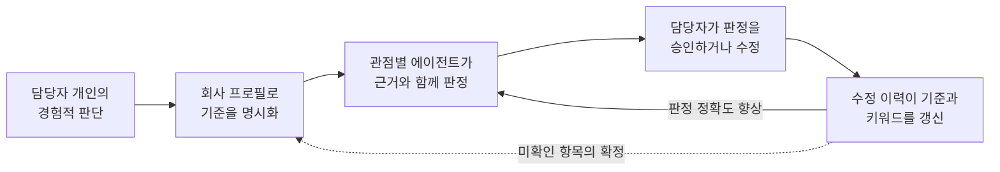
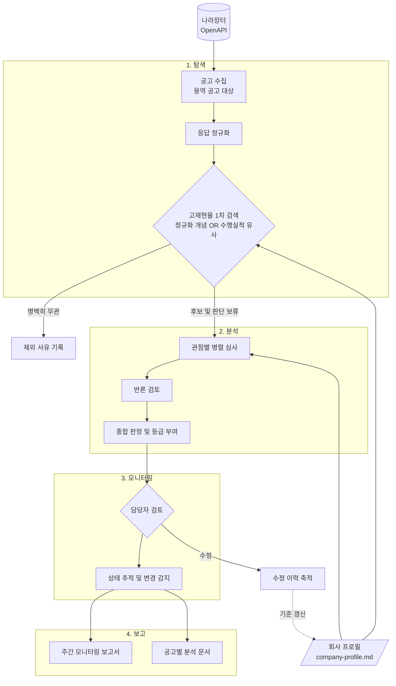
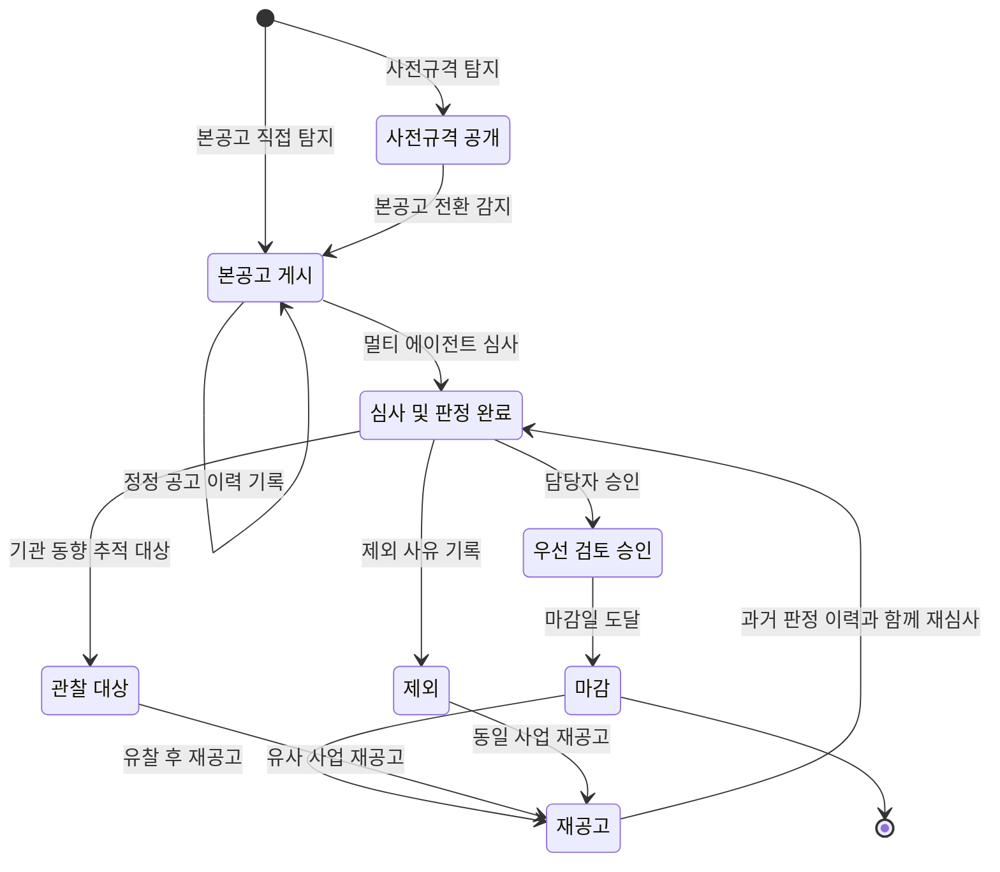
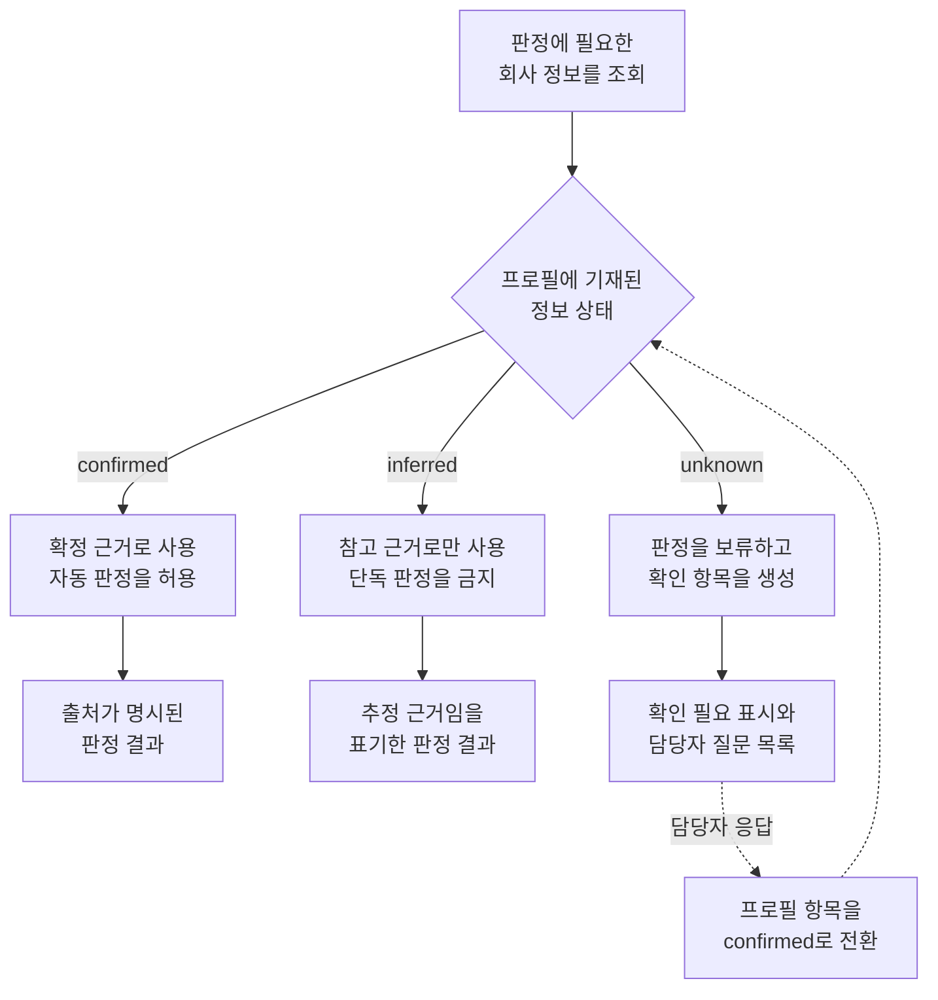
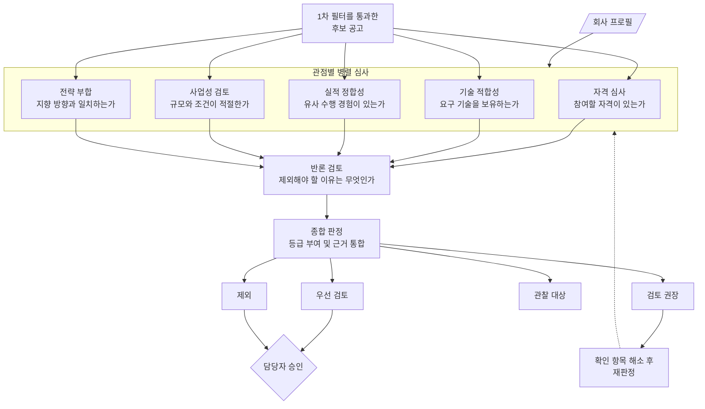
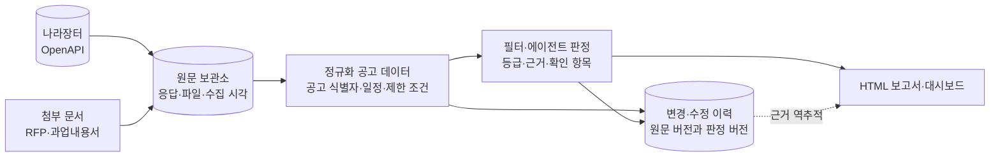
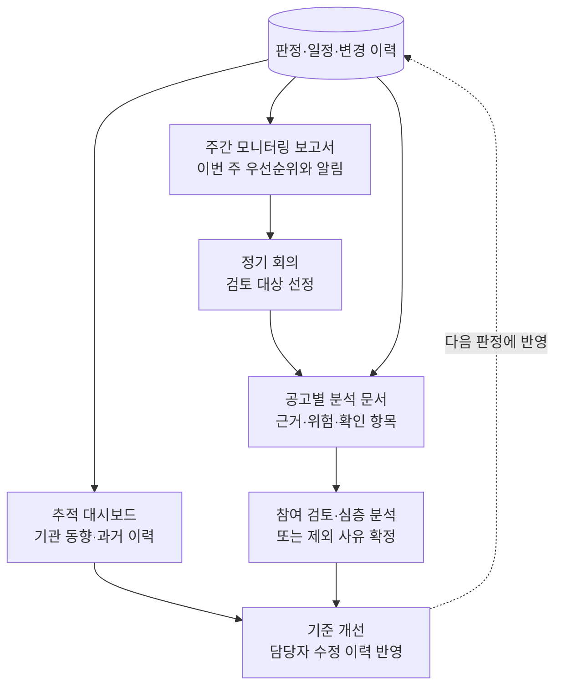
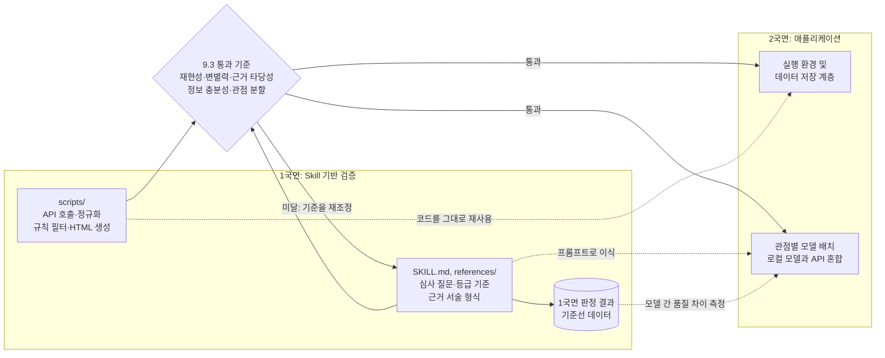
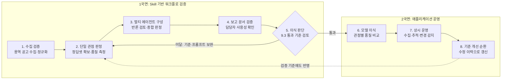

# BidOps Agent 프로젝트 개요 (보관본)

> 회사 프로필을 판정 기준으로 삼아 나라장터 공고를 상시 탐색하고, 멀티 에이전트가 적합성을 다각도로 분석하며, 기획부가 바로 사용할 수 있는 보고 문서를 생성하는 사업기회 모니터링 시스템

| 항목 | 내용 |
|---|---|
| 문서 버전 | v0.1 |
| 작성일 | 2026-08-24 |
| 대상 조직 | 주식회사 루트랩 (대구광역시, 임직원 58명) |
| 주 사용자 | 기획부 사업기획 담당자 |
| 기준 데이터 | `docs/reference/company-profile.md`, 나라장터 공개 입찰정보 |
| 선행 문서 | `AX_reaserch/public_si_bidops_agent_project_proposal.md` (v0.1, 2026-08-20) |

---

## 0. 한 문장 정의

**BidOps Agent는 회사의 역량·실적·제약 정보를 판정 기준으로 정형화하고, 나라장터에 공개되는 입찰 정보를 상시 수집하여, 회사가 참여를 검토할 가치가 있는 공고를 근거와 함께 선별하고 추적하는 사내 AX 시스템이다.**

---

## 1. 선행 제안서와의 관계

선행 제안서는 "담당자가 이미 선택한 공고 한 건"을 입력으로 받아 요구사항을 추출하고 참여 자격을 검증하는 심층 검토 도구를 정의했다. 그러나 실제 기획 업무에서 시간이 가장 많이 소모되는 지점은 그 앞 단계, 즉 매일 올라오는 수백 건의 공고 가운데 검토할 대상을 고르는 작업이다.

따라서 이번 프로젝트는 범위를 다음과 같이 재조정한다.

| 구분 | 선행 제안서 | BidOps Agent |
|---|---|---|
| 입력 | 담당자가 선택한 RFP 1건 | 나라장터에 공개되는 전체 공고 흐름 |
| 회사 정보의 역할 | 검토 과정에서 참조하는 자료 | 자동 판정을 수행하는 기준 데이터 |
| 처리 방식 | 단일 워크플로의 순차 처리 | 관점별 멀티 에이전트의 병렬 심사 |
| 핵심 질문 | "이 공고의 요구사항은 무엇인가" | "어떤 공고를 봐야 하며, 왜 봐야 하는가" |
| 시간 축 | 단발성 검토 | 사전규격부터 마감까지 상시 추적 |
| 산출물 | 입찰 검토 패키지 | 모니터링 보고서 및 공고별 분석 문서 |

선행 제안서에서 정의한 요구사항 추출과 자격 검증 기능은 폐기하지 않는다. BidOps Agent가 선별한 공고에 대해 이후 단계에서 수행하는 심층 분석 모듈로 재배치한다.

---

## 2. 문제 정의

### 2.1 업무 가설

기획부가 사업기회를 확보하는 과정에는 다음과 같은 병목이 존재한다고 가정한다.

| 병목 | 발생하는 문제 |
|---|---|
| 공고가 매일 대량으로 게시된다 | 담당자가 검색 키워드에 의존하므로, 표현이 다른 공고를 놓친다 |
| 공고 제목만으로는 과업 내용을 알 수 없다 | 제안요청서를 열어봐야 판단이 가능하므로 확인 비용이 크다 |
| 적합성 판단이 담당자의 경험에 의존한다 | 판단 근거가 기록되지 않아 조직 자산으로 축적되지 않는다 |
| 사전규격 공개 단계를 놓치기 쉽다 | 본공고가 나온 뒤에 인지하면 제안 준비 기간이 부족해진다 |
| 검토했으나 참여하지 않은 공고가 기록되지 않는다 | 유사 공고가 재공고될 때 같은 검토를 반복한다 |
| 판단 결과를 공유할 문서를 수작업으로 작성한다 | 정리 작업 자체가 별도의 업무 부담이 된다 |

### 2.2 AX 관점에서의 재정의

이 프로젝트의 목표는 공고 검색 화면에 요약 기능을 덧붙이는 것이 아니다. 담당자의 머릿속에 있던 판단 기준을 회사 프로필이라는 형태로 외부화하고, 그 기준에 따른 판정과 근거를 데이터로 축적하여, 기준 자체를 지속적으로 개선하는 순환 구조를 만드는 것이 목표이다.

---

## 3. 시스템 흐름

전체 시스템은 네 개의 단계로 구성한다.

### 3.1 탐색 단계

나라장터에 공개되는 입찰 정보를 정기적으로 수집하고, 명백히 무관한 공고를 규칙으로 제거하여 분석 대상 후보를 만든다.

- 수집 대상은 용역 공고를 기본으로 하며, 물품 및 공사 공고는 초기 범위에서 제외한다.
- 수집 주기는 1일 1회 이상으로 설정하고, 사전규격 공개 정보를 함께 수집한다.
- 1차 검색은 LLM을 사용하지 않고 재현 가능한 규칙으로 수행한다. Unicode·대소문자·구분자를 정규화한 한영 개념 일치와 회사소개서 41–46페이지 수행실적 사업명 유사도를 병렬로 계산한다.
- 전략 개념 또는 수행실적 유사 신호 중 하나만 있어도 후보군에 포함한다. 규칙 검색의 목적은 최종 적합성 판정이 아니라 분석 후보 회수이므로, 판정이 모호한 공고는 제거하지 않고 다음 단계로 넘긴다.
- 예산, 지역, 참가자격, 수행실적의 법적 인정 여부는 확인되지 않은 상태에서 1차 제외 조건으로 사용하지 않는다.

### 3.2 분석 단계

1차 필터를 통과한 공고를 대상으로 관점별 에이전트가 병렬로 심사한다. 상세 구성은 5장에서 설명한다.

### 3.3 모니터링 단계

공고를 단건의 판정 대상이 아니라 시간에 따라 상태가 변하는 추적 대상으로 관리한다.

| 추적 항목 | 내용 |
|---|---|
| 사전규격 전환 | 사전규격으로 공개된 사업이 본공고로 게시되는 시점을 감지한다 |
| 마감 임박 | 참가등록 및 제안서 제출 마감이 근접한 공고를 알린다 |
| 공고 정정 | 예산, 과업 범위, 자격 요건이 변경된 이력을 기록한다 |
| 유찰 및 재공고 | 이전에 검토한 사업이 재공고되면 과거 판정 이력을 함께 제시한다 |
| 관심 기관 동향 | 반복 수행 경험이 있는 기관의 신규 공고를 별도로 표시한다 |

공고 하나가 시스템 안에서 거치는 상태 변화는 다음과 같다.

사전규격에서 본공고로 전환되는 경로와, 제외 또는 관찰 상태에서 재공고를 거쳐 재심사로 돌아오는 경로가 이 단계의 핵심이다. 두 경로가 없으면 시스템은 매번 처음 보는 공고를 판정하는 도구에 머무른다.

### 3.4 보고 단계

분석과 모니터링 결과를 기획부가 그대로 사용할 수 있는 문서로 생성한다. 산출물은 7장에서 정의한다.

---

## 4. 회사 프로필의 활용 방식

`company-profile.md`는 이 시스템에서 단순한 참고 자료가 아니라 판정 규칙의 원천이다. 이 문서가 각 정보에 `confirmed`, `inferred`, `unknown`이라는 상태를 부여하고 있다는 점이 설계상 매우 중요하다.

### 4.1 정보 상태에 따른 판정 신뢰도

| 프로필 상태 | 판정에서의 취급 | 결과 표기 |
|---|---|---|
| `confirmed` | 확정 근거로 사용하며 자동 판정을 허용한다 | 근거 문장에 출처를 명시한다 |
| `inferred` | 참고 근거로만 사용하며 단독으로 판정하지 않는다 | 추정에 근거한 판단임을 표기한다 |
| `unknown` | 판정하지 않고 담당자 확인 항목으로 분류한다 | "확인 필요"로 표시하고 질문을 생성한다 |

이 원칙에 따라 시스템은 알 수 없는 정보를 추측으로 채우지 않는다. 예를 들어 선호 예산 범위가 `unknown`이므로, 예산 규모를 이유로 공고를 자동 제외하지 않고 담당자에게 확인을 요청한다.

### 4.2 프로필의 진화

현재 프로필의 6장에는 확인이 필요한 항목이 20개 기재되어 있다. 이 가운데 시스템 운영에 반드시 필요한 항목은 8장에서 별도로 정리한다. 담당자가 판정을 수정할 때마다 그 사유를 수집하여, `unknown` 항목을 점진적으로 확정 정보로 전환하는 것을 운영 목표로 삼는다.

---

## 5. 멀티 에이전트 구성

회사 프로필의 구조를 그대로 심사 관점으로 대응시킨다. 각 에이전트는 서로 다른 질문에 답하며, 독립적으로 판정과 근거를 산출한다.

| 에이전트 | 담당 질문 | 주요 참조 정보 | 판정 방식 |
|---|---|---|---|
| 자격 심사 | 참여할 자격이 있는가 | 인증 현황, 조달 자격, 지역 제한 | 규칙 우선, LLM은 조항 추출만 담당 |
| 기술 적합성 | 요구 기술을 보유하고 있는가 | 2.1 보유 기술, 2.2 수행 가능 역할 | LLM 기반 의미 매칭 |
| 실적 정합성 | 유사 사업 수행 경험이 있는가 | 2.4 대표 수행실적, 3.2 반복 수행 기관 | LLM 기반 유사도 판단 |
| 사업성 검토 | 수행할 만한 규모와 조건인가 | 3.3 사업 규모 참고정보, 5장 참여 제약 | 규칙과 LLM의 혼합 |
| 전략 부합 | 회사가 지향하는 방향과 맞는가 | 4.1 관심 분야, 4.7 신규 진출 영역 | LLM 기반 판단, 추정 정보임을 명시 |
| 반론 검토 | 이 공고를 제외해야 할 이유는 무엇인가 | 위 다섯 에이전트의 판정 결과 | 다른 에이전트의 결론을 입력으로 받는 검증 단계 |
| 종합 판정 | 최종 등급과 권고 사항은 무엇인가 | 전체 판정과 반론 | 가중 합산 및 근거 통합 |

### 5.1 반론 검토 에이전트를 두는 이유

LLM 기반 적합성 판정은 긍정적 근거를 우선적으로 찾아내는 경향이 있으므로, 부적합 사유를 적극적으로 탐색하는 별도의 검증 단계가 필요하다. 이 에이전트는 다른 에이전트의 판정을 입력으로 받아 다음을 확인한다.

- 근거로 제시된 실적이 실제로 요구 과업과 대응되는지 확인한다.
- 프로필에서 `inferred` 상태인 정보가 확정 근거처럼 사용되지 않았는지 검사한다.
- 자격 요건 가운데 확인되지 않은 항목이 누락된 채 통과 판정이 내려졌는지 점검한다.

### 5.2 판정 등급과 참여 준비 상태

종합 판정은 **사업 기회로서의 등급**과 **참여 준비 상태**라는 두 축을 각각 부여하며, 등급과 무관하게 판단 근거를 반드시 함께 기록한다. 두 축을 분리하는 이유는 4.1절의 정보 상태 원칙에서 곧바로 따라 나온다. 회사 프로필에 `unknown` 항목이 많은 동안에는 자격 확인이 끝나지 않은 상태가 정상이므로, 확인이 남았다는 이유로 등급을 낮추면 좋은 기회가 매번 하위 등급으로 밀려난다.

| 등급 | 의미 | 후속 조치 |
|---|---|---|
| 우선 검토 | 우선 축 가운데 하나에 강하게 부합하며 확인된 결격 사유가 없다 | 제안요청서 심층 분석을 즉시 진행한다 |
| 검토 권장 | 참여 가능성이 있으나 공고 문면만으로는 근거가 약하거나 혼재한다 | 담당자가 확인 항목을 해소한 뒤 재판정한다 |
| 관찰 대상 | 현재는 적합하지 않으나 유사 사업이 반복될 가능성이 있다 | 기관 동향 추적 목록에 추가한다 |
| 제외 | 사업 영역이 명확히 다르거나 결격 사유가 확인되었다 | 제외 사유 구분과 함께 기록하고 재공고 시 참조한다 |

| 참여 준비 상태 | 의미 |
|---|---|
| 확인 완료 | 참여를 막는 미확인 항목이 남아 있지 않다 |
| 부분 확인 필요 | 참여 가능성은 있으나 확인해야 할 조건이 남아 있다 |
| 참여 불가 확인 | 참여를 막는 조건이 확인되었다 |
| 해당 없음 | 제외 등급이어서 참여 준비를 판단할 대상이 아니다 |

`우선 검토`이면서 `부분 확인 필요`인 상태는 모순이 아니라 이 시스템이 가장 자주 산출하는 정상적인 결과이다. 반대로 `제외` 등급에는 `확인 완료`를 부여하지 않는다. 검토하지 않기로 한 공고에 확인 완료를 표시하면 확인을 마쳐 참여할 수 있다는 뜻으로 읽히기 때문이다.

### 5.3 사람의 개입 지점

시스템은 판정을 자동으로 확정하지 않는다. 담당자의 승인이 필요한 지점을 다음과 같이 유지한다.

- 우선 검토 등급의 확정은 담당자의 승인을 거친다.
- 제외 등급의 판정 가운데 자격 미달이 아닌 사유는 담당자가 검토한다.
- 담당자의 수정 내용과 사유는 모두 기록하여 기준 개선에 사용한다.

---

## 6. 데이터 소스

### 6.1 나라장터 공개 정보

| 항목 | 내용 |
|---|---|
| 제공처 | 공공데이터포털의 조달청 나라장터 입찰공고정보서비스 |
| 접근 방식 | OpenAPI (인증키 발급 필요) |
| 기준 오퍼레이션 | 용역 입찰공고 목록 조회 (`getBidPblancListInfoServc`) |
| 제공 정보 | 공고 목록, 공고 상세, 기초금액, 면허 제한, 지역 제한, 공고 변경 이력 |

업무 구분(물품, 용역, 공사, 외자)마다 오퍼레이션이 분리되어 있으므로, 대상 공고의 업무 구분에 맞는 오퍼레이션을 사용해야 한다. 초기 범위에서는 용역 공고를 대상으로 한다.

### 6.2 데이터 수집 원칙

- 화면 크롤링이 아니라 공식 OpenAPI를 우선적으로 사용한다.
- 첨부 문서(제안요청서, 과업내용서)는 API가 목록 정보만 제공하므로, 파일 확보 방식은 별도로 설계한다.
- 첨부 문서의 형식은 HWP, HWPX, PDF가 혼재하므로 파싱 난이도가 높다. 이 부분은 심층 분석 단계의 과제로 분리한다.
- 수집한 원문과 판정 결과를 함께 보관하여, 판정 근거를 원문에서 다시 확인할 수 있도록 한다.

원문, 정규화 데이터, 판정 결과, 보고서는 공고 식별자를 중심으로 연결해 보관한다. 이 연결이 있어야 보고서의 한 문장을 원문 공고와 당시의 판정 기준까지 되짚어 확인할 수 있다.

### 6.3 회사 정보

- `docs/reference/company-profile.md`를 단일 기준 문서로 사용한다.
- 회사소개서 원본 PDF는 근거 확인 용도로 함께 보관한다.
- 내부 영업 정보와 고객 정보는 이 시스템에서 다루지 않는다.

---

## 7. 산출물

### 7.1 주간 모니터링 보고서 (HTML)

기획부가 정기 회의에서 사용하는 것을 목적으로 하는 문서이다.

- 이번 주에 새로 탐지된 공고의 등급별 요약을 제시한다.
- 우선 검토 등급 공고의 핵심 근거를 간략히 제시한다.
- 마감이 임박한 공고와 사전규격이 본공고로 전환된 사업을 별도로 표시한다.
- 담당자의 확인이 필요한 항목을 목록으로 정리한다.

### 7.2 공고별 분석 문서 (HTML)

우선 검토 등급을 받은 공고에 대해 개별적으로 생성하는 문서이다.

- 공고의 기본 정보와 일정을 정리한다.
- 각 심사 관점의 판정 결과와 근거를 제시한다.
- 반론 검토 에이전트가 제기한 위험 요소를 함께 기재한다.
- 참여를 결정할 경우 확인해야 할 사항을 목록으로 제시한다.

### 7.3 추적 대시보드

- 관심 기관과 키워드별 공고 발생 추이를 확인한다.
- 과거 판정 이력과 담당자의 수정 내역을 조회한다.

세 산출물은 같은 판정 데이터를 서로 다른 업무 시점에 보여 준다. 주간 보고서는 회의 전 선별용, 공고별 분석 문서는 참여 판단용, 대시보드는 누적 이력 탐색용으로 사용한다.

---

## 8. 우선 확인이 필요한 정보

회사 프로필의 `unknown` 항목 가운데, 시스템 운영을 시작하기 위해 반드시 확정해야 하는 항목이다.

| 우선순위 | 확인 항목 | 필요한 이유 |
|---|---|---|
| 1 | 관심 키워드 및 명시적 제외 키워드 | 1차 규칙 필터를 구성하는 기준이다 |
| 1 | 직접생산확인증명 및 소프트웨어사업자 신고 현황 | 자격 심사의 자동 판정에 필수적이다 |
| 1 | 최소 및 최대 사업 예산 | 사업성 검토의 판단 기준이 된다 |
| 2 | 단독 수행과 컨소시엄 참여의 구분 기준 | 참여 형태에 대한 권고를 생성하는 데 필요하다 |
| 2 | 조달 등록 및 디지털서비스 마켓플레이스 등록 현황 | 특정 발주 방식의 참여 가능 여부를 결정한다 |
| 2 | 기술 분야별 실제 투입 가능 인력 | 동시 수행 가능성을 판단하는 근거가 된다 |
| 3 | 지역 우선순위 및 최대 상주 가능 인력 | 지역 제한 공고의 판정 정밀도를 높인다 |
| 3 | 2022년 이전 수행실적의 계약상 인정 범위 | 실적 요건 충족 여부의 판정에 영향을 미친다 |

1순위 항목이 확정되기 전까지는 해당 기준으로 공고를 자동 제외하지 않고, 담당자 확인 항목으로 분류하여 운영한다.

---

## 9. 구현 접근: 워크플로 선검증

### 9.1 두 국면으로 나누는 이유

이 프로젝트를 곧바로 애플리케이션으로 구현하지 않고, 먼저 Claude Code의 skill 형태로 워크플로를 구성하여 검증한 뒤에 이식한다. 그 이유는 다음과 같다.

- 판정 기준과 프롬프트는 초기에 수십 차례 수정된다. 이를 코드에 내장하면 수정할 때마다 배포와 회귀 확인이 필요하지만, skill은 마크다운 문서를 고치는 것만으로 즉시 반복할 수 있다.
- 이 프로젝트의 불확실성은 기술 구현이 아니라 판정 품질에 있다. 수집 파이프라인과 문서 생성은 구현 방법이 명확한 반면, 적합성 판단이 담당자에게 실제로 유용한 수준에 도달하는지는 시도해 보기 전에는 알 수 없다. 따라서 불확실성이 큰 부분을 먼저 검증한다.
- 에이전트를 몇 개로 나눌지, 각 관점이 실제로 서로 다른 결론을 만들어 내는지는 설계만으로 결정할 수 없다. 실제 공고에 적용해 봐야 판단할 수 있다.

### 9.2 1국면: Skill 기반 워크플로 검증

워크플로를 세 개의 skill로 분리한다. 단계별로 분리하면 각 단계를 독립적으로 반복 실행하고 개선할 수 있다.

| skill | 역할 | 산출물 |
|---|---|---|
| `bidops-collect` | 나라장터 OpenAPI 수집, 정규화, 규칙 기반 1차 필터 | 후보 공고 목록 (JSON) |
| `bidops-screen` | 관점별 서브에이전트 심사, 반론 검토, 종합 판정 | 판정 결과와 근거 (JSON) |
| `bidops-report` | 판정 결과를 보고 문서로 변환 | 모니터링 보고서 및 분석 문서 (HTML) |

각 skill 안에서 스크립트로 확정할 부분과 프롬프트로 남길 부분을 명확히 구분한다.

| 구분 | 위치 | 내용 | 이식 시 취급 |
|---|---|---|---|
| 결정적 처리 | `scripts/` | API 호출, 응답 정규화, 규칙 필터, HTML 생성 | 코드를 거의 그대로 재사용한다 |
| 판단 로직 | `SKILL.md`, `references/` | 관점별 심사 질문, 등급 판정 기준, 근거 서술 형식 | 검증된 내용을 프롬프트로 이식한다 |

이렇게 구분하면 1국면의 산출물이 곧 2국면의 구현 명세가 된다. 검증이 끝난 시점에 새로 작성해야 하는 것은 실행 환경과 데이터 저장 계층뿐이다.

### 9.3 검증 통과 기준

"워크플로가 동작했다"는 사실만으로는 이식 여부를 판단할 수 없다. 다음 다섯 가지를 명시적으로 측정한다.

| 항목 | 확인 내용 | 사전 확정 임계값 |
|---|---|---|
| 재현성 | 동일한 공고를 다른 시점에 판정했을 때 등급이 일치하는가 | 등급 일치율 80% 이상이며, 불일치가 한 관점에 절반 넘게 몰리지 않는다 |
| 변별력 | 우선 검토 등급이 전체에서 차지하는 비율이 적정한가 | 분석 표본의 10~25%. 이 구간을 벗어나면 기준을 재조정한다 |
| 근거 타당성 | 담당자가 근거를 읽고 판정에 동의하는가 | 담당자 리뷰에서 `동의` 70% 이상, `근거 부족` 10% 이하 |
| 정보 충분성 | 공고 제목과 요약만으로 판정이 가능한가 | 첨부 문서가 필요한 확인 항목의 비율을 정량화하여 다음 단계의 우선순위를 정한다 |
| 관점 분할의 타당성 | 각 에이전트가 실제로 다른 결론을 만들어 내는가 | 표본의 40% 이상에서 관점 간 판정이 갈린다. 항상 같은 판정만 내리는 관점은 통합하거나 질문을 재정의한다 |

임계값을 착수 전에 숫자로 확정해 두는 이유는, 측정을 마친 뒤에 기준을 정하면 나온 결과에 맞추어 기준을 조정하게 되기 때문이다. 상세한 측정 방법은 `docs/legacy/validation/skill-workflow-validation.md`에 기재한다.

검증에는 정답셋이 필요하다. 과거에 실제로 참여한 공고와, 검토했으나 참여하지 않은 공고를 함께 확보해야 한다. 참여한 공고만으로 구성하면 부적합 판정의 정확도를 측정할 수 없기 때문이다.

### 9.4 2국면: 애플리케이션 이식

검증을 통과한 워크플로를 로컬 LLM 또는 OpenAI API 기반의 애플리케이션으로 옮긴다.

이 단계에서 가장 주의해야 할 사항은 모델 교체에 따른 품질 변화이다. 1국면의 판정은 Claude가 수행하지만 운영 환경에서는 다른 모델이 판정하므로, 동일한 프롬프트를 사용하더라도 결과가 달라질 수 있다. 따라서 1국면에서 생성한 판정 결과와 근거를 모두 보관하여 모델 비교의 기준선으로 사용한다.

관점마다 요구되는 추론 수준이 다르므로, 모델을 일괄적으로 선택하지 않고 차등 배치한다.

| 관점 | 요구 수준 | 배치 방향 |
|---|---|---|
| 자격 심사 | 낮음. 규칙 판정이 중심이며 LLM은 조항 추출만 담당한다 | 소형 로컬 모델로 충분하다 |
| 기술 적합성, 실적 정합성 | 높음. 표현이 다른 개념 사이의 의미 매칭이 필요하다 | 로컬 중형 모델을 기준선으로 삼고 품질을 측정한다 |
| 사업성 검토, 전략 부합 | 중간. 수치 판단과 방향성 판단이 혼합된다 | 로컬 모델로 시도하고 미달 시 API를 사용한다 |
| 반론 검토, 종합 판정 | 가장 높음. 다른 판정을 검증하고 통합해야 한다 | API 사용을 우선 검토한다 |

이 차등 배치가 로컬 모델과 외부 API를 함께 사용하는 근거가 된다. 모든 판정을 API로 처리하면 비용이 과도하고, 모든 판정을 로컬 모델로 처리하면 검증 단계의 품질이 확보되지 않는다.

### 9.5 단계별 추진 계획

| 국면 | 단계 | 목표 | 완료 기준 |
|---|---|---|---|
| 1국면 | 1 | 수집 검증 | 나라장터 용역 공고를 수집하고 정규화하는 스크립트가 동작하며, 규칙 기반 1차 필터의 제거 비율을 확인한다 |
| 1국면 | 2 | 단일 관점 판정 | 기술 적합성 관점 하나만으로 판정과 근거 생성이 동작하고, 정답셋으로 품질을 측정한다 |
| 1국면 | 3 | 멀티 에이전트 구성 | 관점별 심사를 병렬로 수행하고 반론 검토와 종합 판정을 연결하며, 9.3의 다섯 항목을 측정한다 |
| 1국면 | 4 | 보고 문서 검증 | 생성된 보고서를 담당자가 검토하고, 필요한 정보와 불필요한 정보를 구분한다 |
| 전환 | 5 | 이식 판단 | 9.3의 통과 기준을 검토하여 이식 여부와 보완 사항을 결정한다 |
| 2국면 | 6 | 모델 이식 | 로컬 모델과 API를 관점별로 배치하고, 1국면의 판정 결과를 기준선으로 품질 차이를 측정한다 |
| 2국면 | 7 | 상시 운영 | 정기 수집, 상태 추적, 사전규격 전환 감지, 변경 이력 관리를 자동화한다 |
| 2국면 | 8 | 기준 개선 순환 | 담당자의 수정 이력을 수집하여 판정 기준과 키워드를 갱신한다 |

2단계에서 정답셋을 먼저 확보하는 것이 특히 중요하다. 품질 측정 수단 없이 관점을 늘리면, 판정 결과가 달라졌을 때 그 원인이 기준 변경인지 모델 편차인지 구분할 수 없기 때문이다.

---

## 10. 초기 범위에서 제외하는 사항

- 물품 및 공사 공고의 분석은 수행하지 않는다.
- 제안서 자동 작성 기능은 포함하지 않는다.
- 첨부 문서의 전문 파싱과 요구사항 추출은 선행 제안서의 심층 분석 모듈로 분리한다.
- 낙찰 가능성이나 경쟁사 동향의 예측은 수행하지 않는다.
- 내부 인사 및 회계 시스템과의 연동은 고려하지 않는다.

---

## 11. 주요 위험 요소

| 위험 | 영향 | 대응 방향 |
|---|---|---|
| 공고 제목과 요약만으로는 과업 내용의 판단이 어렵다 | 판정 정확도가 낮아진다 | 첨부 문서 확보 경로를 조기에 검증한다 |
| 회사 프로필의 `unknown` 항목이 많다 | 자동 판정 가능 범위가 제한된다 | 8장의 1순위 항목을 우선 확정한다 |
| 적합 공고의 비율이 매우 낮다 | 정답셋 구성과 품질 측정이 어렵다 | 과거 참여 이력을 정답셋의 기준으로 활용한다 |
| OpenAPI의 응답 항목이 업무 구분마다 다르다 | 정규화 로직이 복잡해진다 | 용역 공고로 범위를 한정하여 시작한다 |
| 판정 결과를 담당자가 신뢰하지 않는다 | 시스템이 사용되지 않는다 | 모든 판정에 원문 근거를 반드시 첨부한다 |
| 검증 단계와 운영 단계의 모델이 다르다 | 이식 후 판정 품질이 저하된다 | 1국면의 판정 결과를 기준선으로 보관하고 관점별로 품질 차이를 측정한다 |
| Skill 단계의 검증이 통과 기준 없이 종료된다 | 이식 여부를 판단할 근거가 없어진다 | 9.3의 다섯 항목을 착수 전에 측정 방법까지 확정한다 |
