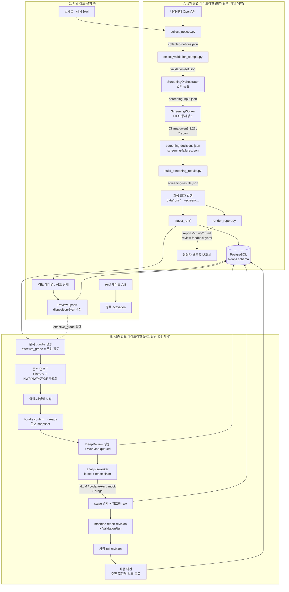

# 워크플로우 입출력 지도

- 기준일: 2026-08-27
- 대상: `web/` (FastAPI backend + React frontend)
- 확인 방법: 소스 정독 + 컨테이너에서 `pytest` 733 passed 실행

이 문서는 "어떤 기능이 무엇을 받아 무엇을 남기는가"를 한 곳에 모은다. 값의 의미와
상태 전이 규칙은 `docs/business-rules.md`, `docs/contracts.md`가 정본이며 여기서는
연결 관계만 기록한다.

---

## 1. 전체 흐름 한눈에 보기

시스템은 **두 개의 독립된 파이프라인**과 **하나의 사람 검토 축**으로 되어 있다.



핵심: **A와 B는 자동으로 이어지지 않는다.** A가 `우선 검토` 등급을 만들면 담당자가
B의 문서 준비를 *수동으로* 시작해야 한다. 이는 의도된 설계다(`CLAUDE.md`의 "최종
Go/No-Go는 담당자의 몫").

---

## 2. 파이프라인 A: 1차 선별

### A-1. 수집 (`collect`)

| 항목 | 값 |
|---|---|
| 트리거 | `POST /api/runs/{run_id}/pipeline/collect` · 스케줄러 `run_daily` |
| 실행 주체 | `PipelineService` → `python3 skills/bidops-collect/scripts/collect_notices.py` (별도 프로세스) |
| 입력 | `run.window_from`, `run.window_to`, `BIDOPS_G2B_API_KEY`, (`--from-raw` 시) 기존 `raw/` 심볼릭 링크 |
| 출력 | 새 디렉토리 `data/runs/<원본명>-rerun-<UTC>-<hex8>/collected-notices.json` (`bidops.collected.v2`) + `raw/` 원문 페이지 |
| 부수 효과 | 종료 코드 0이면 `ingest_run()` 자동 실행, 판정이 있으면 같은 window의 이전 회차를 `superseded` 처리 |
| 실패 처리 | 종료 코드 ≠ 0 → `status=failed`, 로그 라인만 메모리에 보존(재기동 시 소실) |

### A-2. 표본 선정 (`sample`)

| 항목 | 값 |
|---|---|
| 트리거 | `POST /api/runs/{run_id}/pipeline/sample` |
| 입력 | 같은 디렉토리의 `collected-notices.json` (없으면 `PipelineInputError`) |
| 출력 | `validation-set.json` (`bidops.validation-set.v2`) — `sample_role`(analysis/audit), `sample_stratum` 추가 |

### A-3. 판정 입력 동결 (`ScreeningOrchestrator`)

| 항목 | 값 |
|---|---|
| 트리거 | `POST /api/runs/{run_id}/pipeline/judgment` (202) · CLI `app.screening.cli run-one` · 품질 게이트 · 스케줄 |
| 입력 | `run_id`, scope(`single_notice`/`full_run`/`quality_sample`), `policy_version`, `profile_source`(`current` \| `git:<40hex>`), `requested_by` |
| 출력 | `data/screening-executions/<scr-32hex>/screening-input.json` (`bidops.screening-input.v1`) + `screening_execution` 행 |
| 동결 대상 | 정규화 공고(23개 허용 필드), 정책 digest, 프로필 digest, 모델명·모델 digest, `generation_config` + digest |
| 불변 조건 | enqueue 이후 환경 변수를 다시 읽지 않는다. row/입력 digest 불일치는 **모델 호출 전에** 실패 |

### A-4. 판정 실행 (`ScreeningWorker`)

전역 동시성 1, `queue_no ASC` FIFO, `active_slot=1` partial unique index로 보장.
공고 1건당 **7개 span을 순차 호출**한다.

| # | span | 입력 | 출력 |
|---:|---|---|---|
| 1–5 | 다섯 관점 (`기술 적합성`, `실적 정합성`, `공공 SI 적합성`, `사업성·자격 제약`, `전략 부합`) | 정책 allow-list가 지정한 공고 필드 + 프로필 절 | `perspective.v1` (`assessment`, `reason`, `evidence[]`) |
| 6 | `counterargument` | 투영 공고 + 다섯 관점 | `counterargument.v1` |
| 7 | `synthesis` | 투영 공고 + 관점 + 반론 | `judgment.v3` (`grade`, `readiness`, `primary_focus`, …) |

| 항목 | 값 |
|---|---|
| 모델 경계 | `OllamaClient` → `qwen3.8:27b`, `think=false`, `stream=false` |
| 산출물 | `screening-decisions.json`, `screening-failures.json`(부분 실패 시), `screening-results.json` |
| 병합 | `build_screening_results.py`를 **subprocess로** 호출 (skill 코드를 import하지 않음) |
| 발행 | `data/runs/<원본>--screen-<UTC>-<hex8>/` 로 원자적 복사 → `ingest_run()` |
| 하트비트 | 5초 주기. 60초 무응답 active row는 `중단됨`/`process_interrupted`로 회수하고 슬롯 해제 |
| 실패 처리 | 공고별 실패는 `screening-failures.json`에 격리, 전체는 부분 성공으로 진행 (ADR-018) |

### A-5. 적재 (`ingest_run`)

| 항목 | 값 |
|---|---|
| 입력 | 회차 디렉토리의 `collected-notices.json`, `validation-set.json`, `screening-results.json`, `reports/<run>/review-feedback.yaml` |
| 출력 | `run` / `notice` / `judgment` / `perspective` / `screening_evidence` / `counterargument` / `verification_item` / `matched_performance` / `attachment` / `review` / `ingest_warning` 행 |
| 계약 | 엄격 생산자 · 관대한 소비자(ADR-003). 핵심 필드(식별자·등급·준비 상태) 누락은 **적재 거부**, 비핵심 누락은 `ingest_warning` + 실제 값만 저장 |
| 멱등성 | 같은 회차 재적재는 같은 `run_id`를 만들고 기존 리뷰를 덮어쓰지 않는다 |

### A-6. 보고서 (`report`)

| 항목 | 값 |
|---|---|
| 입력 | `screening-results.json` |
| 출력 | `reports/<run>/weekly-monitoring.html` 등 + 빈 `review-feedback.yaml` (`bidops.feedback.v2`) |
| 특성 | 결정적 렌더링. 같은 입력 → 같은 바이트 |

---

## 3. 파이프라인 B: 심층 검토

### B-1. 문서 준비 (`DocumentPreparationAgent`)

| 단계 | 엔드포인트 | 입력 | 출력 |
|---|---|---|---|
| bundle 생성 | `POST /api/notices/{id}/document-bundles` | `X-BidOps-Actor-Name` | `DocumentBundle(status=draft, revision=n)`; **`effective_grade`가 `우선 검토`가 아니면 403** |
| 문서 등록 | `POST /api/document-bundles/{id}/documents` | multipart `file`, `request_id` | `ContentObject` + `ContentScan`(ClamAV) + `DocumentVersion` + `DocumentStructure`(+`DocumentBlock`) |
| 메타데이터 | `PATCH /api/document-versions/{id}` | `role`, `effective_date`, `replaces_…`, `is_current`, `version`(낙관적 잠금) | 갱신된 `DocumentVersion` |
| 확정 | `POST /api/document-bundles/{id}/confirm` | 확인 항목 | `status=ready` + `DocumentBundleItem` 불변 snapshot |

`ready` bundle은 그 시점의 `content_object_id`, `sha256`, `role`, `structure_id`를
전부 복사해 고정한다. 이후 원본 문서가 바뀌어도 이미 시작한 분석의 입력은 변하지 않는다.

### B-2. 분석 실행 (`DeepReviewAgent` + `analysis-worker`)

| 항목 | 값 |
|---|---|
| 트리거 | `POST /api/notices/{id}/deep-reviews` (202) |
| 입력 | `request_id`(멱등키), `bundle_id`, `X-BidOps-Actor-Name` |
| 고정 입력 4종 | `notice_id` + `bundle_id` + `profile_version_id` + `policy_version_id` (unique 제약) |
| 출력 | `DeepReview(status=queued)` + `DeepReviewAttempt` + `DeepReviewStage` × 3 + `WorkJob(queued)` |
| 워커 claim | `SELECT … FOR UPDATE SKIP LOCKED` + `lease_fence` 증가 + `lease_expires_at` |
| 3 stage | `requirements_and_evaluation` → `delivery_risk_economics` → `synthesis_and_validation` |
| 모델 경계 | `VllmClient`(기본) / `CodexExecClient`(건별 승인 필수) / `MockAnalysisClient`(reference mode 전용) |
| stage 출력 | `structured_output`(JSONB), `invocation_metadata`, 암호화된 raw 응답 → MinIO `model-response` 버킷 |
| 재시도 | 완료된 stage는 불변. 중단된 in-flight stage만 `queued`로 되돌림 |

### B-3. 보고서와 결정 (`DecisionAgent`)

| 단계 | 엔드포인트 | 입력 | 출력 |
|---|---|---|---|
| machine report | (워커 내부) `ReportService.materialize_machine_report` | 완료된 3 stage | `ReportRevision(origin=machine, sequence=1)` + `ValidationRun` + `ValidationCheck[]` + `Claim`/`EvidenceRef` |
| 조회 | `GET /api/deep-reviews/{id}/report` | — | `ReportView` (섹션·블록·claim·evidence·validation) |
| 근거 확인 | `GET /api/evidence/{id}` | — | 원문 위치(page/paragraph/table_cell/bbox) + 인용 |
| 사람 수정 | `POST /api/deep-reviews/{id}/report-revisions` | `base_revision_id`, `report`, `reason`, `factual_change_evidence_ids` | 새 `ReportRevision(origin=human)` + 재검증 |
| 최종 의견 | `POST /api/deep-reviews/{id}/final-opinions` | `report_revision_id`, `validation_run_id`, `value`, `reason`, `acknowledged_validation_failure` | `FinalOpinion` + `AuditEvent` |

`value`는 `추진` / `조건부 추진` / `보류` / `검토 종료`. 검증 실패 상태에서 의견을
남기려면 `acknowledged_validation_failure=true`를 명시해야 한다.

---

## 4. 축 C: 사람 검토와 운영

| 기능 | 엔드포인트 | 입력 | 출력 |
|---|---|---|---|
| 회차 목록/상세 | `GET /api/runs`, `GET /api/runs/{id}` | — | 회차 요약, 산출물 검증, 파이프라인 단계 |
| 회차 통계 | `GET /api/runs/{id}/stats` | — | 등급 분포, 준비 상태 분포, 마감 임박 |
| 검토 대기열 | `GET /api/notices?run_id=…` | 등급·준비 상태·초점·표본 역할·첨부·검색어·정렬 | 목록 (**기본값에서 `제외` 숨김**, `sample_role=analysis`) |
| 공고 상세 | `GET /api/notices/{pk}` | — | 공고 사실 + 판정 + 다섯 관점 + 반론 + 확인 항목 |
| 관련 공고 | `GET /api/notices/{pk}/related` | — | `ordinal` / `unified` / `pre_spec` 관계 |
| 리뷰 저장 | `PUT /api/notices/{pk}/review` | `run_id`, `disposition`, `corrected_grade`, `verification_answers[]`(전체 교체) | `Review` + `VerificationAnswer` |
| 리뷰 내보내기 | `GET /api/reviews/export` | `run_id` | `review-feedback.yaml` |
| 첨부 | `GET/POST /api/notices/{pk}/attachments`, `DELETE /api/attachments/{id}` | HWP/HWPX/PDF, 50MB 이하 | 서버 생성 경로. `origin=manual`만 삭제 가능 |
| 프로필 | `GET /api/profile/sections`, `/unknowns`, `/snapshots` | — | 회사소개서 절과 `unknown` 목록 |
| 지표 | `GET /api/metrics/validation?run_id=` | — | 감사 표본 기준 정밀도·재현율 |
| 정책 | `GET/POST /api/policies`, `POST /{v}/candidate`, `POST /{v}/activate` | — | 버전별 정책. activation은 품질 게이트 통과 필요 |
| 품질 게이트 | `POST/GET /api/quality-gates`, `PUT /{id}/reviews/{notice_id}` | A/B 정책 조합 | 사람 판정 기반 일치율 |
| 스케줄 | `GET/PATCH /api/schedule/settings`, `POST/GET /executions`, `GET/PUT /always-on` | — | 예약·실행 이력·상시 운전 스위치 |
| 판정 실행 조회 | `GET /api/screening/executions[/{id}[/artifacts/{kind}]]` | — | 실행 상태·시도·산출물 스트리밍 |

---

## 5. 계약 준수 검증 결과

| 계약 | 상태 | 근거 |
|---|---|---|
| skill 코드를 import하지 않고 subprocess + 파일 계약으로 연결 | **준수** | `PipelineService._command`, `ScreeningWorker._merge`, `RuntimePipelineBridge._run` 모두 `python3 skills/…` 호출 |
| 등급과 준비 상태를 분리 | **준수** | `constants.py`의 두 목록이 유일 정본, 라우터·프론트 모두 참조 |
| `제외` 등급의 `readiness` 제약 | **준수** | `screening/contracts.py`의 `validate_judgment` |
| 기본 필터에서 `제외` 숨김 | **준수** | `notices.py:93` `Judgment.grade != "제외"` |
| 회차 불변성 (재실행은 새 행) | **준수** | 파생 회차 `--screen-<stamp>-<hex>` 발행, 이전 회차는 `superseded`만 표시 |
| 입력 동결 digest 재검증 | **준수** | orchestrator freeze → worker `_verify_binding` |
| API 키 마스킹 | **준수** | `mask_secrets()`가 값 치환 + 키 패턴 치환 |
| 첨부 경로 격리 | **준수** | 서버 생성 경로, `origin=manual`만 삭제, 실패 시 파일 정리 |
| 모델 응답을 신뢰하지 않는 검증 | **준수** | `contracts.py`는 값을 채우거나 보정하지 않고 거부만 한다 |
| SPA fallback이 `/api`를 가로채지 않음 | **준수** | `SPAStaticFiles.get_response`가 `/api` 접두사를 제외, mount는 라우터 등록 이후 |
| **A → B 자동 연결 없음** | 의도된 설계 | 담당자가 문서 준비를 시작해야 한다 |
| **문서 준비 UI 부재** | **미완성** | `docs/tracking/findings.md`에 이미 기록됨. 아래 6절 참조 |

---

## 6. 확인된 끊어진 연결

### 6-1. 문서 준비 단계에 화면이 없다 (기능 차단)

`web/frontend/src/components/deep-review/api.ts`에는 `getDocumentBundles`(조회)만 있고
bundle 생성·문서 업로드·역할 지정·confirm 함수가 없다. `NoticeDetailPage`는
`status === "ready"`인 bundle을 찾아 심층 검토 시작 버튼을 보여 주지만, 그 bundle을
만드는 경로가 화면에 없다.

```
백엔드 준비 완료:  POST /notices/{id}/document-bundles
                  POST /document-bundles/{id}/documents
                  PATCH /document-versions/{id}
                  POST /document-bundles/{id}/confirm
프론트 구현:       (없음)
화면 표시:         "문서 준비가 완료된 ready bundle이 있어야 심층 검토를 시작할 수 있습니다."
```

결과적으로 파이프라인 B는 **curl/CLI 없이는 시작할 수 없다.**
`docs/tracking/findings.md`의 「단계 B 준비와 retry 제어 UI가 완결되지 않음」과 동일한 문제이며,
기능 구현이 1순위인 현 단계에서는 가장 우선순위가 높은 미완성 항목이다.

### 6-2. 회차 화면이 판정 단계를 두 번, 서로 다르게 말한다

같은 `RunsPage`에서 두 위젯이 충돌한다.

| 위젯 | 표시 |
|---|---|
| `PipelineStages` | 3단계 "에이전트 판정" · `execution_allowed=false` · "판정은 에이전트가 screening-decisions.json을 직접 작성해야 하므로 여기서 실행하지 않습니다." |
| `ScreeningRunPanel` | "전량 판정 대기열에 넣기" 버튼 → `POST /api/runs/{id}/pipeline/judgment` |

`routers/runs.py:_pipeline()`의 judgment 정의는 T15 이전 모델(에이전트가 파일을 직접 작성)에
맞춰진 문구가 그대로 남아 있다. 현재는 애플리케이션이 판정을 실행한다.
`execution_allowed`와 `message`를 실제 런타임에 맞게 고치거나, `PipelineStages`에서
judgment 행을 `ScreeningRunPanel`로 링크하는 것이 맞다.

### 6-3. 연결되지 않은 대체 경로

`DocumentBundleService.ingest_legacy_attachment` / `ingest_provider_attachment`
(합쳐서 약 500줄)는 어떤 라우터·워커·서비스도 호출하지 않는다. 실제 문서 등록은
`upload_document`가 담당한다. 기능에는 영향이 없지만, 두 경로 중 어느 쪽이
정본인지 코드만 봐서는 알 수 없다.
