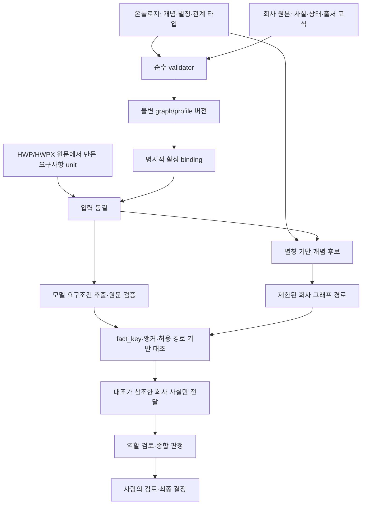

# BidOps 온톨로지 목적·구현·현업 사례 비교분석

분석일: 2026-10-20  
분석 대상: `main` / `bd12c38f383173f8cc840c151eb95c47adecd8dc`  
외부 연구: [현업 온톨로지 리서치](2026-10-20-ontology-industry-research.md)

읽기용: [도식과 전체 본문을 담은 HTML 보고서](2026-10-20-ontology-report.html)

상태: 조사·설계 권고. 구현 승인이나 새로운 제품 정본이 아니다. 이 작업에서는 제품 코드·정책·큐·운영 DB를 변경하지 않았다.

## 1. 종합 판단

**BidOps는 회사 근거를 불변 버전으로 보관하고 분석에 묶는 기반을 잘 구축했다. 그러나 현재 온톨로지는 실회사 역량과 요구조건을 충분히 표현·연결하지 못하며, 결정적 대조 규칙의 적용 범위도 좁다. 업무 판단 품질은 인수 기준을 통과하지 못했다.**

현재 모습은 `통제 어휘 + 타입이 있는 회사 사실 그래프 + 제한된 그래프 검색 + 사실 키별 대조 규칙`으로 설명하는 것이 정확하다. 의미 모델의 범위가 좁다는 문제와 그래프 DB를 쓰지 않는다는 선택은 별개다.

우선순위는 **차단 조건을 표현하고 대조하는 경로 복구 → 회사 역량·정책의 의미 분리 → 근거·시간·평가 체계 보강**이다. 저장소 교체나 그래프 시각화 확대가 먼저라는 근거는 발견하지 못했다.

### 분석의 증거 구분

| 구분 | 이번에 확인한 범위 |
|---|---|
| 코드 확인 | parser, 저장·활성화 서비스, 검색, 입력 동결, 추출 변환, 대조, 전송 projection, 관련 테스트 소스 |
| 입력 파일 확인 | Git 밖 `ontology.v2.json`, `rootlab.source.v4.json`의 구조·건수·관계; 순수 parser 검증 |
| 기존 실행 기록 | RL-05 실제 실행·채점·사람 reject 기록 |
| 이번에 하지 않은 것 | 실제 모델 재호출, 운영 상태 조회·변경, 전체 앱 테스트, 실제 447개 항목의 단계별 재생 |

따라서 아래 구조적 한계는 코드로 확인했지만, 각 한계가 실제 447개 `unknown`에 기여한 비율까지 확정한 것은 아니다.

## 2. 프로젝트에서 온톨로지가 필요한 이유

[로드맵](../work/constitution/roadmap.md)과 [RL-03 명세](../work/groups/RL/features/RL-03-fit-verdict/spec.md)를 기준으로 읽으면, 목적은 다음과 같다.

1. 회사의 자격·인력·실적·선호·제외 조건을 공통 형식으로 표현한다.
2. 사전규격의 요구사항을 회사 근거와 연결한다.
3. 확인된 사실을 대조해 충족·부족·미확인을 구분한다.
4. 역할별 검토·종합 판정·제안서 초안이 같은 근거를 사용하게 한다.
5. 어떤 회사·문서·온톨로지·정책 버전으로 판단했는지 재현한다.

이 목적은 현업 사례와 잘 맞는다. 특히 ePO의 개념 정합성, FIBO의 버전 관리, Open Targets의 근거 구분과 닮았다. 다만 현재 구현은 1·5의 보존 장치에 비해 2·3의 의미 연결과 대조 능력이 약하다.

과거 HP는 홈페이지 전문 가상회사를 전제로 했다. RL은 루트랩 실회사로 전환했지만 어휘·노드 타입·검색 경로에는 그 출발점의 제약이 남아 있다. [RL-00 명세](../work/groups/RL/features/RL-00-company-ground-truth/spec.md), [로드맵의 HP·DEMO 종료 기록](../work/constitution/roadmap.md)

## 3. 현재 구현을 따라가면



두 대조 경로를 구분해야 한다.

- **개념 경로:** `match_concepts` → 그래프 경로 → `_concept_reasons`. 관계를 찾았다는 사실만으로 요구사항 충족을 입증하지 않는다.
- **조건 경로:** 추출된 constraint → `resolve_fact_key` → `card_fact_value` → `_confirmed_comparison`. 이 경로는 모든 조건에 그래프 경로를 요구하지 않는다.

따라서 기존 findings의 “개념 후보→그래프 경로가 있어야 fit”이라는 원인 추정은 전체 대조를 설명하기에는 좁다. **별칭·그래프 경로의 한계와 fact_key·대조 규칙의 한계를 함께 조사해야 한다.**

근거: [검색 구현](../../web/backend/app/deep_review/services/company_knowledge_retrieval.py)의 `match_concepts`, `_concept_paths`; [대조 구현](../../web/backend/app/deep_review/services/card_compare.py)의 `constraint_comparison`, `_concept_reasons`, `compare_requirements`.

### 구성 요소별 구현 수준

| 구성 | 확인된 구현 | 현재 한계 |
|---|---|---|
| 개념 | `id,label,aliases,kind`; kind 4종 | 정의·범위·계층·대체 개념 필드 없음 |
| 타입·관계 | 노드 타입 10종, 관계 11종, endpoint 검증 | 타입 집합과 관계 의미가 코드에 고정 |
| 회사 사실 | 4상태, 출처 종류, 타입별 값 검증 | 선호·정책·기관이 capability/domain에 함께 들어감 |
| 출처 | source hash, JSON pointer, quote 검사 | 회사 JSON 밖의 원래 증빙까지 구조적으로 연결되지 않음 |
| 저장·활성화 | 불변 버전, binding, 활성화 이력 | 업무 의미의 품질을 자동 보증하지 않음 |
| 검색 | NFKC·casefold 정규화, 별칭 매칭, 최대 3-hop | 정해진 관계만 탐색, 상위 개념 추론 없음 |
| 대조 | 14개 fact key의 허용 경로와 분기 | 제외 분야·일부 상한·수행 역량의 비교 미포함 |
| 최신성 | 입력 버전 변경 감지, 일부 날짜 필드 | 모든 사실의 업무 유효성 검사는 아님 |
| 평가 | 사람 gold와 제품 출력의 대조·reject 기록 | 전체 unknown으로도 카드 일치율이 높게 나오는 문제 |

주요 코드: [온톨로지 계약](../../web/backend/app/core/company_ontology.py), [등록·읽기 서비스](../../web/backend/app/deep_review/services/company_knowledge.py), [분석 입력](../../web/backend/app/deep_review/services/company_analysis_input.py), [추출·앵커](../../web/backend/app/deep_review/services/card_analysis.py).

## 4. 실제 입력과 평가 결과

### 4.1 조사 시점의 회사 입력

Git 밖 원본을 읽어 집계했다. 회사자료 전문과 개별 실적 내용은 이 문서에 복제하지 않는다.

| 항목 | 관측 |
|---|---:|
| 온톨로지 개념 | 105 |
| capability / qualification / technology / domain 개념 | 37 / 29 / 12 / 27 |
| 회사 source 노드 / 관계 | 148 / 129 |
| confirmed / proposed / unknown / inferred 노드 | 130 / 1 / 17 / 0 |
| project 타입 노드 | 66 |
| capability 타입 노드 | 9; 모두 `pref:*` |
| `supports_capability` 관계 | 0 |
| `uses_technology` 관계 | 0 |
| 어떤 source 관계에도 연결되지 않은 노드 | 18; 제외 조건 6 + 발주처 선호 12 |

`project` 66은 집계·미확인 노드를 포함한 타입별 개수다. 검증 완료된 실제 수행 실적 66건이라는 뜻이 아니다. 연결되지 않은 노드도 사실 키로 소비될 수 있으므로 “제품 전체에서 사용되지 않는다”는 결론 역시 내리지 않는다.

입력 식별:

- ontology version: `bidops.company-ontology.rl-v2`
- ontology canonical SHA-256: `4d0f95c274e18c5774d9254f6d36a8125ade2844b7b2ff2a6593f95a001d7a15`
- company source SHA-256: `78f525bcae479e50943e38616427f5f9852500a9164d5dd81a815ee8fd221af9`

온톨로지 파일 바이트 해시와 parser가 계산한 canonical 해시는 다르다. 위 온톨로지 값은 binding 비교에 쓰는 canonical 해시다. 현 파일은 순수 parser의 구조·해시 검증을 통과했다. 이는 내용의 업무상 충분성을 검증한 결과가 아니다.

### 4.2 업무 품질

[RL-05 실제 분석·채점·인수 기록](../validation-runs/2026-10-19-rl/RL-05/README.md)에 따르면:

| 지표 | 기록된 결과 | 해석 |
|---|---:|---|
| 판정 일치 | 3/10; 기준 8/10 | 실패 |
| 차단 조건 재현율 | 0/7; 기준 0.8 | 실패 |
| 평가 대상 카드 상태 일치 | 84/100 | unknown 편중으로 판별력이 약함 |
| 전체 모델 카드 상태 | 447개 모두 unknown | met·gap을 실제로 구분하지 못함 |
| 필수자격 미충족을 met로 판단 | 0 | met 자체가 0이므로 유용성 입증 아님 |
| 사람 인수 | reject | 실행 완료와 품질 합격을 구분해야 함 |

결과에는 `unmeasured_reference` 표식이 있다. 이 수치는 격리 참조 실행에서 발견된 실패의 증거이며 운영 품질·활성화의 근거로 승격할 수 없다.

큐의 RL-03·RL-05 `done`과 위 reject는 모순이 아니다. 구현·평가 절차를 끝냈다는 것과 제품 품질이 통과했다는 것은 다른 상태다. 현재 status 기록도 이 차이를 명시하고 있다.

## 5. 제대로 구축한 부분

### 5.1 불변 버전과 재현성

온톨로지·회사 source·graph·profile·활성 binding을 구분하고 해시와 버전을 연결한다. 같은 ontology version에 다른 내용을 넣으면 충돌로 거부한다. 활성화는 명시적인 별도 절차다.

이는 FIBO에서 강조하는 변경 검토·발행 관리와 방향이 맞다. **개선할 때 보존해야 할 핵심 자산**이다. [등록 서비스의 `_ontology_row`, `activate_company_knowledge`](../../web/backend/app/deep_review/services/company_knowledge.py), [FIBO 개발 과정](https://spec.edmcouncil.org/fibo/page/development-process)

### 5.2 미확인·제안·확인을 구분

`unknown`·`proposed`·`inferred`를 confirmed 근거로 쓰지 않는다. 보유 사실과 세부 미확인을 구분하며, 확인되지 않은 값을 부족으로 바꾸지 않는다. 이 원칙은 현재 결과가 보수적이라는 이유로 제거해서는 안 된다.

근거: [온톨로지 상태·origin 검사](../../web/backend/app/core/company_ontology.py), [대조의 `constraint_comparison`](../../web/backend/app/deep_review/services/card_compare.py).

### 5.3 관계 존재와 충족을 구분

실적에서 역량까지 경로가 있더라도 `partial`이라는 이유만으로 met를 만들지 않는다. 이는 Open Targets가 근거의 전파 범위를 통제하는 방식과 비교할 수 있다. 향후 실적 연결을 늘릴 때도 유지해야 한다. [검색의 `_concept_paths`](../../web/backend/app/deep_review/services/company_knowledge_retrieval.py), [Open Targets 근거 선택](https://platform-docs.opentargets.org/associations)

### 5.4 입력 동결과 전송 범위

RL `card-v1` 입력은 회사 binding의 모든 사실을 동결한다. 역할·종합 전송에서는 대조가 참조한 사실만 선택하고, 미확인 사실의 값을 확인 근거처럼 내보내지 않는다.

따라서 현재 문제를 “회사 facts가 검색 budget 때문에 입력에서 모두 빠졌다”로 설명하면 부정확하다. 동결된 사실을 **대조가 참조하지 못하는 문제**를 먼저 보아야 한다. [분석 입력의 `build_company_analysis_input_v2`, `card_company_transfer`](../../web/backend/app/deep_review/services/company_analysis_input.py)

### 5.5 실패를 숨기지 않는 평가

형식 검사·실제 실행·사람 인수를 분리하고 reject를 남겼다. 온톨로지 구조가 통과해도 업무 결과가 실패할 수 있다는 점을 실제 평가가 드러냈다. 이 평가 자산은 다음 수정의 회귀 기준으로 재사용할 수 있다.

근거: [RL-05 기록](../validation-runs/2026-10-19-rl/RL-05/README.md), [기존 findings](../tracking/findings.md).

## 6. 부족한 점과 수정이 필요한 부분

### 6.1 가장 시급함: 저장된 회사 정책이 판정에 도달하지 않는다

**확인된 사실**

- `CARD_COMPARE_FACT_PATHS`에는 `excl:*`, `pref:onsite_cap`, `pref:concurrent_cap` 등이 없다.
- 그래프 검색의 `TRAVERSED_RELATIONS`는 `operates_in`·`uses_technology`를 탐색하지 않는다.
- `direct`는 회사→역량 또는 회사→자격, `partial`은 실적/인력→역량 경로로 제한된다.
- 개념 경로만으로는 어떤 요구도 충족을 증명하지 않는다.

따라서 제외 분야를 domain에 등록하거나 별칭만 추가해도 현재 대조가 이를 차단 조건으로 계산하는 것은 아니다. **개념 추가, 조건 추출, 사실 매핑, 대조 규칙을 하나의 기능 단위로 연결해야 한다.**

근거: [허용 fact 경로](../../web/backend/app/deep_review/services/company_analysis_input.py)의 `CARD_COMPARE_FACT_PATHS`, [그래프 검색](../../web/backend/app/deep_review/services/company_knowledge_retrieval.py), [개념 대조](../../web/backend/app/deep_review/services/card_compare.py)의 `_concept_reasons`.

### 6.2 가장 시급함: 상주 장소와 허용 지역을 충분히 비교하지 못한다

**코드로 확인한 한계**

- `_regions`는 시·도 명칭·별칭을 부분 문자열로 찾는다. 시·군·구 코드와 상위 지역 관계가 없다.
- 따라서 “원주시청”처럼 시·도 명칭이 생략된 표현에서 상위 지역을 얻지 못한다.
- 상주 요구 지역이 확인돼도 회사 region의 부분집합이 아니면 `gap` 대신 `scope_unverified`다.
- `지역을 지원한다`와 `그 지역에서만 수행한다`의 배타성이 모델에 분명하지 않다.

이 보수적 분기는 이유가 있다. “대구 가능”만으로 “나머지 모든 지역 불가”를 추론하면 안 된다. 수정은 **회사가 확인한 허용·제외 범위와 조건을 먼저 표현하고**, 그 범위에 원문 장소를 검증된 행정구역 매핑으로 대조하는 방식이어야 한다.

근거: [대조 코드](../../web/backend/app/deep_review/services/card_compare.py)의 `_REGIONS`, `_regions`, `_confirmed_comparison`; [사람의 지역 조건 확인 기록](../validation-runs/2026-10-19-rl/RL-05/README.md).

### 6.3 높음: 역량과 선호·정책을 같은 타입에 넣었다

현 입력의 capability 노드 9개는 모두 금액·컨소시엄·동시 수행·상주 상한·기간·하도급·마진 같은 `pref:*`다. 실제 기술 수행 역량을 표현한 capability 인스턴스가 없다. 발주처 선호도 `domain` 타입에 들어간다.

이는 RL-00의 명세에 따른 구현이지 단순 코딩 실수가 아니다. 하지만 “보유 역량을 요구사항과 대조한다”는 목적에는 의미가 맞지 않는다.

**권고:** `Capability`, `DeliveryCapacity`, `CompanyPolicy`, `Organization`, `QualificationHolding`을 구분한다. 모든 기존 필드를 즉시 새 테이블로 옮기기보다, 새 버전 계약에서 의미와 소비 규칙을 먼저 분리한다. AI 에이전트·음성·앱 관련 확인 사항이 concept 부재로 등록되지 못했다는 기존 기록도 우선 다뤄야 한다.

근거: [RL-00 명세의 노드 value·회사 파일 규칙](../work/groups/RL/features/RL-00-company-ground-truth/spec.md), [회사 v4의 미반영 역량 기록](../validation-runs/2026-10-19-rl/RL-05/README.md).

### 6.4 높음: 실적을 역량의 증거로 연결하는 내용이 비어 있다

현재 source의 `performed` 관계는 66개지만 `supports_capability`는 0개다. 수행한 프로젝트 목록과 검토 대상 역량 사이의 연결이 없다.

다만 사업명만 보고 역량 관계를 자동 확정하면 안 된다. 회사가 실제 맡은 역할·기능·수행 기간·증명 가능 범위를 확인한 뒤 근거 관계를 발행해야 한다. 사업명만 확인된 실적은 검색 후보로 활용하되 필수조건 충족 근거로 승격하지 않는다.

**권고:** 실적 전체를 일괄 보강하기보다 자주 필요한 요구 유형에서 출발해, 확인된 담당 범위를 가진 실적부터 연결한다. 같은 근거가 판정과 제안서 초안에 재사용되는지 검증한다.

### 6.5 높음: 요구사항의 업무 의미가 얇다

constraint에는 숫자·텍스트·operator·fact_key·quote·locator가 있다. 그러나 같은 문장 안의 의무·선택·부정·예외, 자격 기준과 산출물 요건, 법적 조건과 회사 선호, AND/OR 관계를 공통 구조로 충분히 표현하지 못한다.

그 결과 문자열 앵커와 14개 사실 키별 분기가 의미 해석의 많은 부분을 담당한다. 개념은 unit 전체의 별칭 출현으로 만들어져 배경 설명·부정 문맥의 단어도 후보가 될 수 있다. 후보 존재를 충족으로 보지 않는 현재 방어는 맞지만, 업무 의미를 더 세밀하게 표현해야 불필요한 unknown을 줄일 수 있다.

**권고:** 조건을 `대상·술어·값·적용 범위·의무성·논리 연결·예외·근거 위치`로 정규화한다. 원문에서 확인되지 않는 필드는 비워 둔다. 회사 fact key는 공고의 의미 자체가 아니라, 정규화된 조건을 회사 사실에 연결하는 별도 매핑 결과로 다룬다.

근거: [constraint DTO](../../web/backend/app/deep_review/schemas/card_analysis.py), [앵커와 v2 변환](../../web/backend/app/deep_review/services/card_analysis.py), [개념 후보 생성](../../web/backend/app/deep_review/services/company_analysis_input.py)의 `card_expected_concepts`.

### 6.6 높음: 회사 원본 증빙까지의 계보가 분리돼 있다

`SourceRef.source_id`는 `self`만 허용하고 pointer는 해당 JSON의 node value를 가리킨다. 이 검증은 **등록 JSON과 인용의 일치**를 확인한다. 회사소개서 PDF·인증서·홈페이지 스냅샷의 특정 위치까지 직접 검증하는 것은 아니다.

RL-00은 원래 문서 쪽·URL을 validation README에 두도록 명시했다. 따라서 이는 기존 설계의 한계이지 숨겨진 구현 위반은 아니다.

**권고:** 사실과 원본 증빙의 연결을 기계가 따라갈 수 있게 추가한다. 원본 object version/hash, locator, 확인 행위·시각, 파생 관계를 연결하고 현재 JSON pointer 계보도 보존한다. “홈페이지에 그렇게 쓰여 있음”과 “입찰 증빙으로 확인됨”을 구분할 근거 수준도 필요하다.

근거: [SourceRef·`_validate_fact_ref`](../../web/backend/app/core/company_ontology.py), [RL-00 SourceRef 계약](../work/groups/RL/features/RL-00-company-ground-truth/spec.md). 참고 모델: [PROV-O](https://www.w3.org/TR/prov-o/).

### 6.7 중간: 날짜는 있지만 시간에 따른 판단이 제한적이다

자격의 `valid_until`, 인력의 `as_of`, 실적의 시작·종료일은 이미 있다. 만료 경고 설정도 있다. “시간 정보가 전혀 없다”는 평가는 틀리다.

다만 대조의 `_scope_unverified`는 최근·유효기간·기준일·현재가용 같은 표현을 만나면 보수적으로 판단을 유보한다. 공통적인 사실 유효기간·재확인 주기·동시 투입 충돌 모델은 확인한 경로에서 충분히 구현돼 있지 않다.

**권고:** 우선 자격의 제출 기준일과 투입 인력의 요구 기간처럼 중요한 두 가지 업무 질문부터 시간 규칙을 추가한다. 버전이 최신이라는 이유로 사실이 현재도 유효하다고 취급하지 않는다.

### 6.8 중간: 개념의 정의·진화·외부 대응 관리

개념 스키마에는 label·alias·kind만 있다. 정의·포함/제외 범위·상하위 관계·deprecated·replaced_by·외부 표준 대응을 표현하는 필드가 없다. 순번형 ID 자체는 결함이 아니지만, 개념의 의미를 바꿔 같은 ID를 재사용하는 것을 방지할 관리 규칙은 중요하다.

**권고:** 새 스키마에서 정의·범위와 폐기/대체 정보부터 추가한다. 상하위 관계는 근거 탐색에 우선 사용하고, 자격 충족의 자동 상속은 별도 규칙으로 제한한다. SKOS와 ePO는 참고할 수 있지만 전체 수입을 선행 조건으로 만들 필요는 없다. [SKOS](https://www.w3.org/TR/skos-reference/), [ePO](https://docs.ted.europa.eu/epo-home/index.html)

### 6.9 높음: 평가가 ‘안전하게 모름’과 ‘업무상 유용함’을 함께 보여줘야 한다

84% 카드 일치는 전체 모델 카드가 unknown인 상태에서도 나온 수치다. 현재 품질 게이트가 판정 일치와 차단 recall을 함께 보아 reject한 점은 적절하다. 추가로 아래 진단 지표가 필요하다.

- 클래스별 precision·recall과 confusion matrix.
- 확인된 사실·지원 규칙이 있어야 답할 수 있는 조건에서의 결정률.
- `unknown_fact` / `unmapped` / `unsupported_comparison` / `scope_unverified` / 추출 격리의 분포.
- 조건 추출 누락과 매핑 실패와 대조 실패를 나눈 단계별 재현율.
- 근거 검색 recall과 최종 판정 정확도의 분리.

**unknown을 강제로 줄이는 목표는 부적절하다.** 실제 정보가 없는 unknown은 정답으로 보존하고, 지원 가능한 조건을 놓치는 unknown만 줄여야 한다.

기존 10건은 이미 실패 분석에 노출됐으므로 수정 후 같은 gold로 회귀를 확인할 수 있지만, 일반화 성능은 별도의 새 holdout으로 확인해야 한다. 회사·온톨로지 버전이 바뀌면 gold의 binding과 의미가 여전히 맞는지도 먼저 확인하고, 변경이 필요하면 기존 gold를 보존한 새 버전을 만든다.

## 7. 권장 구현 방향

### 7.1 작은 의미 모델을 명확하게 만든다

다음은 신규 계약을 위한 제안이며 현재 구현된 타입 목록이 아니다.

| 대상 | 최소 의미 |
|---|---|
| Requirement | 특정 문서 버전의 업무 요구 |
| RequirementCondition | 대상, 술어, 값, 필수/선택, AND/OR, 적용 범위 |
| CapabilityClaim | 회사가 할 수 있다고 확인된 활동과 그 범위 |
| ProjectParticipation | 특정 실적에서 회사가 맡은 역할과 수행 범위 |
| QualificationHolding | 자격 코드·품목·보유·유효기간·증빙 |
| DeliveryCapacity | 역할별 가용 인원·지역·기간 |
| CompanyPolicy | 선호·제외·상한·예외와 승인 주체 |
| EvidenceAssertion | 사실/관계와 원본 증빙·확인 행위를 연결 |
| Assessment | 조건, 사용 사실, 규칙 버전, 결과, 이유, 부족한 근거 |

사업기회·공고·문서는 기존 lifecycle 정본을 참조한다. 처음부터 동일 객체를 그래프에 중복 소유시키지 않는다.

### 7.2 의미 정의·매핑·규칙을 연결해 관리한다

현재 세 개의 fact 표가 같은 키 집합인지는 검사하지만, 실제 원문 표현부터 결과까지 연결되는지는 별도 문제다.

**권장 계약**

```text
condition predicate
  → 허용되는 값 타입·단위·적용 범위
  → 회사 사실을 읽는 resolver
  → 비교할 수 있는 연산과 필요한 근거 수준
  → met / gap / unknown 및 이유
  → 근거·규칙 버전·회귀 예제
```

이를 버전 관리되는 규칙 명세와 결정적 함수의 조합으로 만든다. 임의 코드를 실행하는 범용 규칙 언어부터 구축할 필요는 없다. 어휘 추가가 어떤 resolver·비교 함수와 연결되는지 검사할 수 있으면 된다.

### 7.3 우선 복구할 두 가지 조건

**상주 장소**

`원문 장소 → 검증된 지역 식별 → 요구 인원·역할·기간 → 회사의 명시적 허용/제외 범위와 가용성 → 판정`

시청 이름에 시·도가 없거나 본점 소재지와 수행 장소가 혼재하면 확인 대상으로 남긴다. 단순히 다른 지역이라는 이유로 gap을 만들지 않고, 회사가 승인한 배타적 정책과 충돌하는 경우에만 정책 차단으로 설명한다.

**HW 유지관리 제외**

`해당 문장이 실제 과업 요구인가 → HW 구매/유지관리/소프트웨어 유지관리 구분 → 회사의 적용 범위가 명시된 제외 정책 → 예외 조건 → 정책 차단`

문서에 HW라는 단어가 있다는 이유로 제외하지 않는다. 배경 설비 설명·발주처 제공 장비·혼합 과업·선택 과업을 함께 검사한다. 정책상 제외와 법적 참가 자격 미충족은 다른 사유로 노출한다.

### 7.4 근거와 판단을 같은 기록에서 추적한다

각 조건의 결과에는 최소한 `condition_id`, `fact_ids`, `evidence_ids`, `rule_id/version`, `status`, `reason`, `missing_fields`가 필요하다. 기존 `constraint_results`·evidence·reason_codes를 확장하는 방향이 자연스럽다.

사람에게는 “정보가 없음”, “이 조건을 아직 비교하지 못함”, “확인된 조건과 충돌함”을 다르게 보여준다. `unknown` 하나만으로 다음 행동을 정하기 어렵기 때문이다.

### 7.5 현재 PostgreSQL을 유지한다

이번 조사에서 관측한 실패는 148개 source 노드의 저장·조회 성능보다 의미·매핑·규칙의 공백에 가깝다. 별도 그래프 DB 도입이 이를 해결한다는 증거는 없다.

PostgreSQL 정본·불변 snapshot·현재 서비스 경계를 유지하고, 필요하면 읽기 projection이나 export를 추가한다. 이후 다단계 질의의 실측 성능이나 외부 RDF 연계 요구가 생기면 그래프 DB를 독립 과제로 평가한다.

## 8. 수정 순서와 검증

아래는 후속 작업의 우선순위 제안이다. 새 기능 등록·큐 변경·실제 모델 전송 승인으로 간주하지 않는다.

| 순서 | 작업 | 입력·기대 결과 | 검증·증거 |
|---|---|---|---|
| 1 | 실제 실패를 단계별로 분해 | 동결된 10건의 추출·대조 산출물 → 놓친 조건별 실패 단계 | 저장 응답의 로컬 재생; 원문 없이 이유별 집계 |
| 2 | 상주·제외 조건의 의미와 정책 확정 | 사람 gold의 7개 차단 → 요구·회사 정책·예외의 명시적 연결 | 정규화 조건·fact resolver·규칙 단위 검사 |
| 3 | 대응 경로 구현 | 정답·반례·모호한 사례 → 올바른 gap 또는 unknown | 추출→매핑→대조 통합 검사; 단순 함수 통과와 구분 |
| 4 | 회사 역량과 정책 분리 | 승인된 회사 사실 → 새 버전 타입·근거 관계 | import dry-run, 이전 버전 재현, 영향 소비자 검사 |
| 5 | 원본 증빙·기간 연결 | 확인 자료·기준일 → 유효성·계보 추적 | 근거 locator·시점 경계·상충 사례 검사 |
| 6 | 품질 재평가 | 기존 10건 회귀 + 새 독립 표본 | 기존 인수 지표 유지, 클래스별 지표 추가, 사람 판정 |

수정 전 진단에서 추출 자체가 없는 조건은 대조 함수만 수정해도 복구되지 않는다. 저장 응답 재생은 대조 수정의 효과를 확인하고, 새 추출 계약의 효과는 별도로 확인해야 한다.

필수 반례의 예:

| 입력 | 지켜야 할 결과 |
|---|---|
| “비상주” | 상주 필수 조건으로 해석하지 않음 |
| 본점 소재지와 실제 수행 장소가 다름 | 두 지역 요건을 분리 |
| “상주 또는 원격 협의” | OR·예외를 무시한 자동 차단 금지 |
| HW는 배경 설명이고 과업은 SW 고도화 | 단어 출현만으로 회사 제외 정책 발동 금지 |
| 증명서는 있으나 품목·만료일 미확인 | 자격 전체 충족으로 승격 금지 |
| 비슷한 사업명만 있고 수행 범위 미확인 | 유사 실적 후보와 충족 근거를 구분 |
| 해당 날짜·역할의 가용 인원이 충분하다고 확인됨 | 총인원 대신 확인된 가용 사실로 대조 |

## 9. 이번 조사에서의 확인 절차와 한계

실행한 작업:

1. 작업 트리·현재 커밋 확인, 로드맵·RL 명세·기존 findings·실제 평가 기록 검토.
2. `python3 scripts/feature_status.py queue _ show`로 현재 실행 큐 읽기.
3. 회사 입력 JSON의 구조·상태·관계 종류를 읽기 전용 집계.
4. Python 3.12로 순수 `company_ontology.py` 모듈을 직접 로드해 `parse_ontology`와 `parse_company_knowledge_source` 실행: 통과.
5. 외부 1차 자료 조사와 두 문서의 링크·내용 정합성 확인.

환경 제한: 기본 `python3`는 3.9였고 일반 package import는 `pydantic` 부재로 실패했다. 순수 모듈도 3.9의 `TypeAlias` 지원 문제로 로드되지 않았다. 기존 설치된 Python 3.12를 사용해 순수 모듈만 검증했으며 패키지를 설치하거나 앱·DB를 기동하지 않았다.

이번 결과는 정적 코드 분석, 현재 로컬 입력 파일 검증, 기존 실행 기록 검토의 결합이다. 운영에 현재 어떤 버전이 활성화됐는지는 새로 조회하지 않았다. 실제 모델 재실행이나 제품 전체 검증을 이번에 통과한 것처럼 표시하지 않는다.

**권장하는 다음 결정은 ‘온톨로지 플랫폼 교체’가 아니라, 상주·제외 조건을 시작으로 의미 정의부터 실제 판정까지 이어지는 범위를 구현하는 것이다.** 기존의 불변성·근거 검증·미확인 보존을 유지하면서, 무엇을 왜 비교할 수 있고 없는지를 명시해야 한다.
