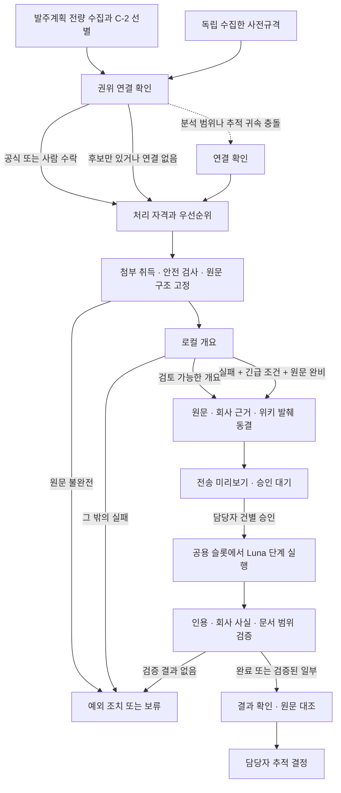

# 실제 사전규격 분석 최종 사용자 흐름 명세

[사용자 목표](intent.md) · [회사 위키 매핑](company-wiki-mapping.md) · [상세 화면 설계](detail-layout.md) · [실행 계획](plan.md)

**2026-11-24 개정.** 분석 대상은 시스템이 고르지 않고 사람이 추적을 시작한 사전규격으로 한정한다([개정안](track-start-entry.md), ADR-0078). 아래 본문의 자동 후보 선정·처리 순서·개요 우회는 그 개정으로 대체됐고, 전송 미리보기·건별 승인·실행·검증·인수는 그대로다.

2026-11-20 구현 기준, 2026-11-22 회사 입력 기준 개정([회사 입력 기준](company-wiki-mapping.md): 원본 루트랩 자료 묶음 전체와 엔진의 공고별 위키 선택, 데모값 사용). 담당자는 대시보드에서 다음 행동이 있는 사전규격을 열고, 전송 자료를 확인해 승인한 뒤 같은 상세에서 원문과 결과를 대조하고 추적을 결정한다. 발주계획 선택, 첨부 다운로드, 개요 실행, 엔진 시작을 건마다 요청할 필요가 없다. 아래 신규 상태와 API는 목표 계약이다. 현행 공개 계약은 [RL-09 엔진 계약](../../../../../contracts/engine-runs.md)이다.

## 출발점과 확인 범위

| 단계 | main `b839367`에 있는 기능 | 운영에서 확인한 범위 | RL-11에서 더할 것 |
|---|---|---|---|
| 발견·연결 | 독립 전량 수집·선별 적재·검색 색인, 공식 연결 및 이름·기관 후보, 사람 수락/기각, C-2 v6 | 11-20 첫 cron에서 공고 트랙 exit 0이나 적재 경고 440건으로 incomplete. 발주계획은 첫 실행 실패 뒤 수집기 수정·재실행으로 전일 557건 중 150건 판정, 경고 0. v6 gold recall 96.3%, precision 45.6%, 실제 평일 규모 품질 미측정 | 권위 연결에 한정한 C-2 정렬, 영향 있는 후보만 업무 목록에 노출 |
| 취득·개요 | 1단계 main 병합·배포. SW 자동 처리 범위, 문서 묶음, 로컬 개요 run과 actionable/needs_check 분리. C-1 우선 등급·브리핑의 기존 별도 자격은 코드에 남음 | 11-20 이미지 `bidops:main-20261120-b839367`, DB 0042. 권한 보정 후 취득·새 묶음 ready 5, draft 1. 개요 1회차 4건 중 identity 실패 1·플래그 해제로 취소 3, 본문 호출 0. 입력 한도 32768 복구 후 2회차 공고 3754 취득→ready→PDF 5~7쪽→로컬 2회→개요 완료·목록 노출, 원문 위치 14개·수량/용어 경고 5종. 개요 내용의 사람 인수와 다음 cron 간섭 확인은 남음 | 기한·추적 우선 처리, 유한 재시도, 개요 실패 우회 |
| 엔진 | RL-09 고정 원문/회사 바인딩, 버전 객체, subprocess, 단일 슬롯·조회·mock. live 요청 거부. 원본 위치 매핑과 회사 projection 일부 구현 | 13:32 KST 운영 GET에서 개요 true, RL·엔진 false, C-2 v6 effective_enabled=true. web·analysis·첨부 worker 같은 이미지. 13:36 재조회에서 공고 3754의 개요 current.status=completed, 검토할 항목 2건·확인 필요 169건. 변동하는 집계는 개별 결과 품질과 별도로 확인 | 자동 후보·미리보기, 승인·실제 Luna·검증 게시, 정정 무효화 |
| 비교·검토 | RL-10 대조 v2·v12 소스 병합. RL-09·10 기록 단계 review. 현행 상세는 개요, 추적, 첨부와 RL 판정 영역. 엔진 패널은 mock 빌드용 | RL-05 격리 인수 reject(판정 3/10·차단 0/7), RL-04 초안 partial(4/6절). RL-10 오프라인 이상적 제약 탐침에서도 v4 회사 근거로 0/7. 운영 회사 근거·브리핑 미등록은 마지막 등록 확인 기록 기준 | 승인 사실·위키 매핑, 동일 입력 비교, 검토 대기열·현재 결과와 원문을 잇는 상세 |

조회 근거는 운영의 읽기 전용 `GET /api/{feature-flags,workload,daily-collection-status,order-plan-screening/daily-trigger}`와 컨테이너 이미지다. 11-19 수정안의 ‘작업 브랜치·첨부 워커 정지’와 11-20 1회차 종료 때의 ‘개요 꺼짐’은 각 시점의 관측이다. 10월 참조 개요와 11월에 새로 준비한 공고는 같은 종단 증거로 세지 않는다. [1단계 수정안](../../../../../specs/1118_launch-hardening/사전규격-단계-수정안.md) · 배포·감독 기록(`docs/validation-runs/20261120-prespec-stage1/README.md`, 저장소에 없음) · [C-2 측정](../../../../../validation-runs/20261119-c2-top150/README.md) · [RL-09](../RL-09-engine-integration/spec.md) · RL-10 탐침(`docs/validation-runs/20261119-rl10-compare-blockers/README.md`, git 이력)

main 대조 지점은 [마감·추적 판별](../../../../../../web/backend/app/lifecycle/services/pre_spec_scope.py), [취득·준비 자격](../../../../../../web/backend/app/deep_review/services/effective_grade.py), [기존 업무량](../../../../../../web/backend/app/lifecycle/services/workload.py), [공용 워커의 claim 순서](../../../../../../web/backend/app/workers/analysis.py), [엔진 입력·게시](../../../../../../web/backend/app/deep_review/services/engine_runs.py), [현행 사전규격 상세](../../../../../../web/frontend/src/pages/PreSpecDetailPage.tsx)다. RL-11 문서 묶음은 이 main 커밋 위의 작업 트리에 있다.

## 담당자가 받는 공고별 검토 결과

개요는 읽을 순서를 정하는 데 쓰고, 아래 결과의 사실 판단은 동결한 원문과 동결한 회사 자료 묶음에 연결한다.

| 판단 기준 | 담당자가 읽는 결과 |
|---|---|
| 사업 적합성 | 발주 목적·핵심 과업·회사가 맡을 범위와 추적 판단을 바꿀 조건. 제목이나 유사 키워드 하나로 적합성을 확정하지 않는다. |
| 참여 조건 | 필수 의무·적용 대상·예외·기준일과 회사 증빙을 대조한다. 공고상 자격 미충족과 회사 수행 제한을 구별한다. |
| 요구사항 대응 | 요구 ID 또는 원문 위치별 대응 근거, 확인된 부분, 부족한 부분과 다음 행동. 필수 범위가 분석됨·문서에 없음·읽기 실패·첨부 누락 중 어느 상태인지 표시한다. 추출 0건은 ‘해당 없음’의 근거가 아니다. |
| 평가 경쟁력 | 평가표와 증빙이 있을 때 정량 배점·예상 범위·빠진 증빙을 표시한다. 근거가 없으면 미산정으로 남긴다. |
| 수행 가능성과 경제성 | 인력 가용성, 일정, 상주·방문, 계약 의무와 비용 요인을 구체화한다. 원가·단가가 없으면 수익률은 미산정으로 둔다. |
| 의견 마감 전 확인 | 회사 증빙으로 해결할 질문, 발주 문구 질의, 본공고 대기를 구분하고 답에 따라 달라질 판단을 적는다. 질의 제출과 추적 결정은 담당자가 한다. |

상세에서 이어지는 결과물은 **① 추적 결정·이유·재검토 조건 ② 조항별 대응표와 원문·회사 증빙 ③ 확인 질문·필요 자료·기한이 있는 경우 해당 기한 ④ 본공고에서 다시 볼 조항·기존 문구·변경 시 영향**이다. 본공고 대조에 필요한 항목을 남기는 범위이며 전체 입찰 delta 계산 워커는 후속 과제다.

## 발견에서 검토까지

| 시작 조건 | 자동 처리 | 다음 상태 | 사람 행동 |
|---|---|---|---|
| 전일 발주계획·공고 트랙 적재 또는 정정 | 사전규격을 독립 발견하고 기존 적재·색인 규칙 적용. 나중에 들어온 계획·입찰공고도 재대조 | 권위 연결 / 후보 / 검색 미확인 | 업무에 영향 있는 충돌만 확인 |
| 자격 있는 사전규격 | 아래 순서로 취득 claim, 검사·변환, 필수 원본과 구조 연결 | 준비 중 → 원문 준비 / 준비 보류 | 원본 보완이 필요한 예외만 조치 |
| ready 묶음과 개요 정책 사용 가능 | 묶음·정책당 한 번 로컬 개요 예약 | 개요 완료 / 확인 필요 / 실패 | 범위·자료 확인이 필요한 경우만 개입 |
| 분석 자격 충족, 최신 원문·회사 바인딩 있음 | 승인 발췌 선택, 분할·한도 계산, 미리보기 생성 | 분석 승인 대기 | 보내기 전 범위 확인·승인 또는 이번 입력 건너뛰기 |
| 해당 미리보기 승인 | 같은 트랜잭션에서 영수증·작업 생성, 슬롯 확보 뒤 단계 전송, 원문·회사 검증, 결과와 검토함 게시 | 실행 대기 → 분석 중 → 결과 확인 / 예외 | 별도 실행·게시 조작 없음 |
| 최신 결과 또는 부분 결과 도착 | 상세에서 차단·미확인·대응표와 근거 연결 | 결과 확인 대기 → 확인함 | 원문 대조 후 확인 기록, 기존 추적 결정(계속 추적·보류·종료) 선택. 확인만 해도 추적 상태는 보존 |
| 새 원문·회사·정책 또는 수동 연결 변경 | 현재성·자격 재계산. 전송 범위가 달라지면 승인 폐기, 이전 결과를 이력으로 이동 | 새 입력 준비 또는 보류 | 새 미리보기 승인. 입찰공고 이후 최종 Go/No-Go는 기존 별도 결정 |

**미확인을 안고 계속 추적.** 상주 장소 등 참여 가능성을 바꿀 조건이 미확인이어도 담당자는 계속 추적을 선택할 수 있다. 결과 읽음과 추적 결정은 미확인 항목의 상태를 바꾸지 않는다. 해당 조건의 질문·원문 위치·회사 근거(또는 빠진 증빙)·답에 따른 판단 변화를 상세에 유지한다. 관련 정정이나 새 근거가 들어오면 해당 조건을 재검토 대상으로 표시하고 기존 추적 결정을 보존한다.

**미확인 항목의 업무함 표시.** 분류 기준은 지금 사람이 취할 수 있는 행동이다.

| 조건 | 업무함과 상세에서의 처리 |
|---|---|
| 의견 마감 전에 회사 증빙을 확인하거나 발주 문구에 대한 질의를 검토할 수 있음 | 발견 즉시 ‘조치 필요’에 표시한다. 같은 공고의 열린 질문은 한 행으로 묶고 상세에서 각각의 질문·필요 자료·답에 따른 영향을 보여준다. 질의 제출은 사람이 결정한다. |
| 질의를 마쳐 답변을 기다리거나 정정·본공고가 있어야 판단 가능 | 해당 질문은 상세에 ‘자료 대기’와 기다리는 자료를 표시한다. 다른 즉시 조치가 있으면 공고의 업무함 행은 유지한다. 미해결 상태로 의견 마감이 임박했다는 이유만으로 다시 알리지 않는다. |
| 답변·정정·본공고·새 회사 증빙이 해당 질문의 판단 근거를 제공하거나 변경함 | ‘조치 필요’에 재검토할 공고 한 행을 표시하고, 해당 질문에 새 자료와 원래 조항을 연결한다. 같은 자료 버전의 중복 수집과 무관한 변경은 재알림하지 않는다. 담당자가 근거를 대조할 때까지 항목은 미확인, 기존 추적 결정은 그대로다. |

**담당자 확인 결과의 적용 범위.** 기본 저장 단위는 공고·문서 버전·조항이다. 발주처 답변과 해당 기간의 인력 가용성은 확인자·확인일·근거와 함께 해당 공고에 기록한다. 같은 조항이 정정되면 이전 답변을 이력으로 제시하고 다시 확인한다. 자격·경력·실적처럼 재사용할 사실은 담당자가 증빙의 출처·적용 범위·유효기간(해당 시)을 확인한 뒤 명시적으로 회사 근거 등록을 선택한다. 기존 회사 근거 발행·활성화 절차를 거친 버전만 다른 공고에서 대조한다. 인력 자격이 유효해도 해당 사업 일정의 투입 가능 여부는 별도 확인 항목으로 남긴다.

### 연결과 처리 순서

1. 발주계획에서 사전규격으로 바로 가는 보편적 공식 키는 없다. 입찰공고가 양쪽 공식 번호를 제공하는 등 기존 권위 링크로 같은 사업이 확인될 때만 해당 계획의 추적·C-2 신호를 참조한다. 사람 수락은 근거 유형·누가 확인했는지를 유지한다. 서로 다른 사람 결정이 있는 사업의 병합은 기존 충돌 절차를 거친다. [연결·병합 규칙](../../../../../business-rules.md#사전규격-수집과-심층-추적)
2. 기관·제목 유사 후보는 기존 후보 규칙(최대 5건·기각 쌍 보존)을 따른다. 연결 수락 시 **현재 보류된 마감 경과 건이 추적 범위에 들어가거나, 현재 승인 입력/귀속이 달라지거나, 담당자가 저장할 추적 결정이 다른 사업 결정과 충돌**할 때만 예외함과 상세에 표시한다. 근거와 영향, 수락·기각·나중에 확인을 제공한다. 후보의 회사 사실·우선순위·추적 상태는 상속하지 않는다. 독립 분석이 가능하면 진행하고 귀속에 의존하는 쓰기만 보류한다. 검색 결과 0은 ‘검색 미확인’으로 보존한다.
3. 독립 수집 → 현행 SW=Y·추적 연결 등의 선별 적재 → 권위 연결과 무관하게 자격 평가. 준비 자격은 기존 `effective_grade`를 재사용하고 1단계 SW 자동 경로는 `auto_processing_predicate`를 적용한다. RL-11 자동 분석 대상은 최신·검토 제외 아님·종료 아님인 **SW=Y 또는 기존 우선 검토 자격** 중, 계속 추적·보류이거나 의견 마감 전·미확인인 공고다. 비SW·미확인에 기존 자격도 없으면 색인/기존 준비 이력을 유지한다. 브리핑 추천이나 C-2 결과만으로 분석 자격을 열지 않는다. 마감 경과 미추적 건은 추적 시작 시 재평가한다.
4. 같은 작업 종류의 신규 claim은 ① 추적 중이며 임박 ② 그 밖의 임박 ③ 나머지 추적 중 ④ 나머지 마감 미경과 ⑤ 미추적·기한 미확인 순이다. 임박은 `0 ≤ deadline_at − now ≤ 48시간`(RL-11 설계값), 경과는 기존 SQL의 엄격한 `deadline_at < now`다. 절대시각으로 비교하고 KST로 표시한다. 같은 구간에서 권위 연결된 C-2 최신 유효 결과 ‘관련’ → ‘불확실’ → 기타 순, 이어 의견 마감 오름차순(null 마지막), 발견 시각·공고 ID 순이다. 권위 계획이 여럿이면 가장 높은 신호와 출처를 표시한다. 무관·미판정·실패·계획 없음은 마지막 동순위로 자격을 보존한다. 마감·추적·정정 변경과 claim 직전에 다시 계산한다.
5. 정상 후보는 원문 준비 완료와 현재 개요 `completed`(또는 `needs_human_review` 중 원문과 무관한 요약 검증 문제만 있음)를 만족하면 자동 선정한다. 분석 승인함은 위 ①~⑤와 C-2 동순위 안에서 개요에 원문 위치가 검증된 필수자격·상주·기한 확인 항목이 있는 건을 먼저, 나머지는 같은 순위로 놓고 마감·발견·ID 순으로 정렬한다. 개요에 그런 항목이 없거나 개요를 우회해도 후보에서 제외하지 않는다. 회사 근거가 미등록이면 예외 한 건으로 묶고 등록 후 대상들을 재평가한다.

### 실패와 복구

| 관측한 상태 | 자동 처리와 중단점 | 담당자가 보는 결과·재개 조건 |
|---|---|---|
| 첨부 미공개·필수 파일 없음 | 다음 정상 수집에서 첨부 목록 변경을 대조한다. 같은 빈 목록을 반복 취득하지 않는다. 408/429/5xx·일시 연결 실패만 동일 버전에 5분·30분 후 최대 두 번(서버 Retry-After가 더 길면 그 이후) | 필수 원문·누락 파일 표시. 새 파일 발견 또는 승인된 대체 원본 등록·검사 뒤 재개 |
| 암호화·악성 의심·깨진 파일·PDF만 있고 필수 HWP/HWPX 계보 없음 | 격리/준비 보류, 동일 바이트 재시도 0. 독립 PDF는 기존 로컬 개요 범위로 처리 가능 | 열 수 있는 정본 요청/등록. 필수 원본과 안전 검사 통과 전 엔진 승인 불가 |
| 변환 실패 | 변환기 일시 불통은 위 두 번 한도. 포맷·표 좌표·본문 파손은 즉시 보류. 재시작마다 횟수를 초기화하지 않는다 | 파일별 실패·빠진 절 표시. 새 원본 또는 수정한 변환기 버전으로 구조를 다시 만들고 검증 |
| 긴 문서 | 로컬 개요 v7의 범위 확인 계약 유지. 엔진은 아래 분할 규칙으로 전체 필수 범위를 계산. 단일 단위·총량 초과면 호출 전 보류 | 범위 선택 시 제외 절과 용도 명시. 필수 범위가 빠진 입력은 전체 분석으로 승인 불가 |
| 개요 일시 장애·용량 초과·검증 실패 | 전송 전 일시 장애만 복구 확인 뒤 1회 재예약. 신원·정책 오류는 환경 단위 보류, 설정 복구 후 재평가. 호출 후 결과 불명·검증 실패·사람 범위 필요는 같은 입력 자동 재호출 0 | 보통 건은 확인 필요. 새 범위·정정·정책에 따라 재평가. 환경 전체 중지는 운영 예외 한 건 |
| 개요 실패 또는 범위 확인 대기 + 추적 중 또는 임박 | 로컬 정책이 허용된 대상이며 **현재 안전한 필수 원문 전부·검증된 구조/locator·회사 바인딩·승인 발췌·전송 한도**가 갖춰지면 미리보기까지 진행. 의도적 비활성·감사/보안 차단·취소·정정 중·범위 누락은 우회 불가 | ‘개요 없이 원문 분석 승인’ 한 행동에 우회 이유·기한·대상 문서·요약 없음 표시. 승인 후 결과에도 범위와 개요 실패를 기록. 기한 경과 시 미추적 승인 대기 철회 |

위 재시도는 입력 버전·단계별 영속 카운터로 제한한다. 처리 보류는 사용자가 매번 재시작하는 큐가 아니다. 정정 수집·준비 완료·추적 변경·회사 근거 발행 이벤트와 재기동 시 미처리 이벤트 대조가 같은 자격 함수를 호출한다. 사건 중복은 같은 준비·미리보기 행을 반환한다.

## 원문과 회사 근거

- 대상은 실제 루트랩 사전규격 단건이다. 공고·회사·최신 준비 완료 문서 묶음의 소유와 상태를 서버에서 확인한다. HWP/HWPX 원본 계보와 PDF 전용 첨부의 기존 처리 경계를 따른다. 문서 준비와 원문 인용의 위치를 공유하고 개요 텍스트가 원문을 대신하지 않는다.
- 분석 입력은 불변 문서 버전 목록, 문단·표의 식별자와 위치, 활성 프로필·그래프 버전(바인딩용), 회사 자료 묶음(프로필·실적·출처 등급·위키 전체)의 본문과 digest, 고정 엔진·정책·출력 계약·Luna 프로필을 묶는다. 실행 재현용 digest와 사람이 읽는 버전·출처는 별개다.
- 회사 관측 시점·자격 유효기간·실적 기간·담당 역할을 보존한다. 값의 등급은 묶음의 출처 sidecar가 정한다. 게이트는 `confirmed`·`demo`를 판정 값으로 쓰고(데모 버전이라 데모 임의값을 실제 값처럼 쓴다) `unknown`은 값으로 쓰지 않는다. 위키의 유형 선택·링크·유사 키워드는 발췌를 고르는 데만 쓰고 그것만으로 자격 충족을 만들지 않는다.

회사 자료는 [회사 입력 기준](company-wiki-mapping.md)의 묶음 전체다. 모델에는 프로필 렌더링과 그 공고에 고른 위키 발췌 본문을 보내며 고객명·계약금액·실적 제목을 포함한다. 미리보기는 묶음 digest와 고른 유형·위키 페이지 목록·글자 수를 보여 준다. 전송 단계마다 동결한 묶음 digest를 다시 확인하고, 달라졌으면 호출 전에 중단한다.

위키 발췌 선택은 로컬에서 끝내며 원본 엔진의 선택기를 그대로 쓴다. 공고 제목·개요로 유형을 분류하고, 그 유형 페이지와 직접 링크한 역량·규칙 페이지·용어집을 12,000자 안에서, 공고와 겹치는 말이 많은 실적 페이지 상위 5개를 16,000자 안에서 고른다. 선택은 결정적이며 고른 유형·페이지·예산 때문에 빠진 페이지를 결과에 남긴다. 회사 묶음이 원본 로더·위키 검사를 통과하지 못하면 승인 대기에 올릴 수 없다. 묶음은 유효하지만 고른 페이지가 0개이면 그 사실을 미리보기에 적고 프로필만으로 진행한다.

## Luna 연결과 실행

- BidOps deep_review가 단계별 호출을 감독한다. 새 live 어댑터가 OpenAI Responses API로 `gpt-6-luna`/high를 호출하고(2026-11-27 개정, [ADR-0081](../../../../../tracking/decisions/0081-engine-live-responses-api.md): codex-exec가 아니다), 별도 엔진 프로세스에는 동결된 입력과 승인된 단계 결과만 건넨다. 단계별 요청·응답, 재개 경계와 전송 감사는 아래 live v1 계약을 따른다. 기존 one-shot mock 프로세스 계약은 그대로 쓴다. 사용자 브라우저와 엔진 subprocess에는 모델 자격증명을 주입하지 않는다. 원본 Claude transport·외부 관측 전송·다른 모델 fallback의 코드 경로를 열지 않는다.
- 새 엔진 전송 정책을 버전+SHA로 발행한다. `mock_reference` 기존 호환을 유지하고 live는 기본 비활성으로 시작한다. 서버가 미리보기로 대상 공고·문서 범위·선택 회사 근거·수신 모델·예정 호출 상한을 보여 주고, 담당자가 **한 공고의 동결 입력 한 건**을 승인한 뒤에만 공용 슬롯에서 작업한다. 이 승인은 기존 RL 정책의 자동 승인으로 대체할 수 없다.
- 승인 뒤 묶음·프로필·위키 발췌·정책·모델·분할 범위가 달라지면 큐 등록과 전송을 각각 거부한다. 같은 요청 ID 재전송은 기존 영수증을 반환하고 입력이나 담당자가 다르면 충돌로 닫는다. 전송 전에 승인·입력 digest를 재확인하고 각 실제 모델 호출에 실행·승인·조각 ID, 순번, 수신 프로필, payload digest, 성공·실패를 감사에 기록한다. 승인 범위 바깥의 자동 재시도·따라잡기는 없다.
- 기존 공용 작업 슬롯 하나를 쓰고 C-2 우선순위를 보존한다. 실행 정책에 호출 수·시간·일일 건수 상한과 단계 타임아웃·lease를 고정한다. 원본 mock의 90초 subprocess와 120초 lease를 그대로 live에 쓰지 않는다. 단계 경계에서 lease를 검증·갱신하고 만료된 작성자는 결과를 게시할 수 없다.

## 긴 문서와 차단 조건

- 문서·절·표의 결정적 단위로 나눈다. 표 머리와 셀 출처를 함께 보내고, 문서 순서·원문 block/셀 ID를 보존한다. 각 호출의 상한에 프롬프트, 관련 위키 발췌, 응답 여유를 포함한다. 조각별 추출을 원문 ID 기준으로 합치고 반복 조건과 서로 충돌하는 조건을 명시한다. 포함·실패·제외 범위를 결과에 남긴다. 필수 절 누락이나 파싱 실패가 있으면 `partial` 또는 `failed`로 표시한다. 자동 절단이나 실패한 절의 묵시적 삭제는 금지한다.
- 동일 요구 ID가 여러 문서·절에 나오거나 한 표 셀에 여러 ID가 있는 경우 각각의 원문 위치를 유지한다. 2자리 ID, 다중 ID, 문서 개정, 표 머리 누락, 반복 인용은 현재 엔진에서 우선 검증·수정할 회귀다. 필수 범위에 누락이 있어 검증된 일부 결과만 보여 줄 수 있으면 `partial`, 동결·승인·계보 검증에 실패하거나 검증된 항목이 없으면 `failed`, 필수 범위와 결과 검증을 모두 마치면 `completed`다. 완전한 결과에도 개별 미확인 조건은 남을 수 있다.
- 대구 외 필수 상주, 확인된 하드웨어의 독립적 필수 의무, 명백한 자격 미충족을 결정적 차단 후보로 처리한다. 추출 단계는 의무 표현·이행 대상·예외·근거 범위를 후보로 낸다. 서버는 인용을 검증하고 확인된 필수성·독립성·범위와 회사 규칙이 모두 맞아야 차단으로 내린다. 하나라도 불명확하면 `확인 필요`로 남긴다. [승인된 회사 규칙 매핑](company-wiki-mapping.md)을 적용하며 LLM 의견으로 결정적 불일치를 뒤집지 못한다.
- 결과 행은 condition/requirement ID, 필수 여부(예·아니오·미확인), 대응 상태(충족·부족·미확인), 차단 유형(공고 자격·회사 제한·해당 없음), 확인 질문, source_refs[], company_fact_refs[]를 갖는다. 원문 참조는 문서 버전·구조 버전·block 또는 셀·문자 범위, 쪽은 알 때만 담는다. 금액·기간·수량·단위·요구 ID는 원문의 같은 위치와 대조한다. 반복 인용이면 가능한 위치를 전부 제시하고 단일 근거로 확정할 때까지 해당 판정을 유보한다. 각 판정은 공고의 문서 ID·block 또는 표 셀·인용 범위와 회사 근거 ID를 연결한다. 원문과 맞지 않는 인용, 위치 불명확, 미확인·만료 회사 사실은 충족이나 차단 근거로 승격하지 않는다. 근거 중복/불명확은 그대로 표시한다.

## 저장과 상세 응답 경계

실행 상태는 기존 집합 `queued|running|completed|partial|failed`를 재사용한다. 입력 현재성 `current|stale|unknown`과 품질 표식은 독립이다. 비교·시운전 결과는 `unmeasured_reference`, 고정 응답은 `mock_reference`로 보존한다. 운영에서 기본으로 보여 주는 결과는 사람 인수와 활성화가 끝난 경로의 현재 입력 실행으로 한정한다. 검증 실패한 실행과 과거 결과는 확인 가능한 이력으로 유지한다.

**live v1 저장 단위.** 기존 mock `engine_run`의 불변 contract를 유지하고 별도 live 입력 manifest·preview·승인 영수증·run·stage·전송 시도·결과 확인 행을 PostgreSQL에 둔다. 객체는 MinIO의 고정 version ID로 읽는다. 문서 순서·안전 상태·구조 hash, 회사/위키·허용 발췌, 분할·요청 템플릿·수신 모델·엔진·validator·한도 버전을 canonical JSON으로 해시한다. 업무 idempotency key는 (회사, 공고, live, manifest digest)이며 run에 UNIQUE를 건다. 새 정정은 최신 ready가 아직 없어도 이전 입력을 즉시 stale로 만든다. 새 회사 버전 활성화도 같은 규칙이다. 원문/바인딩을 버전대로 읽을 수 없으면 currentness=unknown으로 전송·기본 게시를 막는다.

| 신규 계약(모두 서버 계산) | 요청과 응답 | 경쟁·실패 규칙 |
|---|---|---|
| GET `/api/companies/{company_id}/pre-specs/{notice_id}/engine-review` | 현행 공고·회사 범위 안에서 `state, next_action, reason, preview, current_result, history_refs, review_receipt`. nullable 값은 그대로 반환. preview는 문서·절/쪽·회사 발췌 내용·출처·수신자·예정 단계/상한·만료 시각을 보여 준다 | 조회는 쓰기·enqueue·전송 0. 제외/생략 범위를 포함. 원문은 기존 안전 뷰어에서만 제공 |
| POST 같은 경로의 `/approvals` | 요청은 `preview_id, manifest_sha256, request_id`와 기존 actor 감사 헤더. 202 `approval_id, run_id, state`; preview 생성 후 24시간 유효 | 행 잠금 안에서 최신 버전·자격·플래그·정책 확인 후 승인과 유일 run/work를 함께 commit. 같은 요청 재전송은 영수증 재사용, 같은 입력의 다른 요청은 기존 run 참조만 반환(유효기간 갱신은 잔여 stage에 새 영수증을 연결). 요청 ID의 actor/범위 충돌 409, 만료/변경 409와 새 미리보기, 비활성 503 |
| POST 같은 경로의 `/dismissals`, `/acknowledgments` | 각각 preview 또는 result ID와 request_id·actor. 200 기존/새 영수증 | 이번 입력만 건너뛰거나 결과 버전만 읽음 처리. 검토 중 정정이면 409와 현재 상세. 추적은 기존 감사 API로 별도 저장 |
| stage IPC v1 | BidOps → 무자격 subprocess: schema_version, manifest·stage ID, extract/match/synthesize 단계, 승인 범위의 block/사실 참조와 검증된 선행 결과. subprocess → 감독자: 같은 ID·요청 종류·허용 참조/범위 또는 결과 행·coverage·오류 | 감독자가 서버 템플릿으로 payload 구성. 선행 결과는 승인 manifest가 정한 단계 간 필드와 검증된 인용/ID만 허용. 새로운 원문·회사 텍스트나 범위 확장은 새 preview. 스키마 밖 값·순서 위반·크기 초과는 전송 전 차단 |
| GET 업무함(기존 workload/목록 확장) | 같은 서버 projection을 count·목록·상세에 사용. action은 `resolve_exception, approve, review_result` 중 하나 또는 null | 공고·회사당 기본 행 하나, 사람 조치(차단 예외·즉시 확인할 질문·새 근거 재검토) → 승인 → 결과 순. 자료 대기만인 질문은 기본 행을 만들지 않는다. 우회 가능한 개요 실패는 승인 행의 이유. 확인한 결과는 목록에서 사라지고 상세 이력에 남음 |

각 stage는 (run, stage, chunk, 순번) UNIQUE. **전송 전** 승인·현재성·기한·남은 한도·lease를 재검증하고 전송 의도와 상한 예약을 원자적으로 기록한다. **전송 후** 영수증과 검증 결과 저장이 끝나야 다음 stage가 열린다. 호출 뒤 응답 유실·프로세스 종료로 전송 여부가 불명확하면 해당 순번을 소비한 채 중단한다. 같은 입력 재승인·재기동·중복 클릭으로 재발송할 수 없다. 외부 호출 없이 끝난 체크포인트만 이어간다. 승인 후 24시간 동안 전송할 수 있다. 슬롯 대기로 승인 유효기간을 넘기면 미전송 작업은 같은 run에서 새 승인으로 재개할 수 있다. 일부 전송 뒤에는 미전송 잔여 범위만 새 미리보기로 승인하고 같은 run의 미발송 stage만 이어간다. 정정 후 도착한 응답은 이전 이력에만 귀속한다.

**전송 예산과 C-2 예약.** 정책 비활성 또는 필수 cap 미설정은 허용량 0이다. 첫 감독 시운전의 확정 상한은 RL-11 전용 KST 하루 1개 공고, 하루 합계 8회, 같은 공고의 시운전 누적 8회다. 추출·대조·종합에서 실제 전송한 요청마다 1회를 차감하고 전송 후 타임아웃·응답 유실도 포함한다. 로컬 분할·미리보기는 0회다. 재승인이나 날짜 변경으로 공고 상한이 초기화되지 않는다. 별도 권장 설정은 호출당 입력 16,000·출력 2,000토큰, timeout 120초다. 실제 확인된 모델 한도와 정책 한도 중 작은 값을 사용한다. 입력은 템플릿·회사 발췌·선행 결과까지 포함해 추정 상계하고 출력 예산을 먼저 예약한다. 조각과 합성까지 잔여 승인/일일 예산으로 끝낼 수 없으면 첫 호출 전에 보류한다. KST 날짜별 공고·호출 예산을 DB에서 원자 예약하고 확실한 미전송분만 반환한다. 다음 날 자동으로 승인 범위나 하루 cap을 확대하지 않는다.

워커는 한 stage마다 슬롯을 반납하고 C-2 대기·실행을 먼저 조회한다. C-2 cron 예정 시작 전 (각 로컬 개요/Luna 단계의 최악 timeout + 종료 정리 여유 60초)부터 일일 트랙의 실행·실패 종료 확인까지 새 저순위 호출을 멈춘다. 일정·종료 상태가 미확인이면 계속 대기한다. 예정 밖 수동 C-2 요청은 현재 유한 단계가 끝나면 첫 claim을 받는다. 예약 작업의 슬롯 대기와 수집 자체 지연을 별도 측정한다. 일일 작업 미시작을 기다리는 동안 슬롯 자체를 점유하지 않는다.

실무자 응답이 담을 업무 정보는 참여 조건, 요구사항 대응, 확인 항목, 원문 locator와 회사 근거, 실행 현재성과 사람이 읽을 수 있는 실패 사유다. 화면은 서버 결과를 표시하고 다시 계산하지 않는다. 기술 진단을 실무 화면 밖에서 읽는 범위는 [상세 화면 설계](detail-layout.md)를 따른다.

## 비교와 사람 인수

1. 기존 RL-05 gold 10건을 회귀 표본으로 쓰되 엔진과 RL을 같은 공고·첨부 버전과 회사 바인딩에 고정한다. 본비교는 각 경로의 정식 입력으로 한다. RL은 기존 계약의 BidOps 회사 근거를, 엔진은 회사 자료 묶음과 위키를 받는다. 회사 입력이 다르다는 점을 결과에 적고, 엔진을 기존 연결(BidOps 사실 사상)로 돌린 결과를 기준점으로 함께 둔다. 전송용 자료와 단계 수는 각 경로별로 기록한다. 업무 유형·하드웨어 혼합·지역·장문을 보강한 블라인드 holdout은 두 분석 결과를 보기 전에 사람이 작성한다.
2. 공통 결과 표에 문서·조건 ID, 차단, 요구사항 상태, 미확인, 원문 위치를 대응시킨다. 판정 일치와 차단 recall, 카드 일치 기준을 유지하고 잘못된 차단·필수자격 오충족·인용 오류·문서 범위 누락을 쌍별로 확인한다. 처리 시간은 운영 판단 자료로 기록한다. [기존 합격 기준](../../../../../model-quality-gate.md#rl-판정-gold-인수-rl-05)
3. 사람이 채점·인수한 뒤 엔진의 현재 결과를 상세 기본 뷰에 쓰는 것을 제안한다. RL 결과는 비교와 승인된 업무 이력으로 보존한다. 실패·누락을 RL 결과로 섞어 현재 엔진 판정처럼 표시하지 않는다. 품질을 통과하지 못하면 검토자가 원문과 확인 항목을 직접 확인한다.

엔진 결과를 기본 표시하려면 기존 gold 기준(10건 중 판정 일치 ≥8, 차단 recall ≥0.8, 카드 상태 일치 ≥0.7, 필수자격 오충족 0)과 블라인드 보강 표본에서 게시한 차단의 오탐·잘못된 원문 점프·누락 범위를 완료로 표시한 건 각 0을 함께 확인한다. 분모 없는 지표는 미측정이다. 결과 확인과 추적 결정은 별도 영수증으로 남긴다. RL 운영 활성화·브리핑·RL-04 제안서 생성은 경로 의존성이 없다.

### 실제 운영 전 업무 결정

- **실자료 적용과 보존.** 회사 자료 묶음의 digest를 동결·승인한다(실적 대응표와 문장별 발췌 목록은 만들지 않는다). 보존 권장안은 원응답은 일시 처리 후 폐기, 비민감 영수증과 검증된 결과·출처만 기존 감사/업무 보존정책으로 남기는 것이다.
- **첫 시운전 대상 선정.** 확정한 8회 안에 필수 범위를 모두 처리할 수 있는 공고를 선정한다. 성남시 홈페이지 운영·유지관리 사전규격의 저장된 HWPX 정규화 결과(요구사항 41건)에 원본 엔진의 기본 장문 분할을 오프라인 적용했다. 추출 2묶음(원문 재결합 일치), 요구 대조 9묶음, 종합 1회로 계획 12회·실제 전송 0회다. 이 분할 계획은 첫 호출 전에 보류한다. 원본의 문자 수 기반 분할 결과이며 향후 live 어댑터의 토큰 측정과 구별한다.

## 검증 사례

| ID | 확인할 사례 | 기대 결과 |
|---|---|---|
| T1 | 회사 묶음·위키 변경, 깨진 묶음(없는 프로필·경로 이탈·검사 오류), 공고별 위키 선택 | digest 변경과 새 입력, 정의된 코드로 실패(`company_bundle_unavailable`·`company_bundle_invalid`), 고른 유형·페이지 기록 |
| T2 | 없는 승인·만료·다른 회사·문서가 바뀐 승인·요청 중복 | 전송 0회 또는 동일 영수증, 거부 기록 |
| T3 | 후속 조각 실패·lease 만료·감사 저장 실패 | 부분/실패를 보존하고 승인 밖 호출·늦은 게시 차단 |
| T4 | 장문·표·복수 ID·반복 조항·정정 | 원문 위치와 범위 검증, 누락을 표식으로 표시 |
| T5 | 대구 외 필수 상주·지정 장소 미상·혼합 HW·법령/보안 명사 | 확인된 독립 필수 의무만 차단, 불명확 조항은 확인 항목 |
| T6 | 현재·과거·부분·미시작 UI 및 접근성 | 1280/1440에서 4가지 업무 핵심 정보와 원문 대조, 키보드로 이동 및 복귀 |
| T7 | 같은 실제 공고·회사 입력의 두 분석 결과 | 사람이 정한 정답과 공통 기준으로 비교하고 공개 전 승인 |

## 흐름 인수 시나리오

각 행은 독립된 공고/회사 fixture다. 동일 공고의 수집 → 큐 → 워커 → HTTP 응답 → 상세까지 연결해 검사한다. 기본 인수는 격리 PostgreSQL·버전 객체·호출 횟수를 세는 대역으로 실행한다. 실제 Luna 수신과 C-2 일일 작업 무간섭은 승인된 감독 회차에서 별도 판정한다.

| 입력 사례 | 자동으로 끝나야 할 일 | 담당자 행동 | 화면과 실행에서 확인할 증거 |
|---|---|---|---|
| 양쪽 공식 번호가 확인된 추적 사업·C-2 관련·SW 사전규격 | 동일 사업 귀속, 높은 처리 순서, 취득→개요→미리보기 | 발췌 확인·승인, 결과에서 조건 대조·추적 유지/변경 | 연결 출처와 우선 이유, 승인 한 번 뒤 검증·게시, 추적 결정 전후의 별도 감사 |
| 계획 없이 발견한 SW 사전규격 / 권위 계획은 있으나 Top150 밖 | 같은 준비·개요·승인 경로 진입. 뒤늦은 C-2만으로 동일 원문 재분석 0 | 승인·결과 확인 후 필요하면 새 추적 시작 | ‘검색 미확인’ 또는 ‘모델 미판정’, 직접 발견한 공고의 대응표·근거 열기 |
| 유사 후보 두 건·서로 다른 추적 상태 | 미확정 공고 독립 처리. 현재 마감 전이고 귀속 영향 없으면 후보 알림 0. 마감 경과 후 추적 귀속이 달라지면 예외 1건 | 영향 있는 시점에만 수락/기각·보류 | 두 후보의 기관·제목·연결 시 영향, 자동 병합 0, 기각 뒤 재등장 0, 수락으로 자격 변경 시 자동 재개 |
| 필수 첨부 누락 / 암호화 / 변환기 일시 불통 / 영구 파손 | 실패표의 재시도 한도·보류, 새 버전 안전 검사 후 자동 재개 | 누락 원본 보완 또는 손상 확인 | 누락 파일과 사유, 다음 시도 또는 조치, 준비 전 승인·외부 전송 0 |
| 개요 실패·원문 완비, 추적 중 또는 마감까지 정확히 48시간 / 그 밖의 미추적 건 | 긴급 건은 우회 승인 행 하나, 일반 건은 예외. 기한 null인 미추적 건은 임박 처리 안 함 | 우회 근거·원문 범위를 보고 승인하거나 건너뜀 | ‘개요 없이 원문 분석 승인’, 현재·과거 요약 혼용 0, 필수 첨부 하나를 빼면 우회 0 |
| 승인 대기·승인 직후·실행 중 각각 원문 정정 |이전 승인 무효, 후속 전송 차단, 과거 결과 이력화, 새 원문 안전 검사 뒤 새 미리보기 | 변경 파일과 절 확인 후 새 입력 승인 | 정정 표시와 이전 버전 근거, 기존 승인으로 새 바이트 전송 0, 늦은 결과의 현재 게시 0 |
| 긴 표·같은 요구 ID 여러 위치·잘못된 숫자·회사 증빙 만료 | 표 머리/셀 보존, 검증 통과 행만 게시, 빠진 범위와 미확인 사유 산출 | 문제 행에서 문단/셀과 회사 유효기간 확인 | 각 게시 행에서 고정 버전의 쪽/문단으로 이동·원래 행 복귀, 근거 없는 충족/차단 0 |
| 동시 승인 두 탭·중복 이벤트·worker 재기동·응답 유실 | 같은 manifest의 run 하나, 전송 순번별 최대 한 호출, 불명확한 호출 재전송 0 | 동일 영수증 또는 중단 사유 확인 | 승인 전 RL-11 모델 전송 0(로컬 개요는 별도 계수), 중복 실행 0, 예산 초과 0. 감사 장애 주입 시 다음 전송 0 |
| C-2 예정 시각을 가로지르는 장문 + 대기 건 여럿 | 보호 구간 진입 전 양보, 예정 회차 종료 뒤 미전송 단계 재개 | 담당자의 슬롯 해제/재시작 조작 없음 | 예정시각·수집 종료·C-2 enqueue/첫 claim·저순위 슬롯 점유 구간을 같은 시계로 대조. C-2 준비 이후 저순위 점유로 지연된 시간 0초, 누락·실패·경고 구분. 감독 증거가 없으면 운영 미검증 |
| 지정 장소 미상·상주 여부 미확인인 공고에서 계속 추적 | 해당 조건을 열린 상태로 유지하고 관련 정정 시 재검토 표시 | 근거와 질문을 읽고 계속 추적 선택 | 상세 재진입 후 추적 상태는 계속 추적, 조건은 미확인. 원문과 답에 따른 영향이 보이며 자동 충족·자동 보류 0건 |
| 계속 추적 공고에 마감 전 실적 증빙 확인 1건과 본공고 상주 조항 대기 1건 | 실적 질문만 즉시 업무함에 올리고 상세에는 두 질문을 유지 | 증빙을 확인한 뒤 본공고를 기다림 | 다른 대기 작업이 없는 조건에서 조치 필요 1→0건. 의견 마감 임박·무관한 정정에도 0건, 상주 조항이 있는 본공고 도착 시 1건, 같은 버전 재수집 후에도 1건. 추적은 계속 추적 |
| 두 공고가 같은 인력 자격과 상주 조건을 요구 | 공고 A의 발주처 답변·인력 가용성은 A에 귀속. 등록·활성화한 자격 증빙만 B의 기준일·범위와 대조 | A의 답변을 조항에 저장하고 재사용할 자격 증빙만 회사 근거로 등록 | B에서 유효한 자격의 출처를 열 수 있으며 B의 상주 조건·가용성은 미확인. 기준일에 만료된 증빙으로 충족 처리 0건 |
| 실적 요건에 고객·계약금액 대조가 필요하고 위키 제목에도 고객명이 있음 | 회사 묶음의 실적 값과 위키 발췌를 그대로 구성. 값이 `unknown`이면 미확인 | 미리보기에서 묶음 digest와 고른 위키 페이지를 확인해 승인 | 전송 payload의 회사 자료가 동결한 묶음에서 나온 것과 일치. 묶음 digest가 승인 때와 다르면 전송 0건 |
