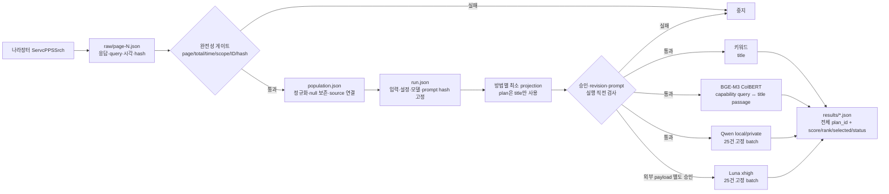

# 발주계획 선별 방법 간이 비교

2026-08-24 00:00 KST 이상, 2026-08-27 00:00 KST 미만에 게시된 나라장터 일반용역·기술용역 전체를 한 번 동결하고 키워드, BGE-M3 ColBERT, Qwen3.8:27B, GPT-5.6 Luna xhigh의 Top 50을 비교하는 일회성 실험 코드다. 웹·DB·scheduler·운영 정책과 연결하지 않는다.

## 현재 안전 상태

저장소의 `config/company-capabilities.json`에는 최소 회사 역량 요약이 작성돼 있지만 아직 `pending`이라 실행 입력으로 승인되지 않는다. `config/methods.json`의 title 전용 keyword 규칙과 확인된 Qwen digest는 고정돼 있고, Qwen/Luna prompt hash와 Luna immutable revision은 비어 있다. 따라서 현 상태에서는 수집과 비모델 test만 가능하고 모델 실행은 fail-closed한다.

실제 최소 회사 역량 요약과 prompt 본문은 Git 밖의 접근 제한 위치에 둔다. 산출물에는 파일 경로나 본문 대신 hash만 기록한다. Luna는 공식 immutable revision을 확인할 수 없으면 실행하지 않는다. 모델 alias를 revision으로 복제해 이 검사를 우회하지 않는다.

## 파일 계약

```text
experiments/order-plan-screening/
├── config/
│   ├── company-capabilities.json   # 비어 있는 계약 template
│   └── methods.json                # 비모델 기본값과 미확정 binding
├── scripts/
│   ├── collect.py
│   ├── run_methods.py
│   ├── record_external_approval.py
│   ├── make_review_set.py
│   └── compare.py
└── tests/

data/experiments/order-plan-screening/<run-id>/
├── run.json
├── raw/page-*.json
├── population.json
├── results/{keyword,bge_m3_colbert,qwen,luna}.json
└── review/{manifest.json,review.tsv,labels.tsv}

reports/order-plan-screening/<run-id>/
├── comparison.csv
└── report.md
```

모든 JSON은 `schema_version`, `run_id`, 입력 hash를 가진다. raw, population, 결과, review, report는 기존 파일을 덮어쓰지 않는다. 재실행은 새 디렉터리를 사용한다. API key, prompt, 모델 원응답, 회사 역량 본문은 로그·보고서에 저장하지 않는다.

## 데이터 흐름



raw에는 인증키를 뺀 query와 API 응답 전체를 불변 page 단위로 두고, `population.json`은 공식 통합번호를 `plan_id`로 사용해 제목·기관·업무구분·금액·발주예정월·조달/계약방법·게시/변경일시를 정규화한다. 없거나 해석할 수 없는 값은 추정하지 않고 `null`과 `unknown_fields`로 남기며, 각 항목은 `raw_ref`와 원본 항목 hash를 가진다.

전체 원본과 정규화 데이터는 향후 조건 추가와 사람 검토를 위해 그대로 보존한다. 다만 이번 발주계획 비교에서 네 방법이 계획 쪽에서 읽는 값은 `title` 하나뿐이다. 기관·금액·계약 방식·원문 ID 등은 비교 입력에 섞지 않는다.

## 로컬 3방법 간편 실행

Keyword, BGE-M3 ColBERT, 로컬 Qwen까지는 한 명령으로 실행할 수 있다. 승인된 prompt는 Git 밖의 파일로 준비하고, 회사 역량 projection을 실제로 검토한 담당자만 승인 flag와 감사 표식을 입력한다. 첫 실행의 `--install-model-deps`는 격리 venv에 BGE 의존성을 설치한다.

### 실행 전 준비

- 저장소 루트(`/home/jechoi/projects/bidops`)에서 실행한다.
- `BIDOPS_G2B_API_KEY`는 신규 수집 때만 필요하다. 기존 raw를 재사용하면 필요하지 않다.
- `BIDOPS_OLLAMA_BASE_URL`에는 승인된 Ollama endpoint를 넣는다.
- `--prompt-file`은 symlink가 아닌 비어 있지 않은 승인 prompt 파일이어야 한다. 스크립트가 SHA-256을 계산해 실행별 methods 설정 사본에 묶는다.
- 이 작업공간의 기본 prompt는 Git에서 제외되는 `.dryforge/approved/order-plan-batch-relevance-v2.txt`에 준비돼 있다. 실행 전에 본문을 검토하고 승인한 뒤 사용한다. 새 clone에는 이 파일이 따라오지 않는다.
- `--approve-capabilities`는 저장소의 회사 역량 projection을 실제로 읽고 승인한 뒤에만 지정한다. `--approved-by`는 인증된 신원이 아니라 실행 artifact에 남는 감사 표식이다.

스크립트는 원본 `config/company-capabilities.json`과 `config/methods.json`을 수정하지 않는다. 실행별 승인 사본은 `.dryforge/order-plan-screening/<run-id>/config/`에 만들고, 모집단과 결과는 `data/experiments/order-plan-screening/<run-id>/`에 새로 만든다.

### 첫 실행: 신규 나라장터 수집

```bash
cd /home/jechoi/projects/bidops

export BIDOPS_OLLAMA_BASE_URL=http://192.168.0.139:11434
export BIDOPS_G2B_API_KEY='환경에서 주입한 키'
PROMPT_FILE="$PWD/.dryforge/approved/order-plan-batch-relevance-v2.txt"

./experiments/order-plan-screening/run-local-comparison.sh \
  --approved-by 'jechoi' \
  --approve-capabilities \
  --prompt-file "$PROMPT_FILE" \
  --execute-qwen \
  --install-model-deps
```

`--install-model-deps`는 `.dryforge/venvs/order-plan-models/`에 격리 venv를 만들고 고정 BGE 의존성을 설치한다. 이후 실행에서는 이 option을 생략할 수 있다.

### 기존 raw 재사용

API를 다시 호출하지 않고 이전 run의 raw를 재사용하려면 새 run ID와 `--from-raw`를 지정한다.

```bash
export BIDOPS_OLLAMA_BASE_URL=http://192.168.0.139:11434
PROMPT_FILE="$PWD/.dryforge/approved/order-plan-batch-relevance-v2.txt"

./experiments/order-plan-screening/run-local-comparison.sh \
  --run-id order-plan-replay-v2 \
  --from-raw /home/jechoi/projects/bidops/data/experiments/order-plan-screening/<기존-run-id>/raw \
  --approved-by 'jechoi' \
  --approve-capabilities \
  --prompt-file "$PROMPT_FILE" \
  --execute-qwen
```

### 스크립트 수행 순서와 결과

스크립트는 아래 작업을 순서대로 수행한다.

1. live endpoint를 쓰지 않는 fake/unit test
2. BGE 의존성 확인 또는 명시적으로 승인된 설치
3. 회사 역량 승인 사본과 prompt hash가 묶인 methods 설정 생성
4. 나라장터 신규 수집 또는 불변 raw replay
5. Keyword readiness 검사와 실행
6. BGE-M3 ColBERT readiness 검사와 실행
7. Qwen revision 확인과 25건 고정 batch 실행

완료 시 각 방법의 `status`, 성공·실패 건수, 전체 실제 소요시간 `elapsed_ms`와 run 디렉터리를 출력한다. 상세 결과는 다음 위치에 생긴다.

```text
data/experiments/order-plan-screening/<run-id>/
├── run.json
├── population.json
├── raw/page-*.json
└── results/
    ├── keyword.json
    ├── bge_m3_colbert.json
    └── qwen.json
```

기존 run과 승인 설정 사본은 덮어쓰지 않는다. 중간 실패 뒤 재실행하거나 설정·prompt를 바꿀 때는 새 run ID를 사용한다. 수집이 완료된 run이라면 `--from-raw`로 기존 raw만 재사용한다. 전체 option은 다음 명령으로 확인한다.

```bash
./experiments/order-plan-screening/run-local-comparison.sh --help
```

GPT Luna는 hosted 외부 전송이므로 이 스크립트에 포함하지 않는다. 고정 모델 식별자 정책, API key, payload preview와 실행별 사람 승인을 별도로 확정한 뒤 기존 수동 승인 절차를 사용한다.

## 1. 설정 확정

승인된 별도 `company-capabilities.json`은 다음 계약을 사용한다.

```json
{
  "schema_version": "bidops.order-plan-capabilities.v1",
  "approval_status": "approved",
  "profile_version": "불변-version",
  "summary_sha256": "아래 projection의 SHA-256",
  "approved_by": "감사 표식",
  "approved_at": "2026-08-28T12:00:00+09:00",
  "capabilities": [
    {"id": "안정-ID", "summary": "승인된 최소 요약"}
  ]
}
```

`summary_sha256`은 `{"profile_version": ..., "capabilities": [...]}`의 canonical JSON hash다. 다음 명령은 본문을 출력하지 않고 hash만 계산한다.

```bash
PYTHONPATH=experiments/order-plan-screening/scripts python3 -c \
  'from pathlib import Path; from common import load_json,digest_json; d=load_json(Path("/approved/company-capabilities.json")); print(digest_json({"profile_version":d["profile_version"],"capabilities":d["capabilities"]}))'
```

별도 `methods.json`에는 다음을 확정한다.

- keyword `positive_rules`와 필요 시 `negative_rules`: 각 항목은 `id`, `fields: ["title"]`, `terms`, 양수 `weight`를 가진다. 다른 필드를 지정하면 설정 단계에서 거부한다.
- BGE-M3: `BAAI/bge-m3`의 고정 commit과 장치·precision·max length.
- Qwen: 정확한 로컬 model digest와 Git 밖 prompt 파일의 SHA-256.
- Luna: 공식 immutable revision, `xhigh`, 같은 prompt 계약과 SHA-256.

네 방법은 같은 두 설정 파일에 묶인다. 사람 label을 본 뒤 같은 run의 규칙·prompt·모델을 바꾸지 않는다.

## 2. 수집과 동결

외부 승인 전 확인용 staging run을 만든다. API key는 환경에서만 읽으며 URL이나 raw wrapper에 넣지 않는다.

```bash
python3 experiments/order-plan-screening/scripts/collect.py \
  --run-id 20260824-20260826-staging \
  --output-dir data/experiments/order-plan-screening/20260824-20260826-staging \
  --from-date 2026-08-24 \
  --to-date 2026-08-27 \
  --company-capabilities /approved/company-capabilities.json \
  --methods-config /approved/methods.json
```

수집기는 page·retry별 실제 호출 수를 세고 700회에서 경고, 900회에서 신규 호출을 중지한다. `bsnsDivNm`이 일반용역·기술용역인지, 게시 시각이 KST 반개구간 안인지, totalCount와 page 합계가 같은지, 공식 통합번호가 누락·중복되지 않았는지 확인한다. 하나라도 실패하면 완전한 run으로 간주하지 않는다.

`PPSSrch` API는 게시일시 외에 발주년월 범위도 필수로 받는다. 수집기는 게시일시만 `2026-08-24T00:00:00+09:00` 이상, `2026-08-27T00:00:00+09:00` 미만으로 자르고, 발주년월은 공식 서비스 시작월 `200412`부터 최대 `YYYYMM` 값 `999912`까지 열어 두어 숨은 월 선필터를 만들지 않는다. 이 두 축의 정확한 query는 raw page에서 제외될 수 없고, replay 때도 재검증한다.

동일 raw의 재정규화는 네트워크를 사용하지 않는다. 새 디렉터리만 허용한다.

```bash
python3 experiments/order-plan-screening/scripts/collect.py \
  --run-id replay-20260824-20260826 \
  --output-dir data/experiments/order-plan-screening/replay-20260824-20260826 \
  --from-raw data/experiments/order-plan-screening/20260824-20260826-staging/raw \
  --company-capabilities /approved/company-capabilities.json \
  --methods-config /approved/methods.json
```

## 3. Luna payload 확인과 승인 run 확정

먼저 실제 전송 필드, 건수, 고정 batch 크기·개수, preview hash만 확인한다. 회사 요약 본문은 화면에 표시하지 않는다. preview hash는 실제 순서대로 만든 모든 batch payload를 묶어 계산하므로 title, 회사 요약, prompt, 모델 revision, batch 크기 중 하나라도 달라지면 기존 승인을 재사용할 수 없다.

```bash
python3 experiments/order-plan-screening/scripts/record_external_approval.py \
  --source-run-dir data/experiments/order-plan-screening/20260824-20260826-staging \
  --show
```

담당자가 같은 내용을 확인한 뒤에만 목표 run ID에 대한 승인 artifact를 만든다. `approved_by`는 인증된 신원이 아니라 감사 표식이다.

```bash
python3 experiments/order-plan-screening/scripts/record_external_approval.py \
  --source-run-dir data/experiments/order-plan-screening/20260824-20260826-staging \
  --approve \
  --target-run-id 20260824-20260826 \
  --approved-by '담당자 표식' \
  --approved-at '2026-08-28T12:00:00+09:00' \
  --output /approved/luna-approval-20260824-20260826.json
```

승인된 최종 run은 같은 raw를 새 디렉터리에 복사·검증하면서 `run.json`에 승인자·시각·preview hash를 처음부터 기록한다.

```bash
python3 experiments/order-plan-screening/scripts/collect.py \
  --run-id 20260824-20260826 \
  --output-dir data/experiments/order-plan-screening/20260824-20260826 \
  --from-raw data/experiments/order-plan-screening/20260824-20260826-staging/raw \
  --company-capabilities /approved/company-capabilities.json \
  --methods-config /approved/methods.json \
  --external-approval /approved/luna-approval-20260824-20260826.json
```

## 4. 모델 실행 직전 검사와 실행

`--check-ready`는 모델·네트워크를 호출하지 않고 population/config/model/prompt/approval binding만 검사한다.

```bash
RUN_DIR=data/experiments/order-plan-screening/20260824-20260826

python3 experiments/order-plan-screening/scripts/run_methods.py \
  --run-dir "$RUN_DIR" --method keyword --check-ready \
  --company-capabilities /approved/company-capabilities.json \
  --methods-config /approved/methods.json

python3 experiments/order-plan-screening/scripts/run_methods.py \
  --run-dir "$RUN_DIR" --method bge_m3_colbert --check-ready \
  --company-capabilities /approved/company-capabilities.json \
  --methods-config /approved/methods.json

python3 experiments/order-plan-screening/scripts/run_methods.py \
  --run-dir "$RUN_DIR" --method qwen --check-ready \
  --prompt-file /approved/order-plan-batch-relevance-v2.txt \
  --company-capabilities /approved/company-capabilities.json \
  --methods-config /approved/methods.json

python3 experiments/order-plan-screening/scripts/run_methods.py \
  --run-dir "$RUN_DIR" --method luna --check-ready \
  --prompt-file /approved/order-plan-batch-relevance-v2.txt \
  --external-approval /approved/luna-approval-20260824-20260826.json \
  --company-capabilities /approved/company-capabilities.json \
  --methods-config /approved/methods.json
```

실제 실행은 각 명령에서 `--check-ready`만 제거한다. BGE 실행 환경에만 `requirements-models.txt`를 설치한다. Qwen 기본값은 승인된 literal `BIDOPS_OLLAMA_BASE_URL`의 Ollama native endpoint(`/api/chat`)이며 JSON schema format을 사용한다. 2026-08-28 확인된 비교 endpoint는 `http://192.168.0.139:11434`, 고정 `qwen3.8:27b` digest는 methods config에 기록했다. 승인된 vLLM을 쓸 때만 `api_style=openai_compatible`와 정확한 `/v1` base URL을 설정한다. 두 endpoint 사이 자동 전환은 없다. Luna는 `OPENAI_API_KEY`를 환경에서 읽고 Responses API에 `store=false`, `reasoning.effort=xhigh`, strict JSON schema를 사용한다.

Qwen과 Luna는 population 순서를 25건씩 고정 분할한다. 1,000건이면 40회, 1,200건이면 48회 호출이며 마지막 batch만 25건보다 작을 수 있다. timeout·잘림·schema 위반·응답 항목 누락이나 중복이 생기면 해당 batch 전체만 실패로 기록하고 다음 batch를 진행한다. 실패 batch를 재시도하거나 한 건씩 쪼개거나 다른 모델로 넘기지 않는다.

Ollama native 실행은 첫 추론 전 `/api/tags`의 model digest가 고정 `model_revision`과 같은지 한 번 검증한다. OpenAI-compatible vLLM은 표준 API가 artifact digest를 제공하지 않으므로 승인된 배포 환경의 `BIDOPS_QWEN_MODEL_REVISION`과 비교하며, 불일치하면 호출하지 않는다. Luna는 `model_name` alias가 아니라 승인 artifact와 preview에 고정된 `model_revision`을 실제 API `model`로 전송한다.

Qwen과 Luna에 보내는 한 batch의 사용자 입력은 다음 형태다. `item_id`는 batch 안의 `0..N-1` 임시 번호이고 의미 있는 `plan_id`는 보내지 않는다. 실행기는 메모리의 로컬 순서표로 응답을 원래 `plan_id`에 다시 연결한다.

```json
{
  "company_capabilities": {
    "profile_version": "승인-version",
    "capabilities": [{"id": "capability-id", "summary": "승인된 최소 요약"}]
  },
  "items": [
    {"item_id": 0, "title": "첫 번째 사업명"},
    {"item_id": 1, "title": "두 번째 사업명"}
  ]
}
```

모델이 반환해야 하는 batch 구조화 JSON은 다음 계약이다. 배열 순서는 달라도 되지만 `item_id`가 `0..N-1`을 정확히 한 번씩 모두 포함해야 한다. 추가 필드·누락·중복·범위 이탈은 자동 보정하지 않고 그 batch 전체를 `malformed_response`로 남긴다.

```json
{
  "items": [
    {
      "item_id": 0,
      "relevance": "relevant | not_relevant | uncertain",
      "score": 0.0,
      "reason": "500자 이하의 짧은 판정 이유"
    }
  ]
}
```

계획 쪽 근거가 title 하나뿐이므로 모델에게 `evidence_fields`를 생성시키지 않는다. 검증을 통과한 모델 항목에는 실행기가 `evidence_fields: ["title"]`을 붙인다. 이 응답은 로컬에서 `plan_id`, 상태, 순위, Top 50 선택 여부, 지연·token·오류 정보와 결합해 결과 JSON에 저장한다. 모델의 원응답과 reasoning은 저장하지 않는다. batch 단위 지연과 token 수는 총합이 유지되도록 항목에 결정적으로 나눠 담는다.

각 방법 결과의 `metrics.elapsed_ms`에는 adapter 생성 직전부터 전체 모집단 처리가 끝날 때까지의 실제 벽시계 시간을 기록한다. 따라서 BGE 모델 로딩, Qwen revision 확인, 모델 호출과 응답 검증이 포함된다. `total_latency_ms`는 항목·batch에서 측정한 지연의 합으로 별도 보존하며, 비교 CSV와 보고서에는 두 값을 모두 표시한다.

방법별 실제 입력·출력은 다음과 같다.

| 방법 | 입력 | 일차 출력 |
|---|---|---|
| keyword | title에만 적용하는 고정 rule | 가중치 합 `score`, `matched:<rule>@title` |
| BGE-M3 ColBERT | 승인 회사 역량 요약을 query로, title만 passage로 사용 | late-interaction `score`, `nearest_capability:<id>` |
| Qwen | 고정 prompt + title 25건 + 승인 회사 역량 projection | batch별 `item_id`, `relevance`, 0..1 `score`, `reason` |
| Luna | Qwen과 같은 최소 batch이며 preview hash와 사람 승인을 추가 검증 | batch별 `item_id`, `relevance`, 0..1 `score`, `reason` |

모든 점수는 해당 방법 안의 순위에만 사용한다. keyword 가중치 합, ColBERT 유사도, Qwen/Luna의 0..1 판정 점수를 서로 같은 확률처럼 비교하지 않는다.

## 5. 사람 검토와 비교

네 결과가 모두 생긴 뒤 블라인드 검토 묶음을 만든다.

```bash
python3 experiments/order-plan-screening/scripts/make_review_set.py --run-dir "$RUN_DIR"
cp "$RUN_DIR/review/review.tsv" "$RUN_DIR/review/labels.tsv"
```

한 명의 검토자가 `labels.tsv`의 `relevance`, `priority`, `reason`, `reviewer`, `reviewed_at`을 채운다. 허용 조합은 `관련+높음|보통|낮음`, `판단보류+낮음`, `비관련+해당없음`뿐이다.

```bash
python3 experiments/order-plan-screening/scripts/make_review_set.py \
  --run-dir "$RUN_DIR" --labels "$RUN_DIR/review/labels.tsv"

python3 experiments/order-plan-screening/scripts/compare.py \
  --run-dir "$RUN_DIR" \
  --output-dir reports/order-plan-screening/20260824-20260826
```

보고서는 precision@50, 관련+높음, 후보 합집합 내 고유 발견과 상대 회수율, pairwise Jaccard, 감사 표본 관련 건수, 성공·실패, 지연, token·비용·장치를 기록한다. 전체 recall은 계산하지 않고 자동 우승 또는 정책 활성화를 하지 않는다.

## 비모델 검증

```bash
python3 -m unittest discover -s experiments/order-plan-screening/tests -p 'test_*.py' -v
```

테스트는 작은 fixture와 fake adapter만 사용한다. live 나라장터·BGE·Qwen·Luna endpoint를 호출하지 않는다.
